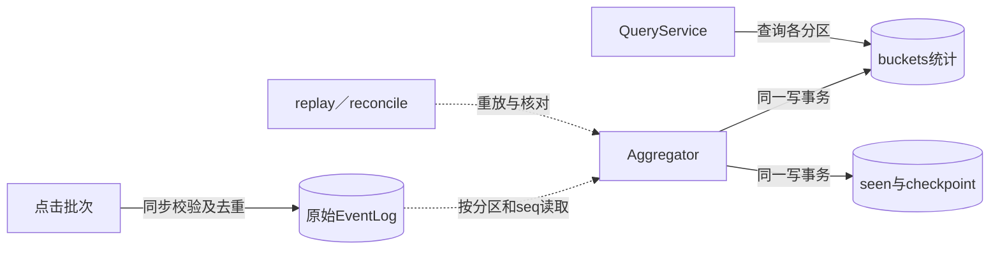
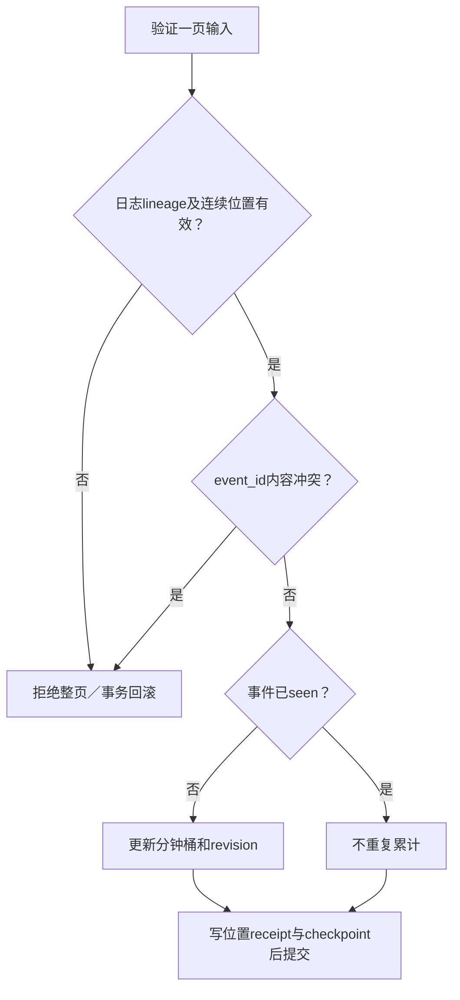
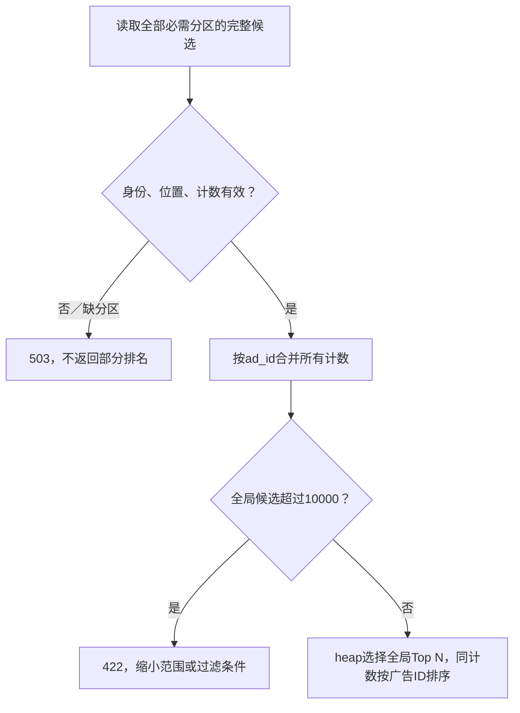

# 第22章：从一个重复点击读懂聚合与重放

把系统想成两份账：原始事件日志记录发生了什么，聚合表记录这些事件的统计结果。Worker靠输入位置连接两份账，去重身份防止重放重复加一。水位线说明查询窗口是否已经走过预期等待期，不意味着所有晚到事件都被禁止。

## 贯穿案例：e1为什么只能贡献一次

给某个分区输入点击`event_id=e1`，广告`ad1`，`click_timestamp=960`；其分钟桶起点为960。第一次应用后，ad1计数为1；重新读取并应用同一页，计数仍为1，checkpoint不倒退。若同一e1改成另一个广告，应冲突并回滚该页。测试时使用固定时钟和分区选择，数据形状参考[test_core.py](../tests/test_core.py)中的`click`辅助函数。



日志已接受事件不表示所有聚合分区都已推进；全局查询需要检查各分区进度。先在一个分区理解幂等，再看热点广告加盐与跨分区汇总。

## 三种身份不可混淆

| 数据 | 字段 | 本案例中的作用 |
|---|---|---|
| 点击事实 | `event_id`与内容hash | e1只能代表同一内容；相同ID不同内容是冲突 |
| 输入位置 | `lineage/partition/seq` | 说明来自哪份日志、哪个位置，不等于事件ID |
| 分钟统计 | `minute/ad_id/user_id/ip/country/count/revision` | `960/ad1/...`对应的一行可被迟到事件修订 |
| `checkpoint` | `seq/max_event/watermark/late/lineage` | 既跟踪恢复位置，也提供窗口完成度信息 |
| `input_positions` | `seq/event_id/hash/accepted` | 重放旧位置也能检查位置内容是否被替换 |

## 六站阅读路线

1. [EventLog.append](../src/ad_click/log.py#L44)：从点击数组到日志receipt。先找事件去重及批次原子性。
2. [EventLog.read](../src/ad_click/log.py#L115)：从分区和after位置到连续page。记下page中的lineage和entry结构。
3. [prepare_batch](../src/ad_click/records.py#L34)：核对Worker在拿写锁前冻结并验证哪些数据，防止调用方改动输入。
4. [Aggregator.apply](../src/ad_click/aggregate.py#L44)：本章重点。依次读lineage检查、旧位置检查、新位置连续性、按事件去重和checkpoint提交。
5. [Aggregator.totals](../src/ad_click/aggregate.py#L193)：从查询范围到广告总数，注意`closed`由查询终点与水位比较得出。
6. [replay](../src/ad_click/recovery.py#L140)和[reconcile](../src/ad_click/recovery.py#L72)：把重放理解为再次应用受验证的日志，而不是直接把总数覆盖成某个猜测。

## 微观一：旧位置也要验证

[aggregate.py:50](../src/ad_click/aggregate.py#L50)

```python
were garbage-collected fail explicitly. New events older than the dedup
horizon are counted as expired, never added to the buckets.
"""
batch = prepare_batch(batch, self.partition)
with self.transaction(True) as db:
    cp = dict(db.execute("SELECT * FROM checkpoint").fetchone())
    if cp["lineage"] and cp["lineage"] != batch["lineage"]:
        raise Error(409, "queue lineage changed; explicit rebuild required")
    cp["lineage"] = batch["lineage"]
    meta = dict(db.execute("SELECT key,value FROM worker_meta"))
    floor, replay_floor = meta["position_floor"], meta["replay_floor"]
    for entry in batch["entries"]:
        value, fingerprint, seq = entry["event"], entry["hash"], entry["seq"]
        # Decided before any ID lookup so the outcome never depends on
        # how far GC has progressed (rebuild and reconcile agree).
        too_old = seq > cp["seq"] and expired(
```

事务内先检查lineage，再查询seen内容。`seq <= checkpoint`并非无条件返回：后面还会比较原位置receipt。否则，源日志在旧偏移换成不同事件时，消费者会把数据损坏当成成功重放。

状态变化：应用前`seq=0/count=0`；应用e1后`seq=1/count=1`；同一页再应用后仍`seq=1/count=1`。若历史位置内容变了，应用抛错，不能静默推进。

## 微观二：统计与输入进度一起提交

[aggregate.py:85](../src/ad_click/aggregate.py#L85)

```python
        if tuple(receipt) != (
            value["event_id"],
            fingerprint,
            entry["accepted"],
        ):
            raise Error(409, "source position content changed")
    elif seq >= floor or not seen:
        raise Error(
            409, "historical source position cannot be verified"
        )
    continue
if seq != cp["seq"] + 1:
    raise Error(409, "input offset gap")
minute = value["click_timestamp"] // 60 * 60
if too_old:
    cp["expired"] += 1
elif not seen:
```

`minute`使用事件时间向下取整，而不是接收时间。`not seen`才允许更新桶；随后即便事件以前出现过，新输入位置仍有单独的receipt和checkpoint推进。由此可以接受“同一事件出现在后续合法位置”，同时不重复累计。



## 崩溃发生在加一之后怎么办

如果`before_commit`抛错，桶、seen和checkpoint都应回滚；重启后重放该页会进行第一次有效统计。这是事务保证，不是依靠“尽量只发送一次”。读[CoreTests.test_checkpoint_output_rollback_and_replay](../tests/test_core.py#L85)，关注失败前后`audit`和位置。

接着读[PersistenceReliabilityTests.test_same_event_at_a_later_compatible_position_is_not_counted_twice](../tests/test_persistence_reliability.py#L190)：不同seq并不必然意味着不同业务点击。最后看[CoreTests.test_late_revision_watermark_and_filters](../tests/test_core.py#L119)，检查晚到事件确实可以修订统计。

## 微观三：分散热点后为什么不能只拿局部Top 1

四个分区各有hot=6，另外各自不同的local广告=9。如果每片只返回Top 1，hot会在
所有分片被丢弃；真实全局结果却是hot=24，大于每个local的9。

沿[QueryService.aggregate](../src/ad_click/query_service.py#L80)到
[QueryService._reduce](../src/ad_click/query_service.py#L159)，先检查每个必需分区的
lineage/位置/计数，再用Counter按广告求和，最后heap选择Top N。按ad_id独占分区
与按event_id分散热点是不同前提，不能直接套用另一种路由下的局部排名优化。



先手算hot的24，再读
[QueryTests.test_exact_global_top_n_never_truncates_each_worker_first](../tests/test_service_reliability.py#L52)。
这里的向量位置是多个分区快照的组合，不是跨分区原子快照。

## 源损坏与坏客户端请求要分开

[parse_source_row](../src/ad_click/records.py#L95)发现持久原始行深JSON损坏时返回503，
不跳过、删除或返回半页。必要source/worker响应深到无法解码时，QueryService也应
返回503；这是源不可用，有效客户端请求不应被误报400。源恢复后，同一查询服务应可复用。

对照[AggregationSourceReviewTests.test_deep_persisted_json_fails_as_storage_unavailable_after_reopen](../tests/test_aggregation_source_review.py#L14)
和[HTTPReliabilityTests.test_deep_required_peer_response_is_503_and_query_capacity_recovers](../tests/test_http_reliability.py#L129)：
前者使用真实SQLite损坏记录，后者使用真实HTTP及受控坏上游，分别验证保留源数据和释放查询容量。

[open-source-review_cn.md](../docs/open-source-review_cn.md)提供已读的PyFlink业务示例及Flink窗口源码。
本地closed后仍允许迟到修正，Flink还涉及allowedLateness及窗口清理；两者不是同一状态生命周期。

## 学完应能回答

- **为什么不能只保存最后消费偏移？** 重放时还要识别业务事件重复与历史内容变化。
- **为什么晚到事件不直接丢弃？** 代码更新桶并增加修订／迟到计数，水位是查询语义，不是绝对封账。
- **checkpoint已经推进但桶没更新可以吗？** 不可以，两者必须来自同一事务结果。

练习：在测试固定时钟下，对同一页apply两次，再把某一事件的ad_id修改后apply。预期前两次总数不变，第三次报冲突且整页没有部分效果。运行命令与字段限制见[README_CN.md](../README_CN.md)。


---

[返回全仓库学习导航](../../docs/learning-guide_cn.md) · [项目运行说明](../README.md)

[导读原稿](../../tools/learning_guides/ad-click-aggregation-system.md)。正文与图按当前实现编写；源码链接和摘录由生成器绑定到当前定义。修改行为后应同时复核案例、时序和解释，再重新生成；定义与链接校验不等同于业务回归测试。
