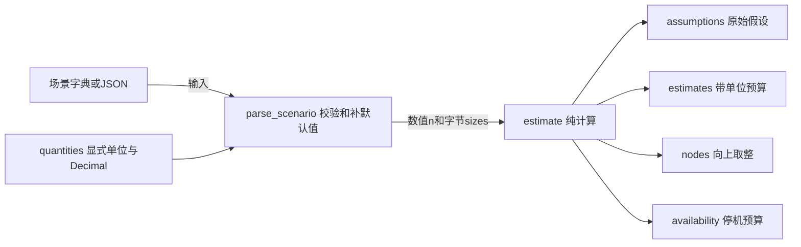
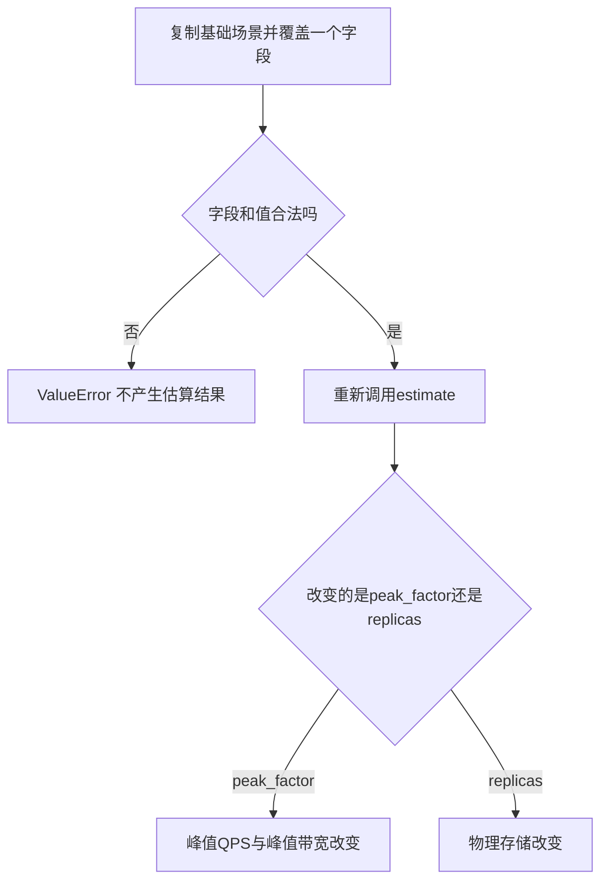

# 第3章：从一组业务数字读懂容量估算

这个项目是一台**带单位和假设的计算器**：输入用户量、每人请求量和数据大小，输出负载、存储、带宽与节点预算。它没有Web服务、数据库或后台线程。先把每个输出的公式和单位对上，再阅读输入校验，就能掌握大部分实现。

## 先用一个能手算的案例建立全貌

假设10名日活用户，每人每天写1条记录，每条100 B，保留2天；压缩后为原来的0.5，存3副本，每份副本再加20%索引。把 `monthly_active_users=10`、`daily_active_ratio=1`、`writes_per_dau=1`、`metadata_size="100 B"`、`media_fraction=0`、`retention_days=2`、`compression_ratio="0.5"`、`replicas=3`、`index_overhead_ratio="0.2"` 传入 `estimate`。

应该先预测出这四个值：

| 阶段 | 计算 | 程序中的量 |
|---|---|---|
| 每日写入 | 10 × 1 × 100 | `logical_bytes_per_day = "1000"` |
| 保留的逻辑数据 | 1000 × 2 | `retained_logical_bytes = "2000"` |
| 压缩后的主数据 | 2000 × 0.5 | `compressed_primary_bytes = "1000"` |
| 实际副本与索引预算 | 1000 × 3 × 1.2 | `physical_bytes_with_replicas_and_indexes = "3600"` |

输出数字以十进制字符串表达；上表是公式的预期值，不是磁盘实测。可直接对照 [EstimationTests.test_storage_replication_compression_index_order](../tests/test_estimation.py#L32)。



这张图里的组件都是同一进程中的函数。CLI负责读写JSON，核心模型不执行I/O，因此可以独立用于脚本、测试或其他服务。

## 数据在各层怎样变化

| 名字 | 来源与形态 | 为什么保留 |
|---|---|---|
| `inputs` | 调用方给出的部分场景字典 | 允许只覆盖少数默认假设 |
| `values` | 补齐默认值后的场景 | 输出 `assumptions`，让结论可以追溯 |
| `n` | 经过范围校验的Decimal数字 | 比例、天数、每人请求量参与计算 |
| `sizes` | 显式单位转换后的字节数 | 防止把MB、MiB或bits混在公式里 |
| `quantities` | 由假设推导出的Decimal | 派生结果，不应反过来当作真实流量 |
| `nodes.serving` | 基础节点需求向上取整后的整数 | 不能部署1.01台节点 |

## 按这六站阅读源码

1. [estimate](../src/capacity_estimation/model.py#L28)：先看最终返回的四组字段。输入是场景字典，输出是可序列化预算；知道字段在哪里生成后，再看公式。
2. [parse_scenario](../src/capacity_estimation/scenario.py#L31)：把案例中的字符串和整数变为 `values/n/sizes`。重点回答：默认值在哪里补齐，未知字段为何报错？
3. [parse_bytes](../src/capacity_estimation/quantities.py#L64)：把 `"100 B"` 变成整数100。下一站回到 `estimate`，此时所有大小都已统一成字节。
4. [estimate](../src/capacity_estimation/model.py#L28)：从 `dau` 顺着读到 `physical`，逐项核对上面的1000、2000、3600。
5. [availability](../src/capacity_estimation/model.py#L9)：输入可用性百分比，输出不同周期的停机秒数。它是另一个独立预算，不会改变节点数量。
6. [sweep](../src/capacity_estimation/model.py#L99)：在同一份基础场景上替换一个字段，返回多份估算；下一步比较变化前后的输出，而不是只看一个大数字。

## 微观一：先厘清乘法顺序

[model.py:30](../src/capacity_estimation/model.py#L30)

```python
values, n, sizes = parse_scenario(inputs)
dau = n["monthly_active_users"] * n["daily_active_ratio"]
writes = dau * n["writes_per_dau"]
reads = dau * n["reads_per_dau"]
average_record = (
    sizes["metadata_size"] + n["media_fraction"] * sizes["media_size"]
)
daily_bytes = writes * average_record
retained_bytes = daily_bytes * n["retention_days"]
compressed = retained_bytes * n["compression_ratio"]
physical = compressed * n["replicas"] * (1 + n["index_overhead_ratio"])
peak_qps = (writes + reads) / 86400 * n["peak_factor"]
baseline_nodes = (
    peak_qps * n["safety_factor"] / (n["server_qps"] * n["utilization"])
).to_integral_value(rounding=ROUND_CEILING)
```

`dau` 和 `writes` 先把“每人每天”变成“全系统每天”。`average_record` 体现只有 `media_fraction` 比例的记录携带媒体。`daily_bytes` 再乘保留天数得到逻辑存储；压缩、副本和索引依次作用到这个量。这里的索引开销作用在每一份压缩副本上，所以案例是 `2000 × 0.5 × 3 × 1.2`。

最后两行改在计算节点数：峰值请求乘安全系数，再除以单节点基准能力及目标利用率，然后向上取整。存储副本数没有进入这个QPS公式；这种模型取舍在返回值的 `notes` 中明确记录。

## 微观二：为什么线程调用不会互相改变精度

[arithmetic_context](../src/capacity_estimation/quantities.py#L7) 建立独立数值上下文。`estimate` 与单位转换在上下文里计算，调用者设置的精度、舍入和异常陷阱不会泄漏进模型；调用结束也不会改写调用者的设置。

可用 [test_model_is_independent_of_callers_decimal_context](../tests/test_engineering.py#L9) 理解这个边界：测试故意把外部精度降到3并启用 `Inexact` 陷阱，模型结果仍与默认调用一致。

## 改变一个假设，应该影响什么



这不是缓存结果的增量修补。`sweep` 对每个点调用完整模型，并通过字典展开生成新场景，原 `inputs` 不变。对应测试 [EstimationTests.test_sensitivity_isolated_scenarios_and_monotonic_growth](../tests/test_estimation.py#L69) 同时检查趋势和输入未修改。

无效单位如 `"1 Mb"`、没有单位的 `"100"`、不能表示整字节的 `"0.1 B"` 会在输入层被拒绝。不要在公式里补救这些值；先读 [EstimationTests.test_binary_decimal_units_and_fractional_bytes](../tests/test_estimation.py#L24) 的断言。

## 用回答检查理解

- **把副本数3改成6，逻辑数据也翻倍吗？** 不会。案例逻辑量仍为2000 B，物理预算从3600 B变成7200 B。
- **为什么网络输出乘8？** 数据大小统一是字节，带宽字段定义为bits/s。
- **`nodes.total=3` 能证明高可用吗？** 不能。模型只是给 `serving` 加显式 `spare`，没有模拟故障域或负载分布。

## 做一次可核对的练习

先保持案例其他假设不变，把保留天数2改成4：预期逻辑量4000 B，压缩后2000 B，物理预算7200 B；每日写入量和平均写QPS不变。然后再把副本数改回1，解释为什么物理预算降为2400 B。运行入口和测试命令见 [README_CN.md](../README_CN.md)。


---

[返回全仓库学习导航](../../docs/learning-guide_cn.md) · [项目运行说明](../README.md)

[导读原稿](../../tools/learning_guides/capacity-estimation.md)。正文与图按当前实现编写；源码链接和摘录由生成器绑定到当前定义。修改行为后应同时复核案例、时序和解释，再重新生成；定义与链接校验不等同于业务回归测试。
