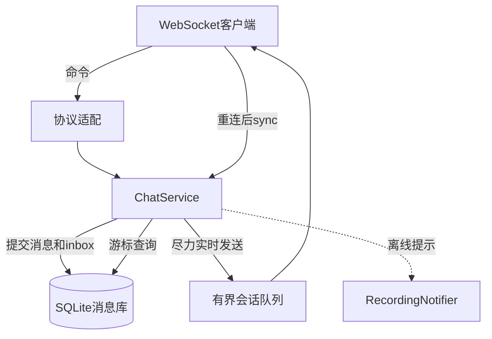
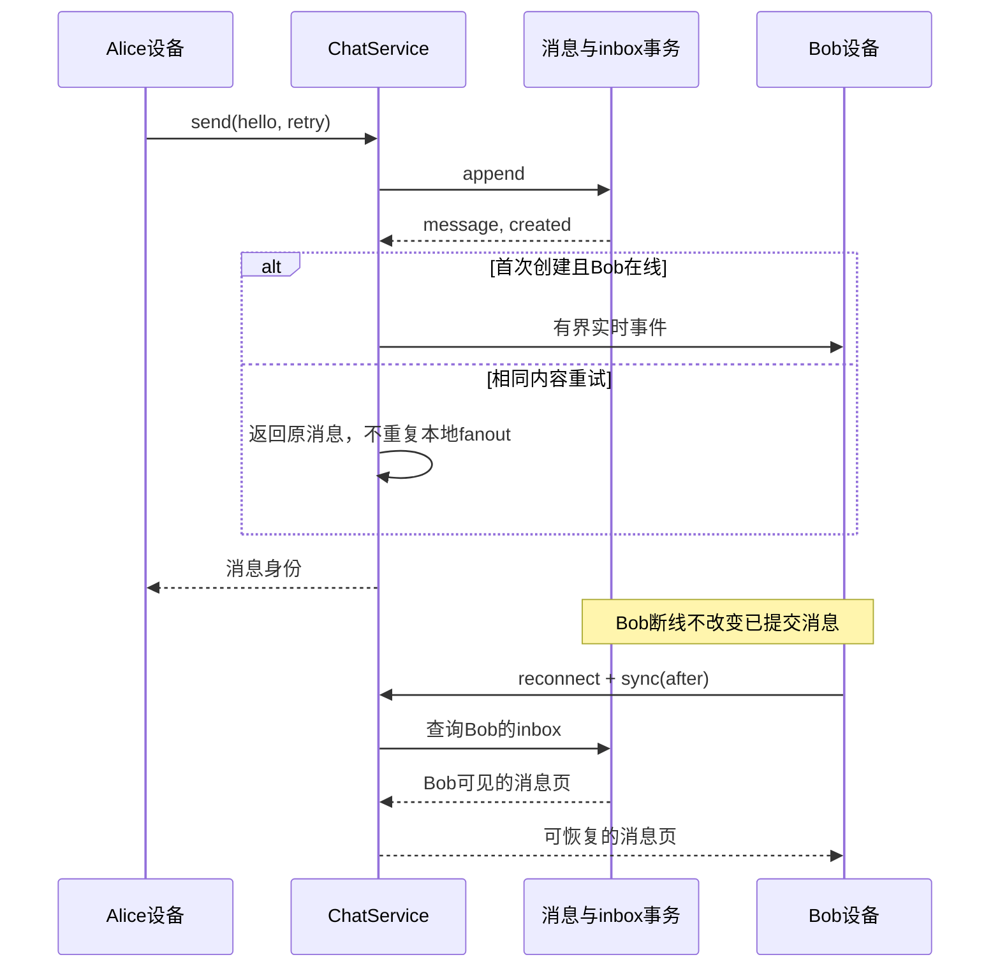

# 第13章：用“断线后还能收到消息”理解聊天系统

聊天服务的主线是：**先把消息作为持久事实保存，再尽力把实时事件送给当前在线设备；断线设备靠游标补消息。** WebSocket连接只是即时运输通道，不是消息本身的唯一存放位置。

先学习本文的ChatService＋SQLiteMessageStore本地方案，并为store传入文件路径；默认的SQLiteMessageStore使用内存数据库，不能跨进程重启恢复。再看 [distributed.py](../src/chat_system/distributed.py) 与Redis方案。两套方案有不同的会话、消息与高可用边界，不能把本地内存在线状态当作跨节点共享状态。

## 一条消息的故事

Alice与Bob有一个direct频道。Alice发送正文hello，客户端消息身份为retry。

1. 首次发送创建一条消息；Alice和Bob各自的inbox都引用它。
2. 相同频道、发送者和客户端身份携带相同正文重试，得到原消息；不会再创建消息和inbox记录。
3. Bob断线时未收到实时事件，重连后从已确认游标调用sync，仍能读到这条持久消息。
4. 相同重试身份换成不同正文不是新消息，应按冲突处理。

发送者获得响应、接收者实时看到、接收设备确认同步页，是三种不同的进度。

## 宏观：事实与连接分开放



| 状态 | 关键字段 | 所有者 | 丢失后怎样恢复 |
|---|---|---|---|
| Message | 频道、发送者、正文、客户端消息身份、服务端消息ID | MessageStore | 从持久库读取 |
| inbox | 用户与消息的对应关系 | SQLiteMessageStore事务 | 决定用户的同步消息集合 |
| Session | `user_id, device_id, queue, last_heartbeat, closed` | 单个事件循环中的ChatService | 重连重新建立 |
| 在线状态 | 用户的有效会话集合 | 本地服务内存 | 心跳与会话清理重建 |
| 设备同步进度 | 客户端确认的游标 | 客户端协议与重连客户端 | 从最后确认位置继续 |

## 六个阅读站点

1. [ChatService.connect](../src/chat_system/service.py#L133)：看token如何得到用户身份；相同设备连接为何替换旧Session。输出不是用户资料，而是有界会话对象。
2. [ChatService.create_direct](../src/chat_system/service.py#L287)：确认频道成员资格在消息发送前建立，direct对如何复用。
3. [ChatService.send](../src/chat_system/service.py#L381)：跟踪hello和retry从参数进入持久化，再进入实时分发。
4. [SQLiteMessageStore.append](../src/chat_system/store.py#L235)：重点看去重身份、正文冲突、消息和inbox是否在同一事务提交。
5. [ChatService._deliver_live](../src/chat_system/service.py#L425)：看接收者队列满后的处理；实时失败不能删除已提交消息。
6. [ChatService.sync](../src/chat_system/service.py#L463)：输入Session、after和limit，输出该用户可见消息；随后阅读 [ReconnectingChatClient.acknowledge](../src/chat_system/client.py#L256) 的整页确认约束。

每站只追Alice这一条消息。先忽略presence订阅与群成员管理，待direct消息主线清楚再加入这些分支。

## 微观：发送锁保护的不是网络推送

[service.py:395](../src/chat_system/service.py#L395)

```python
# Commit and local fanout are ordered together, independently of push IO.
async with self._send_lock:
    self.validate_session(session)
    message, created, members = await run_blocking(
        self.store.append,
        channel_id,
        session.user_id,
        content,
        client_message_id,
    )
    self.validate_session(session)
    if not created:
        return message
    offline = self._deliver_live(message, members, session.user_id)
await self._notify_offline(offline, message)
self._validate_acknowledgement(session)
```

这段锁覆盖持久提交和本地实时分发，因此并发发送不会让后提交的消息先在本地排队。`run_blocking`把同步数据库工作移出事件循环；它不是“取消后数据库必然回滚”的承诺。

`created=False`直接返回旧消息，避免相同重试又向在线队列投递一遍。离线通知发生在锁外，所以慢Provider不会占着发送顺序锁。



最后的消息页来自inbox查询，而非恢复旧WebSocket队列。幂等唯一键实际是(sender, client_id)；channel与content会在命中旧记录时一起校验，同一发送者不能把旧client_id换到另一频道使用。

## 微观：sync为什么很短

[service.py:463](../src/chat_system/service.py#L463)

```python
def sync(self, session, after=0, limit=100):
    self.validate_session(session)
    return self.store.sync(session.user_id, after, limit)
```

业务价值集中在两个边界：先检查当前Session仍有效，再由store按用户可见范围读取。不要因为这个函数只有三行就跳过它；这是实时连接与持久恢复的连接点。

## 取消与断线的失败分支

发送协程在数据库提交期间被取消时，同步线程可能仍在工作。服务必须等该工作完成，才能释放保护发送顺序的锁；否则下一条消息可能与前一条尚未结束的提交交错。

另一种情况是提交成功但网络响应丢失。客户端使用同一个client_message_id和正文重试，store返回原结果。换一个随机新身份会绕过去重，不能用来“安全重试”。

阅读 [run_blocking](../src/chat_system/concurrency.py#L22) 时，区分“协程被取消”与“底层线程工作已经结束”。

## 两组实验式测试

- [test_identical_retries_commit_exactly_one_message_and_inbox](../tests/test_store_reliability.py#L66)：两个连接并发追加相同retry；created结果一真一假，两边得到同一消息，inbox总数为2而不是4。
- [test_cancelled_commit_finishes_before_send_lock_is_released](../tests/test_service_reliability.py#L102)：用事件暂停append，然后取消send。观察测试为何先确认锁仍受保护，再释放底层线程。
- [test_acknowledgement_must_match_the_complete_received_page](../tests/test_client_reliability.py#L120)：同步页的确认必须匹配收到的整页，不能随意跳过未处理消息。

## 自查与练习

**Bob在线就不需要持久化吗？** 仍需要。实时发送可能因断线、队列溢出或未确认而丢失，inbox提供恢复依据。

**同一用户的两个设备是同一Session吗？** 不是。Session按用户与设备区分；设备替换和游标确认必须尊重各自身份。

**把离线通知放到发送锁里面是否更可靠？** 不会自动更可靠，反而让慢外部I/O拖住所有本地消息顺序。可靠推送要靠对应的持久任务方案。

练习：先让Bob离线，Alice发送hello；连接Bob后从起始游标同步，再用同一retry重发。预期只有一个服务端消息身份，Bob不会多出第二条持久消息。


---

[返回全仓库学习导航](../../docs/learning-guide_cn.md) · [项目运行说明](../README.md)

[导读原稿](../../tools/learning_guides/chat-system.md)。正文与图按当前实现编写；源码链接和摘录由生成器绑定到当前定义。修改行为后应同时复核案例、时序和解释，再重新生成；定义与链接校验不等同于业务回归测试。
