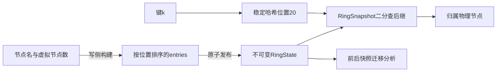
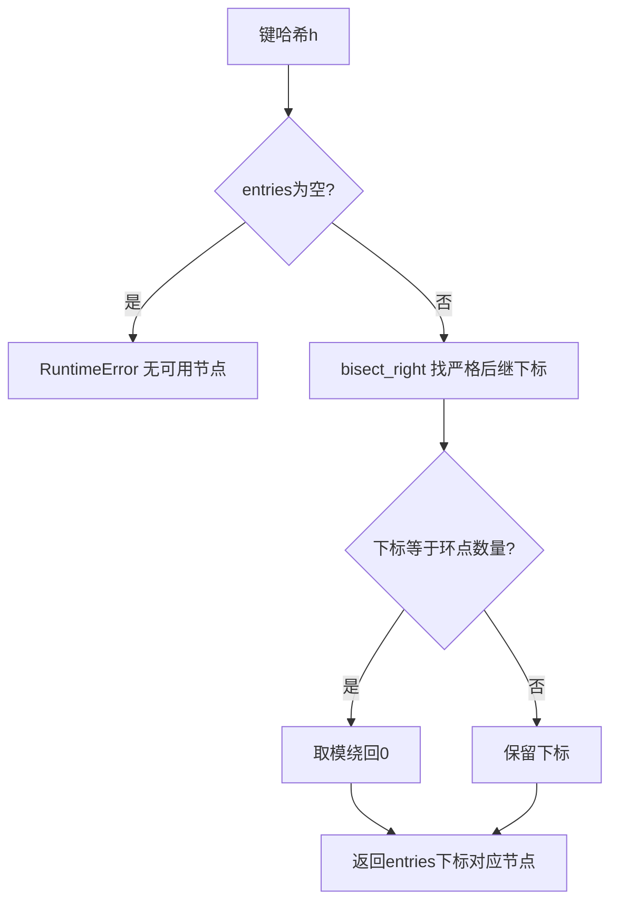

# 第6章：用一张小环读懂路由、快照与扩容

这个库只回答“键应该归哪个节点”，不存储键值，也不搬运数据。核心是一组有序虚拟节点：读请求找到键哈希之后的第一个环点；拓扑修改则构造一份完整新环，再一次发布。

## 用可控哈希代替随机的大整数

设每台机器只有1个虚拟节点，注入确定性的测试哈希：`A#0→10`、`B#0→50`、`C#0→30`，键 `k→20`。起初只有A、B：20之后第一个位置是50，所以k属于B。加入C后，20之后第一个位置变成30，k改属于C。

注意本实现使用 `bisect_right`：若键恰好哈希到30，也会找**严格更大**的环点50，因此属于B。不能凭其他哈希环教程的闭区间习惯猜边界。



## 数据与状态的对应关系

| 名称 | 案例内容 | 是什么 |
|---|---|---|
| `_RingState.entries` | `(10,A,0),(50,B,0)` | 完整拓扑事实；位置、物理节点、虚拟索引 |
| `_RingState.positions` | `(10,50)` | 从entries派生的二分查找索引 |
| `_RingState.nodes` | `(A,B)` | 物理成员列表 |
| `RingSnapshot._state` | 指向某一代RingState | 批量读取固定使用的拓扑 |
| `_state` | 发布后指向新RingState | 活环的当前版本 |
| 迁移区间／键迁移记录 | 前后归属发生变化的部分 | 计划；没有实际发送数据 |

## 六站读代码，不从统计工具开始

1. [ConsistentHashRing._entries](../src/consistent_hashing/ring.py#L173)：输入节点名和虚拟索引，产生环点。先找到为何输入哈希的是 `A#0` 而非 `A`。
2. [_RingState.from_ordered](../src/consistent_hashing/ring.py#L28)：把已排序输入物化成元组，并派生positions。它决定快照为何可以保持不变。
3. [ConsistentHashRing.snapshot](../src/consistent_hashing/ring.py#L265)：取得一份拓扑与哈希函数；后续批量路由应保留这个对象。
4. [RingSnapshot._start](../src/consistent_hashing/ring.py#L66)：把k的20变成entries下标1；理解 `bisect_right` 与取模后再看返回节点。
5. [ConsistentHashRing.add_node](../src/consistent_hashing/ring.py#L200)：生成C的30，构造新状态后发布。下一步比较保存的旧快照与当前环。
6. [affected_ranges](../src/consistent_hashing/migration.py#L43)：输入前后明确快照，输出受影响区间；[iter_migrations](../src/consistent_hashing/migration.py#L91) 再消费调用方提供的键流。

## 微观一：为什么查的是“右边第一个”

[ring.py:66](../src/consistent_hashing/ring.py#L66)

```python
def _start(self, state: _RingState, key: str) -> int:
    if not state.entries:
        raise RuntimeError("Hash ring is empty - no nodes available.")
    return bisect.bisect_right(state.positions, self._hash(key)) % len(
        state.entries
    )
```

空环先报错，避免对0取模。`bisect_right` 返回严格大于键位置的插入点：20得到1，30若存在也跳过30。取模使超过最大点的键绕回下标0。后续 [RingSnapshot.get_node](../src/consistent_hashing/ring.py#L73) 只从该条entry取物理节点名。



## 微观二：新拓扑准备好后才替换

[ring.py:208](../src/consistent_hashing/ring.py#L208)

```python
with self._writing():
    state = self._snapshot()
    if node in state.nodes:
        raise ValueError(f"Node '{node}' already exists on the ring.")
    self._ensure_capacity(len(state.entries) + count)
    added = self._entries(node, 0, count)
    self._publish(
        _RingState.from_ordered(
            sorted(state.entries + tuple(sorted(added))), state.nodes + (node,)
        )
    )
return [position for position, _, _ in added]
```

写锁内先固定旧状态，检查重复节点和总容量，再生成新环点。哈希函数若在生成C的过程中抛错，还没有进入 `_publish`，所以读者继续看到旧的A、B环。

[ConsistentHashRing._publish](../src/consistent_hashing/ring.py#L196) 只在短状态锁内替换引用。耗时哈希和排序没有拿着状态锁进行；已经取得旧快照的读者仍可使用旧元组。

权重调整同样要读 [ConsistentHashRing.set_virtual_nodes](../src/consistent_hashing/ring.py#L237)：增加权重只追加新索引，减小则删除较大索引，不先删除整台机器再重新加入。

## 用测试看“旧视图还能用”

- [test_snapshot_remains_usable_after_live_ring_becomes_empty](../tests/test_chapter_coverage.py#L56)：保存快照后删空活环；旧快照仍能路由，活环读取则报空环错误。这是快照边界的直接证据。
- [test_weight_hash_failure_does_not_publish_partial_state](../tests/test_review.py#L156)：权重变化中注入哈希异常，应保留完整旧拓扑。
- [test_ranges_exactly_match_changed_owners](../tests/test_chapter_coverage.py#L34)：把迁移计划与逐键前后路由比较，核对区间边界。

不要把这些测试的通过理解为物理迁移完成：库没有复制数据、追赶增量写或切换客户端版本的实现。

## 能否回答这三个问题

- **库能枚举全部属于B的数据键吗？** 不能。`get_keys` 需要调用方提供键集合，因为环不保存数据键注册表。
- **增加虚拟节点能拆开一个热点键吗？** 不能。一个键在一个快照下仍只有一个主属。
- **快照越多越好吗？** 每份保留的旧快照都会延长旧拓扑内存的生命周期，应在批处理完成后释放。

## 动手练习

按照小环案例捕获 `before`，再加C捕获 `after`。预期 `before.get_node("k")` 一直为B，而 `after.get_node("k")` 为C；再设置一个哈希到30的键验证它属于B。用前后快照生成迁移计划，只把实际改属的键列出。运行示例见 [README_CN.md](../README_CN.md)。


---

[返回全仓库学习导航](../../docs/learning-guide_cn.md) · [项目运行说明](../README.md)

[导读原稿](../../tools/learning_guides/consistent-hashing.md)。正文与图按当前实现编写；源码链接和摘录由生成器绑定到当前定义。修改行为后应同时复核案例、时序和解释，再重新生成；定义与链接校验不等同于业务回归测试。
