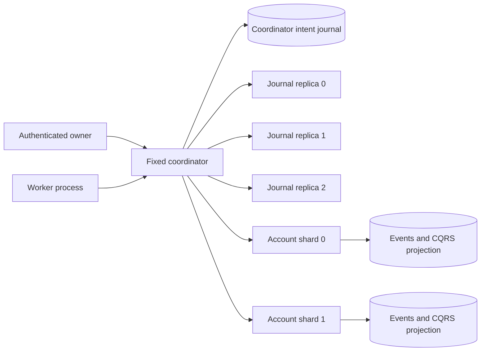

# Chapter 28 — Digital Wallet Design

## Scope and selected strategy

The source chapter requires wallet-to-wallet transfers, reproducible historical state and transaction correctness. Million TPS and 99.99% availability are design targets, not results of this reference. Amounts here are integer USD cents, rather than the chapter API's decimal strings. Static configuration provisions synthetic opening balances; deposits, withdrawals and real financial integrations are excluded.

| Strategy | Correctness mechanism | Main cost / reason for choice |
|---|---|---|
| Database 2PC | Prepare database transactions, durably decide commit/abort | Requires prepared-transaction/XA support and holds database locks while waiting; not provided by this SQLite reference |
| TCC | Business-level reservations followed by idempotent confirm/cancel | Chosen: reservations prevent overspending and make unresolved funds explicit; intermediate states are observable |
| Saga | Ordered local mutations plus compensation | Viable, but money already credited/spent complicates compensation; reservation-based TCC is easier to audit here |

TCC provides eventual completion or cancellation after recovery, not an invisible global atomic state change. No account lock is held across network requests. Instead, a durable held balance prevents reuse of reserved funds.

## Physical topology



Seven independent Python processes communicate over actual HTTP and use six independent SQLite files. No database file is opened by another service process. All files remain on one laboratory host; process independence is not independent-host durability. Routing is deterministic SHA256(account) modulo two. The partition map is static and cannot be changed safely in place.

The coordinator serializes owner requests and worker steps. This makes each audit a stable cut of participant changes initiated through this authority, but limits throughput. Shard mutation and its read-model update share one SQLite `BEGIN IMMEDIATE` transaction with WAL/FULL synchronous writes. The HTTP server serializes each shard's routes so snapshot/read/replay operations do not mix concurrent participant versions.

## Commands, decisions and participant states

A command freezes transaction ID, source, destination, positive integer amount and USD currency. Identifiers are bounded ASCII strings. The source owner authorizes acceptance. Same ID/same content is a replay; same ID/different content is a conflict. IDs are globally unique across this reference. Different IDs intentionally represent separate transfers.

Coordinator journal events are `accepted`, `decision(COMMIT|CANCEL)` and `completed(SUCCEEDED|CANCELED|REJECTED)`. State is deterministically reconstructed from the committed prefix; the mutable retry table is operational scheduling metadata, never the source of monetary truth.

Each shard keeps one participant record per transfer ID, containing frozen intent, role and state. States are PREPARED, CONFIRMED, CANCELED and REJECTED. Local transfers use role `local`; their successful/rejected outcome is a single shard event. Participant states are derived from events, not updated through a second independent money path.

```mermaid
sequenceDiagram
    participant C as Coordinator
    participant Q as 2-of-3 journal
    participant A as Source shard
    participant B as Destination shard
    C->>Q: Accepted intent
    C->>A: Try source
    A->>A: Available to held, event + projection
    C->>B: Try destination
    B->>B: Validate and persist preparation; no credit
    C->>Q: Durable COMMIT decision
    C->>A: Confirm source
    A->>A: Remove hold
    Note over A,B: Funds are in transit
    C->>B: Confirm destination
    B->>B: Credit available balance
    C->>Q: Completed SUCCEEDED
```

Each worker step performs at most one participant mutation or decision/completion append, allowing crashes at every boundary. Progress is recovered by querying durable participant states. A lost prepare reply may already have reserved funds; it does not select cancellation. A definitive business refusal or an administrator's pre-decision cancellation records CANCEL first, then cancels both participants. Source cancellation releases any hold; destination cancellation writes a tombstone even when no Try arrived. Late Try returns the tombstone, never re-reserving or re-crediting. Confirm without prepare, confirm after cancellation and cancel after confirmation are rejected.

After COMMIT, only confirmation recovery is allowed. Cancellation cannot undo a partially credited committed transfer. Pending holds have no automatic timeout: a timeout is evidence of unavailable communication, not evidence that the money is free. Five consecutive participant failures park recovery work with its last error for manual inspection; successful progress clears this counter. Global journal-quorum failure blocks the entire step before any participant change and does not classify transfers as financially failed. Manual retry retains the exact original ID and decision.

Same-shard transfers bypass cross-shard reservation: both balances, a deterministic success/rejection event and read projection commit atomically. If the shard succeeds but the coordinator completion append fails, the participant's local outcome is queried on retry. Local ambiguous commands cannot be canceled through the cross-shard cancellation API.

## Fixed-writer journal replication and fencing

This implementation deliberately does not implement elections or claim a general distributed consensus algorithm. It has exactly one serialized authority using one retained coordinator database. Replica records are immutable sequence/hash-chain prefixes. Every new event follows this order:

1. Resolve/replicate any previous pending local intent, requiring at least two replica acknowledgements.
2. Persist the next sequence, previous hash, canonical event and SHA256 checksum locally with `committed=0`.
3. Query each replica's prefix, catch it up and require at least two durable matching acknowledgements of the full local prefix.
4. Mark the local prefix committed. Only committed events enter coordinator projections or authorize COMMIT-dependent effects.

Failure after a minority accepts leaves the same pending event on authority disk. Restart using that disk completes replication before accepting another command or advancing money. A 503 does not imply rejection: an accepted intent or COMMIT event may later become committed. Clients must retry the original transaction ID. Missing/divergent prefixes fail closed. Local and replica journal triggers prohibit event mutation/deletion; local committed metadata may advance.

There is no alternative-writer prefix recovery or lost-authority-disk promotion. A new coordinator with empty/stale storage is unsupported, even if a replica majority survived. The journal replication is useful for integrity comparison, quorum gating and same-disk restart tests, but does not eliminate the coordinator as an operational single point of failure. Participant databases are not replicated at all.

Replica status/append and every shard mutation check a persisted `(epoch, leader)` owner. Lower epochs or same-epoch different owners cannot change ownership. Fences are updated only through authenticated manual administration. To change epoch, stop authority/worker, fence every replica and shard, update configuration, then restart on the original authority database. A partially fenced cluster may block; it must not be used to start competing authorities. Epochs do not expire and are not time-based leases. Old processes cannot write to fenced shards even if a quorum check completed just before maintenance. Trusted operators, shared service credentials and exclusive access to the retained authority disk are explicit prerequisites.

## Event sourcing, CQRS, snapshots and historical reads

Shard events are genesis, local transfer outcome, prepare, confirm and cancel. Canonical entries contain contiguous sequence, previous hash, payload and checksum. SQL triggers disallow update/delete. A pure reducer derives accounts (available/held) and participant states; it has no network calls, timers or random IDs. Replay never re-submits a transfer. Genesis is generated once from configured opening balances; changing the opening configuration on restart is refused.

The read projection is a distinct JSON row updated transactionally with the event append. Startup validates the event chain and rebuilds this projection, repairing projection drift from valid history. Audit independently replays events and compares the stored projection. `?at=n` applies the shard event prefix up to n; source and destination sequences are unrelated, so this is not a global wall-clock historical snapshot.

Snapshot writes capture a stable event prefix and reducer state, include the head hash and checksum, fsync a temporary file and atomically replace the prior snapshot. Startup verifies the complete chain and that the snapshot state equals its replayed prefix, then applies the tail. Corrupt snapshots/logs stop recovery rather than inventing balances. This full-prefix verification intentionally does not accelerate startup or allow log deletion; the snapshot is a validated checkpoint, not a compaction protocol. Hashes detect corruption and are not cryptographic authentication against an administrator who can rewrite schema and all history.

## Conservation and internal reconciliation

For a stable coordinator audit cut:

`sum(all account available + held) + sum(COMMIT source-confirmed/destination-unconfirmed amounts) == configured opening supply`

Source confirmation removes the held liability before destination credit. The amount remains explicitly in transit until destination confirmation; counting wallets alone would falsely report lost money at this stage. Destination cannot spend funds during prepare. Credit is ordered after source confirmation, avoiding duplicated spendable money.

Audit requires a journal quorum, queries both shard views and replay checks under serialized coordinator access, compares completed operations with participant outcomes, rejects destination-before-source confirmation, checks participants against accepted commands, and verifies supply including transit. It reports discrepancies without issuing compensating payments or silently editing history. Direct administrative/internal writes outside the coordinator are a trusted maintenance boundary and must not run concurrently with normal auditing.

## Validation and extension boundary

The test suite covers concurrent duplicates and competing debits, rollback before local commit, history/snapshot-tail recovery, corruption detection, TCC cancellation tombstones, post-commit lost replies, pending dead-letter recovery, partial source confirmation plus coordinator/shard restarts, real quorum outages, minority-only acceptance, replica catch-up and persisted epoch fencing. See `../benchmarks/REPORT.md` for actual commands and measurements.

Reference limits: 100 configured accounts, 1000 accepted commands, complete retained logs, full history scans/JSON projections, full-state reconciliation, one worker and serialized authority. Loopback-only HTTP and generated role credentials are for a local exercise, not TLS, credential rotation or production end-user authentication. There is no shard migration, participant replication, disk-loss recovery, automatic leader election, bank reconciliation, FX, fees, deposits, withdrawals or external money. Million TPS and four-nines availability remain unproven.
