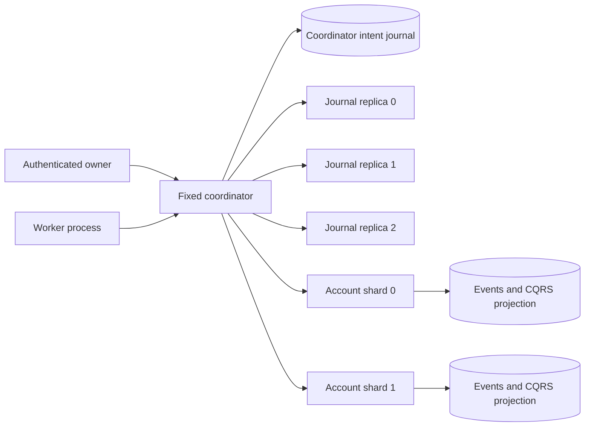

# 第28章 — 数字钱包设计

## 范围与选定策略

原书章节要求支持钱包到钱包转账、历史状态可重演以及事务正确性。百万 TPS 与 99.99% 可用性是设计目标，而非本参考实现的结果。本文金额采用整数 USD 美分，而非该章 API 中的十进制字符串。静态配置预置合成初始余额；存取款及真实金融集成不在范围内。

| 策略 | 正确性机制 | 主要代价 / 选择原因 |
|---|---|---|
| 数据库 2PC | 预备（Prepare）数据库事务，持久化地决定提交/中止 | 需要预备事务/XA 支持，且等待期间持有数据库锁；本 SQLite 参考实现不提供该支持 |
| TCC | 业务层预留（reservation），随后执行幂等的确认（confirm）/取消（cancel） | 已选定：预留可防止超支，并使未决资金显式可见；中间状态可观测 |
| Saga | 有序的本地变更加补偿 | 可行，但资金已被入账/花费会使补偿复杂化；基于预留的 TCC 在此更易于审计 |

TCC 在恢复后提供最终完成或取消，而非不可见的全局原子状态变更。任何账户锁都不会跨网络请求持有；取而代之的是，持久化的冻结余额（held balance）可防止预留资金被重复使用。

## 物理拓扑



七个独立的 Python 进程通过真实 HTTP 通信，并使用六个独立的 SQLite 文件。任何数据库文件都不会被其他服务进程打开。所有文件都保留在同一台实验主机上；进程独立并不等同于跨主机持久性。路由采用确定性的 SHA256(account) 模 2。分区映射是静态的，无法安全地就地更改。

协调者对属主（owner）请求和工作进程步骤进行串行化处理。这使得每次审计都是通过该权威（authority）发起的参与者变更的一个稳定切面（cut），但也限制了吞吐量。分片变更及其读模型更新共享同一个 SQLite `BEGIN IMMEDIATE` 事务，并使用 WAL/FULL 同步写入。HTTP 服务器对每个分片的路由进行串行化，使快照/读取/重放操作不会混入并发的参与者版本。

## 命令、决定与参与者状态

命令会冻结事务 ID、源、目标、正整数金额与 USD 币种。标识符是有长度上限的 ASCII 字符串。接受请求由源属主授权。相同 ID/相同内容视为重放（replay）；相同 ID/不同内容视为冲突（conflict）。ID 在本参考实现中全局唯一；不同 ID 有意表示彼此独立的转账。

协调者日志事件包括 `accepted`、`decision(COMMIT|CANCEL)` 与 `completed(SUCCEEDED|CANCELED|REJECTED)`。状态从已提交前缀（committed prefix）确定性地重建；可变的重试表只是运维调度元数据，绝不是资金真相的来源。

每个分片为每个转账 ID 保留一条参与者记录，包含冻结的意图（intent）、角色与状态。状态包括 PREPARED、CONFIRMED、CANCELED 和 REJECTED。本分片内转账使用角色 `local`；其成功/拒绝结果是单个分片事件。参与者状态由事件推导得出，不会通过第二条独立的资金路径更新。

```mermaid
sequenceDiagram
    participant C as Coordinator
    participant Q as 2-of-3 journal
    participant A as Source shard
    participant B as Destination shard
    C->>Q: Accepted intent
    C->>A: Try source
    A->>A: Available to held, event + projection
    C->>B: Try destination
    B->>B: Validate and persist preparation; no credit
    C->>Q: Durable COMMIT decision
    C->>A: Confirm source
    A->>A: Remove hold
    Note over A,B: Funds are in transit
    C->>B: Confirm destination
    B->>B: Credit available balance
    C->>Q: Completed SUCCEEDED
```

每个工作进程步骤至多执行一次参与者变更，或一次决定/完成事件追加，从而允许在每个边界处发生崩溃。进度通过查询持久化的参与者状态来恢复。丢失的 Try 应答可能已经预留了资金，因此不会因此选择取消。明确的业务拒绝或管理员在决定前的取消会先记录 CANCEL，然后再取消两个参与者。源端取消会释放所有冻结；目标端取消即使未收到 Try 也会写入墓碑（tombstone）。迟到的 Try 返回墓碑，绝不重新预留或重新入账。未 Prepare 就 Confirm、取消后 Confirm、确认后 Cancel 均会被拒绝。

COMMIT 之后只允许确认恢复。取消无法撤销一笔已部分入账的已提交转账。待处理的冻结没有自动超时：超时是通信不可用的证据，而非资金已解冻的证据。参与者连续失败五次后，恢复工作会连同最后一次错误一并搁置，等待人工检查；取得进展后该计数器清零。全局日志多数派失败会在任何参与者变更之前阻塞整个步骤，且不会将转账归类为资金失败。人工重试保留完全相同的原始 ID 与决定。

同分片转账绕过跨分片预留：两个余额、一个确定性的成功/拒绝事件以及读投影在一个事务中原子提交。如果分片执行成功但协调者的完成事件追加失败，重试时会查询该参与者的本地结果。本地结果不明确的命令无法通过跨分片取消 API 取消。

## 固定写入者日志复制与隔离（fencing）

本实现有意不实现选举，也不宣称使用了通用的分布式共识算法。它只有唯一一个串行化的权威（authority），使用唯一一个保留的协调者数据库。副本记录是不可变的序号/哈希链前缀。每个新事件都遵循以下顺序：

1. 解决/复制任何先前待处理的本地意图，要求至少两个副本确认。
2. 在本地持久化下一个序号、前序哈希、规范事件和 SHA256 校验和，标记为 `committed=0`。
3. 查询每个副本的前缀，将其追赶至最新，并要求至少两个持久化的、与完整本地前缀匹配的确认。
4. 将本地前缀标记为已提交。只有已提交的事件才会进入协调者投影，或授权依赖 COMMIT 的后续效果。

少数派接受之后发生故障时，同一待处理事件仍保留在权威磁盘上。使用该磁盘重启后，会先完成复制，再接受下一条命令或推进资金。503 并不意味着拒绝：已接受的意图或 COMMIT 事件此后仍可能变为已提交。客户端必须使用原始事务 ID 重试。前缀缺失/分叉时采取失败关闭（fail closed）策略。本地与副本日志的触发器禁止事件被修改/删除；本地已提交元数据可以推进。

不存在备选写入者的前缀恢复，也没有权威磁盘丢失后的晋升机制。即使副本多数派仍然存活，也不支持使用空/过时存储的新协调者。日志复制对于完整性比对、多数派门控和同盘重启测试很有用，但并不能消除协调者这一运维层面的单点故障。参与者数据库完全不复制。

副本状态/追加以及每次分片变更都会检查持久化的 `(epoch, leader)` 属主。更低的 epoch 或同 epoch 的不同属主无法变更所有权。隔离屏障只能通过经过认证的人工管理来更新。要变更 epoch，需停止权威/工作进程，对所有副本和分片执行隔离，更新配置，然后在原权威数据库上重启。部分隔离的集群可能被阻塞；绝不能用它来启动相互竞争的权威。epoch 永不过期，也不是基于时间的租约。即使多数派检查恰好在维护前完成，旧进程也无法写入已隔离的分片。可信的操作员、共享的服务凭据以及对保留权威磁盘的独占访问是明确的前提条件。

## 事件溯源、CQRS、快照与历史读取

分片事件包括创世（genesis）、本地转账结果、prepare、confirm 和 cancel。规范条目包含连续的序号、前序哈希、负载（payload）和校验和。SQL 触发器禁止更新/删除。纯函数化的 reducer 推导账户（可用/冻结）与参与者状态；它没有网络调用、定时器或随机 ID。重放绝不会重新提交转账。创世事件根据配置的初始余额生成一次；重启时更改初始余额配置会被拒绝。

读投影是一行独立的 JSON 数据，与事件追加在同一个事务中更新。启动时校验事件链并重建该投影，从有效历史中修复投影漂移。审计会独立重放事件并与存储的投影比对。`?at=n` 应用分片事件前缀至序号 n；源与目标的序号彼此无关，因此这并非全局墙钟（wall-clock）时间的历史快照。

快照写入会捕获稳定的事件前缀与 reducer 状态，包含头部哈希与校验和，对临时文件执行 fsync，然后原子替换先前的快照。启动时校验完整事件链，并验证快照状态等于其对应前缀的重放结果，然后应用尾部事件。损坏的快照/日志会中止恢复，而不是凭空捏造余额。这种完整前缀校验有意不加速启动，也不允许删除日志；快照是经过验证的检查点，而非压缩（compaction）协议。哈希用于检测损坏，并不能作为针对可重写模式与全部历史的管理员的密码学认证。

## 守恒与内部对账

对于一个稳定的协调者审计切面：

`sum(all account available + held) + sum(COMMIT source-confirmed/destination-unconfirmed amounts) == configured opening supply`

源端确认会在目标端入账之前移除冻结负债。在目标端确认之前，金额始终显式处于在途状态；若只统计钱包余额，该阶段会错误地报告资金丢失。目标端在 prepare 期间不能花费资金。入账被安排在源端确认之后，避免出现重复的可花费资金。

审计要求日志多数派可用，在串行化的协调者访问下查询两个分片视图和重放检查，将已完成的操作与参与者结果比对，拒绝目标端先于源端确认的情况，将参与者与已接受的命令核对，并验证包含在途金额的资金总量。它报告差异，但不会发起补偿支付，也不会静默修改历史。绕过协调者的直接管理/内部写入属于受信任的维护边界，绝不能与正常审计并发运行。

## 验证与扩展边界

测试套件覆盖并发重复与竞争扣款、本地提交前回滚、历史/快照尾部恢复、损坏检测、TCC 取消墓碑、提交后丢失应答、待处理死信恢复、部分源端确认以及协调者/分片重启、真实多数派中断、仅少数派接受、副本追赶和持久化 epoch 隔离。实际命令与测量结果见 `../benchmarks/REPORT.md`。

参考实现的限制：100 个配置账户、1000 条已接受命令、完整保留的日志、全量历史扫描/JSON 投影、全状态对账、单个工作进程与串行化权威。仅回环（loopback）HTTP 与生成的角色凭据仅用于本地演练，并非 TLS、凭据轮换或生产级终端用户认证。不存在分片迁移、参与者复制、磁盘丢失恢复、自动选主、银行对账、外汇、手续费、存取款或外部资金。百万 TPS 与四个九（99.99%）可用性仍未得到证明。
