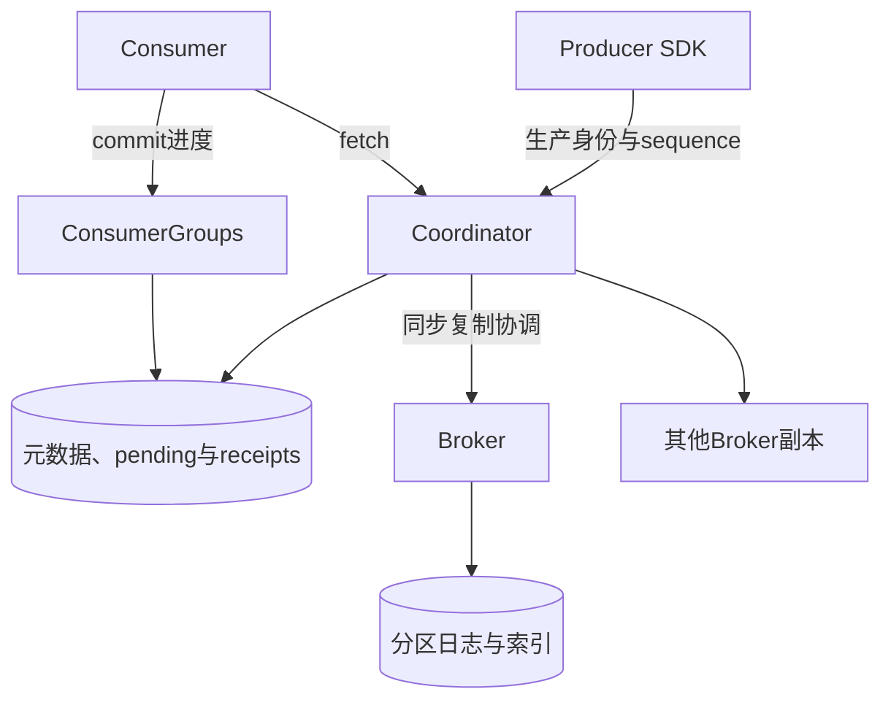
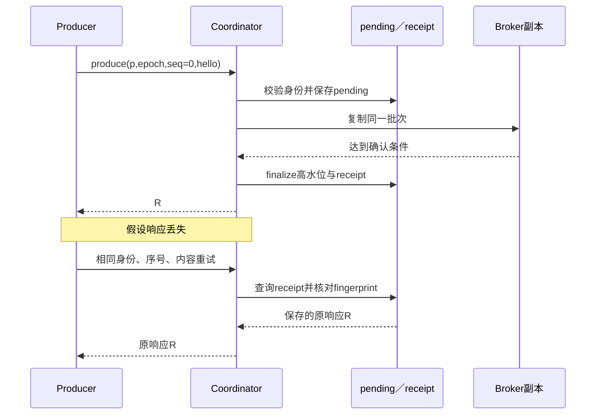

# 第20章：从一次安全重试理解分布式消息队列

消息队列最重要的不是put/get接口，而是**什么算已经提交、重复请求怎样识别、消费者进度由谁确认**。项目用协调器保存元数据和生产回执，Broker保存分区日志，消费组单独管理偏移。

本文先选一个topic、一个partition、一个producer，acks=all。多个Broker通过本地真实HTTP协作；协调器元数据仍是单点参考方案，不能把副本日志等同于元数据高可用。

## 用同一个批次走完全程

producer=p、epoch=0、sequence=0，向input分区0发送一条value=hello。

1. 首次提交获得offset；把这个响应记为R。
2. 同一生产身份、序号及内容并发重试，所有成功响应都应等于R，fetch只得到一条hello。
3. 同一序号改成另一个内容，应冲突，不能覆盖原日志。
4. 消费后但提交offset前崩溃，重读可能再次拿到hello；业务处理需考虑幂等。
5. 如果选择acks=leader，返回的committed=False只是暂存确认，不能当作acks=all的已提交结果。

先理解一个分区内的这组保证，再看分区扩容、消费组重平衡和原子process。

## 宏观：日志与进度分开放



| 数据 | 关键字段 | 含义 |
|---|---|---|
| 生产身份 | producer、epoch、sequence | 新epoch隔离旧生产者，sequence约束批次顺序 |
| 分区日志 | offset、value、hash链 | 分区内有序的持久记录 |
| pending | 尚待完成的批次 | 未完成确认可继续恢复 |
| receipts | 批次fingerprint与response | 相同内容重试返回原结果 |
| parts.hwm | 已提交高水位 | fetch不能越过它读取未提交尾部 |
| parts.floor | 最早保留偏移 | 过旧消费者必须显式重置 |
| 消费组进度 | session、generation、提交offset | 旧成员不能提交新一代的进度 |

高水位表示可读提交边界；消费者提交offset表示业务消费进度。二者不是同一个数字。

## 七站源码路线

1. [Producer.send](../src/message_queue/producer.py#L98)：客户端怎样持有待确认批次，未知结果时为什么不能换一个新payload。
2. [Coordinator.produce](../src/message_queue/coordinator.py#L262)：规范化消息，确定分区；分区锁与producer锁保护哪两个维度。
3. [Coordinator._produce](../src/message_queue/coordinator.py#L297)：检查epoch、回执、序号；输入相同身份和内容，输出原响应或新的批次。
4. [Coordinator._flush](../src/message_queue/coordinator.py#L219)：恢复pending、复制并finalize；这是暂存到提交的桥。
5. [PartitionLog.append](../src/message_queue/log.py#L307)：观察offset、哈希链与磁盘追加，区分完整损坏和可恢复尾部。
6. [Coordinator._fetch](../src/message_queue/coordinator.py#L386)：只读floor到hwm范围，延迟头消息如何影响后续消息。
7. [ConsumerGroups.commit](../src/message_queue/coordinator_groups.py#L259)：检查会话及generation后再前移组进度。

## 微观一：幂等不是只记一个请求ID

[coordinator.py:297](../src/message_queue/coordinator.py#L297)

```python
def _produce(self, topic, producer, epoch, sequence, messages, partition, acks):
    with self.transaction(write=False) as db:
        part = self.part(db, topic, partition)
        current = db.execute(
            "SELECT epoch FROM producers WHERE id=?", (producer,)
        ).fetchone()
        if not current or current[0] != epoch:
            raise Error(409, "producer epoch fenced")
        fingerprint = hashlib.sha256(dumps(messages).encode()).hexdigest()
        receipt = db.execute(
            "SELECT hash,response FROM receipts WHERE producer=? AND epoch=? AND topic=? AND partition=? AND sequence=?",
            (producer, epoch, topic, partition, sequence),
        ).fetchone()
        if receipt:
            if receipt[0] != fingerprint:
                raise Error(409, "producer sequence payload conflict")
            return json.loads(receipt[1])
```

按代码顺序理解：

- epoch不匹配先被fence，旧生产者不能靠旧序号继续写。
- fingerprint绑定消息内容，同一序号携带不同payload返回409。
- 有合法receipt时返回保存的response；不再分配新offset。
- 没有receipt还要继续检查pending和expected sequence，不能直接追加。

所以“客户端超时后重新生成一个sequence”并不是安全重试方式。先恢复原批次的结果，才能知道下一批的身份。



网络复制与SQLite事务不是同一个事务。pending让中间阶段可以被恢复；读者仍受高水位限制，不能把未完成事务尾部当作已提交消息。

## 微观二：延迟消息不能被后面的消息超车

[coordinator.py:408](../src/message_queue/coordinator.py#L408)

```python
now = self._now()
for value in values:
    if value["record"]["not_before"] > now:
        break
    next_offset += 1
    if filters is None or filters.intersection(value["record"].get("tags", [])):
        visible.append(value["record"])
return {
```

例子把同一批次设置成第一条later延迟10秒，第二条behind立即可投递。在10秒前，fetch返回空，而不是跳过later先给behind。

原因是遇到not_before尚未到期的头消息就break。与tags过滤不同，延迟头要保留分区投递顺序；过滤掉的标签消息则仍可能推进扫描位置。

## 两类失败不要混淆

**生产响应丢失**：原批次可能已经提交，按原身份重试，receipt或pending负责收敛。

**消费后未提交进度**：消息事实没有丢失，但业务可能再次处理它。队列不能自动把外部数据库写入与消费commit变成一个事务。

**保留窗口已删除旧偏移**：fetch返回410，要求显式选择重置位置；不能假装旧消息仍存在而无声跳过。

## 对照测试看保证

- [CoordinatorReliabilityTests.test_direct_same_sequence_concurrent_retry_is_one_committed_batch](../tests/test_coordinator_reliability.py#L136)：六个并发重试结果相同，分区只出现一条消息。
- [StateTests.test_delayed_head_preserves_order](../tests/test_state.py#L84)：10秒前为空，之后顺序为later、behind。
- [ClusterTests.test_transport_partition_provisional_ack_and_quorum_recovery](../tests/test_cluster.py#L72)：区分leader暂存确认与quorum恢复后的提交。
- [StateTests.test_retention_floor_receipt_expiry_and_new_append_chain](../tests/test_state.py#L96)：理解过期offset与已失效回执为何不能被随意复用。

## 自查与练习

**相同key的消息就全局有序吗？** key帮助选择分区；保证首先是分区内顺序，不是所有topic的全局顺序。

**acks=leader返回offset就能消费吗？** 不能据此推导已提交，应检查committed与高水位契约。

**同序号不同内容能作为更新吗？** 不能，这是身份冲突，消息日志不是按序号覆盖的可变表。

练习：提交hello后原样重试，再用同序号提交world。预期原样重试得到同一响应，world冲突，fetch始终只有原hello；再换合法下一序号提交world，观察offset连续增长。


---

[返回全仓库学习导航](../../docs/learning-guide_cn.md) · [项目运行说明](../README.md)

[导读原稿](../../tools/learning_guides/distributed-message-queue.md)。正文与图按当前实现编写；源码链接和摘录由生成器绑定到当前定义。修改行为后应同时复核案例、时序和解释，再重新生成；定义与链接校验不等同于业务回归测试。
