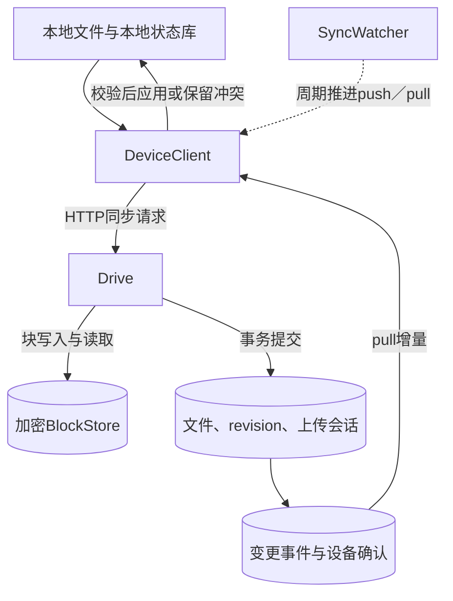
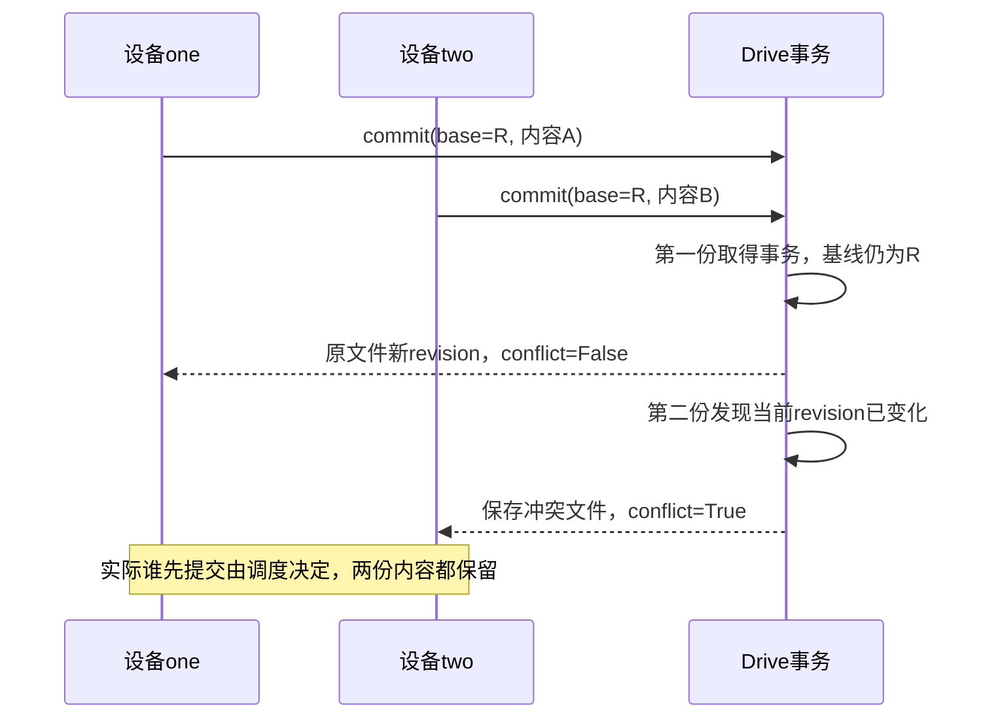
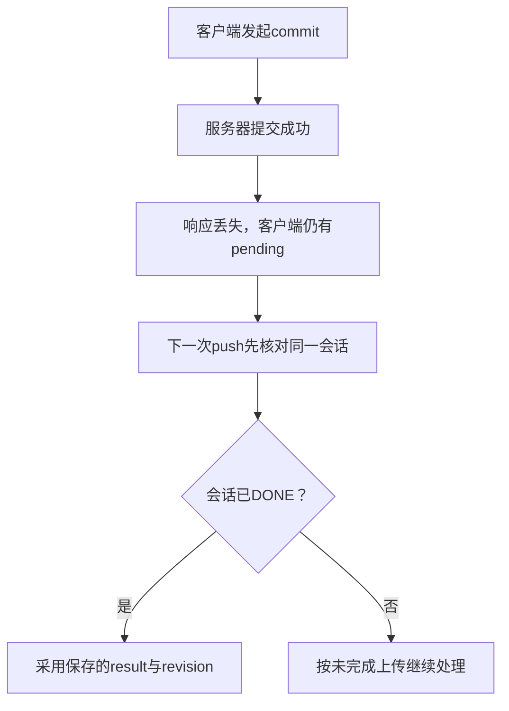

# 第16章：从两台设备修改同一文件看懂同步系统

文件同步不是反复上传整个目录。这个项目把**不可变块、文件版本、设备变更进度**分开：块负责内容复用，版本决定当前文件，设备游标决定下一次还要处理哪些变化。

先读本地Drive服务和DeviceClient。块存储使用命名空间隔离与加密；自动扫描在SyncWatcher中，是客户端周期推进能力，不等同于操作系统级实时文件事件系统。

## 贯穿案例：同一基线的两个修改

已有文件a，内容abcdefgh，设备one、two都记住同一revision。设备one改成AAAAaaaa，设备two改成BBBBbbbb，再并发推送。

预期一份修改成为原文件的新版本，另一份保存为冲突文件；不能静默丢掉任意一方。测试中两次提交的conflict标志恰好一真一假，文件列表为两项。

再考虑“服务端commit成功，响应丢失”：同一设备重试必须复用已接受的上传结果，不能因基线变化制造一份假的冲突副本。

## 宏观：块、版本与事件各有职责



| 数据 | 关键字段 | 回答的问题 |
|---|---|---|
| 块清单 | digest、size与块顺序 | 怎样重建这份文件 |
| 文件版本 | file、revision、checksum | 当前可见的内容是哪份 |
| 上传会话 | upload、state、base及result | 哪次提交被接受，能否安全重试 |
| 本地文件记录 | revision、checksum、deleted | 本地修改相对哪个远端基线 |
| 设备进度 | cursor与ack | 哪些变更已被设备应用 |
| 冲突文件 | 独立文件路径与身份 | 保存另一份并发修改 |

## 六站阅读路线

1. [DeviceClient.push](../src/file_sync/client.py#L434)：输入space与相对路径，读取本地基线，形成待提交内容；先寻找本地pending恢复分支。
2. [Drive.begin](../src/file_sync/service.py#L194)：服务器为目标路径、基线和内容申请上传会话，预留所需资源。
3. [BlockStore.put](../src/file_sync/storage.py#L206)：理解块身份与命名空间，区分重复块和损坏对象。
4. [Drive.commit](../src/file_sync/service.py#L374)：最关键一站；先校验内容，再在事务内复核会话、权限与基线，决定原文件还是冲突文件。
5. [DeviceClient.pull](../src/file_sync/client.py#L642)：读取变更页；失败不能直接推进本地游标。
6. [DeviceClient.apply](../src/file_sync/client.py#L558)：下载、校验并替换文件前，检查本地是否又被修改。最后看 [EventLog.ack](../src/file_sync/notifications.py#L108)。

## 微观一：为什么commit有两次会话读取

[service.py:374](../src/file_sync/service.py#L374)

```python
def commit(self, token, upload):
    user = self.auth(token)
    with self.read():
        snapshot = self.session(user, upload)
        if snapshot["state"] == "DONE":
            return json.loads(snapshot["result"])
        if snapshot["state"] != "OPEN":
            raise ValueError("upload cancelled")
        manifest = json.loads(snapshot["blocks"])
    digest = hashlib.sha256()
    for block in manifest:
        digest.update(
            self.store.get(snapshot["space"], block["digest"], block["size"])
        )
    if digest.hexdigest() != snapshot["checksum"]:
```

第一段取得会话快照，处理已经DONE的幂等重试，再校验文件内容。读取所有块、计算校验和可能慢，因此不能只相信最初读到的状态。

[service.py:390](../src/file_sync/service.py#L390)

```python
with self.transaction():
    row = self.session(user, upload)
    if row["state"] == "DONE":
        return json.loads(row["result"])
    if row["state"] != "OPEN":
        raise ValueError("upload cancelled")
    stored_rows = self._block_rows(row["space"], manifest)
    for block in manifest:
        stored = stored_rows.get(block["digest"])
        if stored is None or stored["size"] != block["size"]:
            raise ValueError("block metadata missing")
        if not self.store.exists(stored["key"]):
            raise OSError("validated block disappeared; retry")
    current = self.db.execute(
        "SELECT * FROM files WHERE space=? AND path=?",
```

第二段进入事务重新取得会话。期间上传可能被取消、权限可能改变、块状态可能变化。只有事务内复核通过，才能继续更新文件版本和发出变更事件。

这里的核心不是“加一把大锁”，而是**锁外验证慢内容，锁内重新判断提交资格**。

## 微观二：并发冲突是一个保留策略



不要把图里one先到理解成固定胜者。决定结果的是提交事务看到的当前revision。观察commit中创建冲突路径与分配身份的位置，确认冲突不是覆盖旧文件后再尝试恢复。

## 丢响应时的恢复



客户端需要记住已经被接受的revision，而不是重试时临时查询到的最新远端头。否则其他设备恰好又提交时，本地会错误地宣称自己已经同步了不曾接受的版本。

## 用测试追踪数据变化

- [test_concurrent_edits_create_exactly_one_conflict](../tests/test_sync.py#L168)：对同一base并发提交；观察两个结果的conflict集合为False、True，文件列表长度为2。
- [test_lost_upload_response_reuses_session_and_publishes_once](../tests/test_client_faults.py#L49)：第一次commit完成后人为抛OSError，第二次push应恢复同一结果，不增加冲突。
- [test_edit_arriving_during_download_is_preserved](../tests/test_device_reliability.py#L82)：pull下载期间用户又编辑文件，预期新本地修改仍被保留。

## 自查与练习

**块已经上传，文件就可见了吗？** 未必。可见性由版本commit决定；未被引用的块需要后续清理。

**同时编辑为什么不让后写直接覆盖？** 本地基线表明它们不是有意替换对方结果，冲突副本保护用户内容。

**pull失败后能先确认游标下次补吗？** 不能直接这样做。游标是应用进度，提前确认可能跳过尚未落地的内容。

练习：先制造一次丢失commit响应，再在本地修改文件后重试push。先预测旧会话应先被核对，再作为新修改继续推进；对照设备可靠性测试，观察旧结果与新编辑没有混为一次提交。


---

[返回全仓库学习导航](../../docs/learning-guide_cn.md) · [项目运行说明](../README.md)

[导读原稿](../../tools/learning_guides/file-sync-system.md)。正文与图按当前实现编写；源码链接和摘录由生成器绑定到当前定义。修改行为后应同时复核案例、时序和解释，再重新生成；定义与链接校验不等同于业务回归测试。
