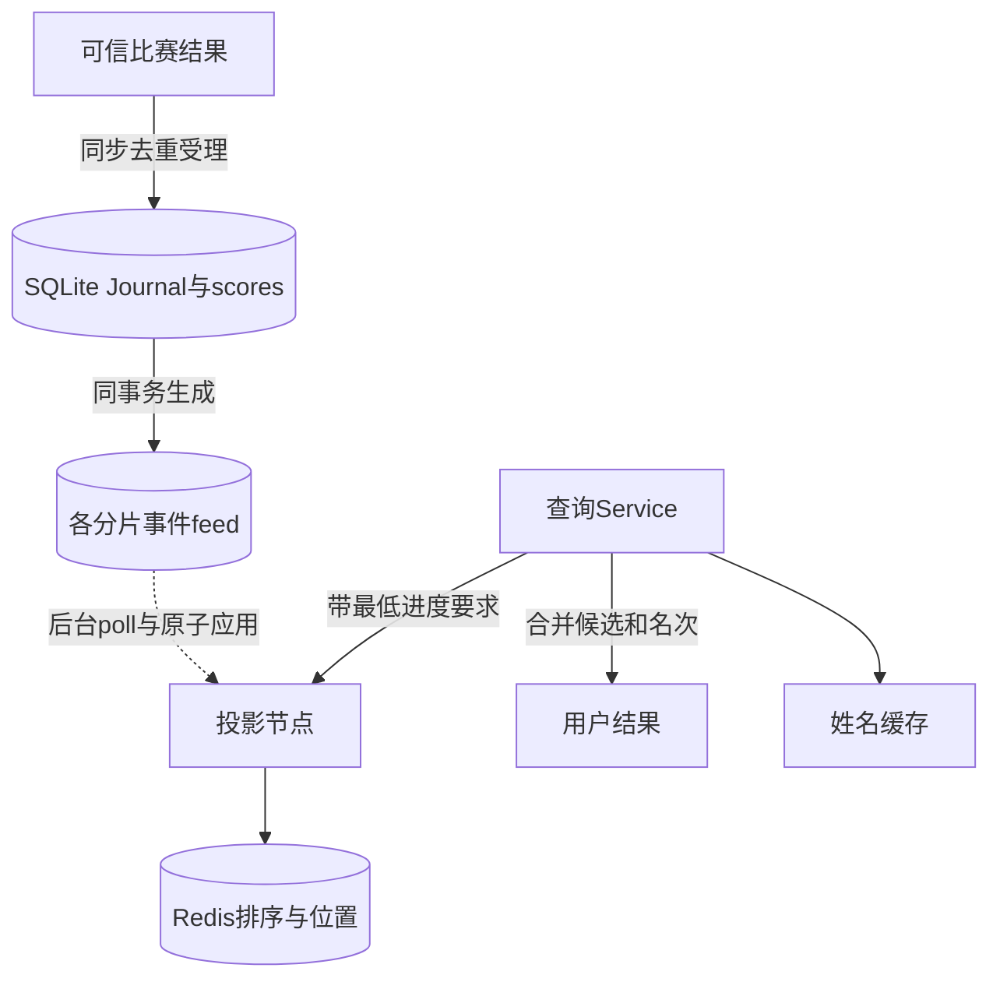
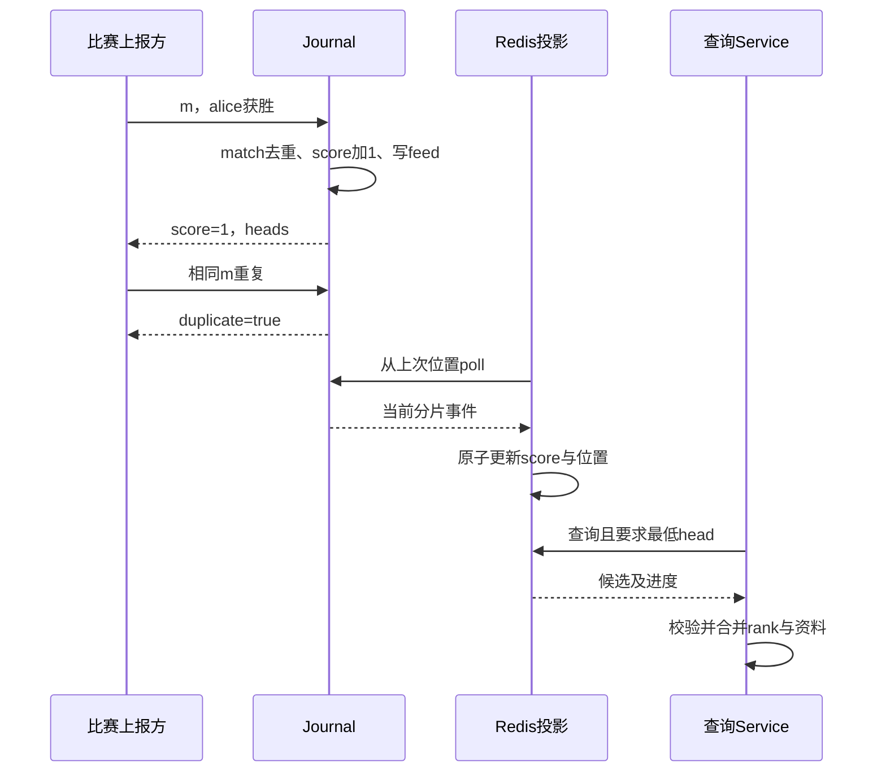

# 第26章：从一场比赛读懂事实日志与排行榜投影

权威比赛日志回答“比赛结果到底是什么”，Redis投影回答“当前谁排第几”。Redis并非唯一事实来源；投影落后或丢失时可以从权威日志恢复。查询层跨分片汇总候选，还必须确认它们属于兼容的赛季、版本和进度。

本项目使用真实Redis与标准库客户端。先读不依赖Redis的Journal测试，再看投影网络实验，避免同时调试业务、HTTP和Redis三个问题。

## 贯穿案例：alice获胜，重复上报20次

测试时钟为2030年1月1日中午，alice和bob已注册。比赛`match_id=m`、winner为alice、players为两人。即使并发上报20次，只有一次receipt的duplicate为False，alice在2030-01赛季的score应是1，比赛事实数量仍为1。把相同m的winner改为bob应冲突。



图中的SQLite scores是权威状态，Redis是可重建查询投影；查询并不是简单在某一台Redis执行一次全局排名命令。

## 要跟住的身份和进度

| 对象 | 关键字段 | 作用 |
|---|---|---|
| 比赛事实 | `match_id/hash/receipt` | 同一场比赛只能产生同一结果 |
| 月赛积分 | `month/user/score` | 胜者加1，不能由客户端任意提交积分增量 |
| 分片日志 | `heads`、lineage与序号 | 告诉投影应该应用哪个前缀 |
| Redis候选 | `user/score/lex` | lex提供稳定显示顺序，score提供竞赛名次 |
| 查询结果 | `rank/position` | 同分rank可相同，position仍是稳定的显示位置 |
| 姓名 | 用户资料 | 可独立更新，不改变比赛积分事实 |

## 六站阅读路线

1. [Journal.ingest](../src/gaming_leaderboard/journal.py#L179)：看信任边界。输入是比赛结果，不是用户自报积分；先跟match身份，再跟赛季和注册时间。
2. [Journal.emit](../src/gaming_leaderboard/journal.py#L54)：输入新的权威score，输出分片事件；注意和比赛受理处于同一事务。
3. [Journal.feed](../src/gaming_leaderboard/journal.py#L253)：从分片偏移返回可验证的事件page，是恢复的源头。
4. [Projection.poll_once](../src/gaming_leaderboard/projection.py#L154)与[Projection.apply](../src/gaming_leaderboard/projection.py#L141)：先找进度、身份和原子Lua更新，再研究主备读取。
5. [Service.query](../src/gaming_leaderboard/service.py#L191)：看查询怎样取得赛季快照、等待投影并检查响应。
6. [top](../src/gaming_leaderboard/ranking.py#L31)和[ranks](../src/gaming_leaderboard/ranking.py#L72)：手算同分的rank与position，最后再看邻居查询。

## 微观一：比赛去重和积分更新在同一事务

[journal.py:179](../src/gaming_leaderboard/journal.py#L179)

```python
def ingest(self, body, before_commit=None):
    normalized = match_result(body)
    match, winner = normalized["match_id"], normalized["winner"]
    players, ended_at = normalized["players"], normalized["ended_at"]
    fingerprint = digest(normalized)
    with self.transaction(True) as db:
        old = db.execute("SELECT * FROM matches WHERE id=?", (match,)).fetchone()
        if old:
            if old["hash"] != fingerprint:
                raise Error(409, "match ID reused with different result")
            return {**json.loads(old["receipt"]), "duplicate": True}
```

若已有match记录，相同hash返回原receipt，不再进入后面的积分增加；不同hash直接409。这同时保证重启去重和并发去重，而不是依赖短期缓存。事务后半段把score、feed与receipt一起写入，避免受理记录存在而积分没增加。

## 微观二：rank不等于列表位置

[ranking.py:37](../src/gaming_leaderboard/ranking.py#L37)

```python
result = sorted(candidates, key=lambda item: item["lex"])[:10]
rank, previous = 0, None
for position, value in enumerate(result, 1):
    if value["score"] != previous:
        rank = position
    value.update(rank=rank, position=position)
    previous = value["score"]
return result
```

先按lex排序得到稳定列表；只有分数变化才更新rank。假设分数为`3,3,1`，显示position是`1,2,3`，竞赛rank是`1,1,3`。不能直接把Redis中的位置加一当作竞赛名次。跨分片个人查询还需要统计严格高于该分数的人数。



## 失败时观察什么

Journal提交前异常，比赛、积分及分片头都应回滚。[JournalTests.test_precommit_failure_and_reopen_feed_checksums](../tests/test_journal.py#L49)检查heads不变，重开后lineage和去重仍成立。

[JournalTests.test_exactly_once_concurrent_and_conflict](../tests/test_journal.py#L39)对应20次并发重报的案例；名称里的exactly_once指本地权威事务的业务效果，不能外推为所有网络传递都恰好一次。

Redis丢失时重建投影需要位置和epoch隔离。真实Lua与恢复行为见[ProjectionNetworkTests.test_real_lua_prevalidation_reset_fence_and_idle_aof](../tests/test_projection_network.py#L17)，需要README列出的真实Redis环境。

## 自查与练习

- **为什么不能直接接受客户端points=100？** 可信输入是受规则约束的比赛结果，积分由服务端生成。
- **查询刚受理的比赛却看不到分数，是数据丢失吗？** 先比较权威heads与投影位置，可能只是尚未应用。
- **同分用户都第一名，为什么邻居仍有前后？** rank与稳定position是不同概念。

练习：注册charlie并保持三人0分，观察三人rank都为1而显示顺序稳定；随后让alice胜一场，预测其他两人的rank与position，再核对查询结果。启动方式见[README_CN.md](../README_CN.md)。


---

[返回全仓库学习导航](../../docs/learning-guide_cn.md) · [项目运行说明](../README.md)

[导读原稿](../../tools/learning_guides/gaming-leaderboard-system.md)。正文与图按当前实现编写；源码链接和摘录由生成器绑定到当前定义。修改行为后应同时复核案例、时序和解释，再重新生成；定义与链接校验不等同于业务回归测试。
