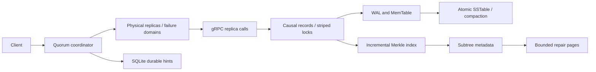

# Chapter 7 runtime design

Source: System Design Interview.md lines1735–2213. See the
[coverage/compatibility review](chapter07-review.md) and [measurements](../benchmarks/REPORT.md).

## Ownership and persistence

ReplicaRecords freezes/validates input before waiting for a striped key lock.
It reconciles siblings, encodes causal metadata and values together, then writes
through the engine and updates the Merkle index. An error after WAL/memtable
publication refreshes the index from the visible record while preserving the
error. Failure is not rollback. Tombstones are encoded values and retained.

Storage timestamps use max(wall time,nextafter(previous physical timestamp,+inf))
per key, separate from each version's causal metadata. The read path and rebuild
choose the highest timestamp across candidate tables and memory. This avoids
clock-regression/creation-order loss but increases read work. Physical component
timestamps remain caller-provided; the records layer makes its own writes monotonic.

async_work.complete shields one local commit and drains it after repeated caller
cancellation. Locks stay owned until the thread/commit finishes. Engine writes,
WAL updates and SQL hints cannot race later cleanup merely because their caller
was cancelled. Real commit errors take precedence. Remote repair rounds are not
shielded as a whole; shutdown can interrupt network waits. Disk stalls can delay
drain, and cancellation can leave committed effects.

storage/files.py fsyncs a temporary immutable file before os.replace, then syncs
the directory where supported. WAL is truncated only after publication. Compaction
retires source files after output durability; failed retirement is logged and
can leave duplicates, with timestamp reads preserving the winner. Raw engine
tombstones are not automatically GC'd. Stop closes WAL even when flushing fails.
Corrupt final SSTables fail startup instead of silently removing accepted data.
Windows directory durability and physical power-loss behavior are not proven.

## Incremental Merkle tree

The bucket digest still hashes sorted length-delimited key/value-hash components.
A complete binary heap caches parent hashes with the existing hash format.
Updating one bucket recomputes only its leaf-to-root path: O(log B) parents,
plus O(K) bucket hashing and ordered-key insertion for K keys in that bucket.
Immutable hash snapshots retain their tuple of heap entries during comparisons.
Bucket count must be a power of2 in1..65536. Key pages use bisect cursors and
bounded slices; no full-bucket sort/all-record response is needed per page.
This class is used on one event loop; it is not a general cross-thread index.

## Repair wire protocol

MerkleInspect accepts1..64 unique heap indices, a bucket count and optional
expected root. Index1 is root; leaves start at bucket_count. Compare root first,
then only children of differing subtrees, in bounded batches. Bucket-count
mismatch is FAILED_PRECONDITION; a changed expected root is ABORTED.

RepairBucketPage requires the remote root, bucket, exclusive after_key cursor,
record count<=128 and a byte budget. Server budget is at most2MiB and below its
channel limit. Pages read records with causal envelope/tombstones, checking root
again after each await. Oversized individual records fail RESOURCE_EXHAUSTED.
The client checks sorted keys, bucket membership, complete metadata responses and
cursor progress to prevent silent omissions/repeated loops from malformed replies.

cluster/anti_entropy.py owns this protocol; cluster/repair.py retains the old
ReplicaRepair import and owns SQL hints. Repair serializes rounds per node and
pins local placement. Pull all differing remote pages before pushing, because a
push changes the peer root. On concurrent mutation, prior merges remain valid
and later rounds retry. There is no cross-node consistent snapshot or rollback.
Continuous writes can prevent a round completing; no hard global round deadline
or persistent mid-bucket resume cursor is implemented. Each RPC has its deadline.

Trees cover all local records, not pair-specific common replica ranges. With
N smaller than membership size, roots may keep differing even after responsible
records converge. Repair still filters placement and never deletes nonowned data.
Avoid interpreting equal/different global roots as a cluster-wide consistency proof.

## Hints, quorum and limits

Hints persist encoded records before delivery. Same-object rounds are serialized;
ACK deletion matches original id/target/key/blob, fencing reuse by another journal
instance. Page cursor fairness is retained. SQL operations drain on cancellation.
The journal has no automatic DLQ, disk quota or coalescing controller.

Quorum intersection is not linearizability. Sloppy substitutes, concurrent causal
siblings and changing membership retain their original documented semantics.
Replica RPCs are distinct from coordinator CRUD, avoiding recursive fanout.

Automatic provisioning and safe node drain, topology consensus, TLS/authentication,
real multi-datacenter operation, streaming compaction, a bounded disk cache and
large-data recovery remain unfinished. Current SSTables cache full file contents.

Repair pages additionally verify each encoded record against its indexed digest. A visible storage commit awaiting index publication aborts the page.
