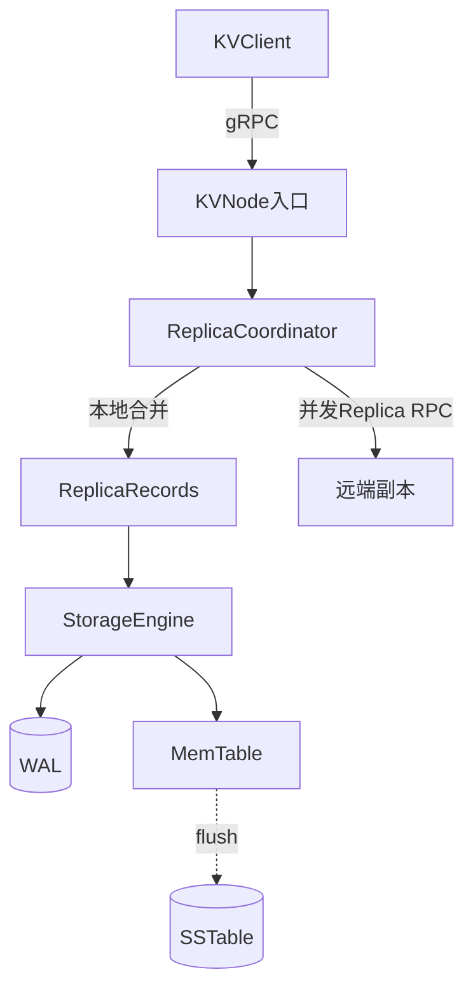
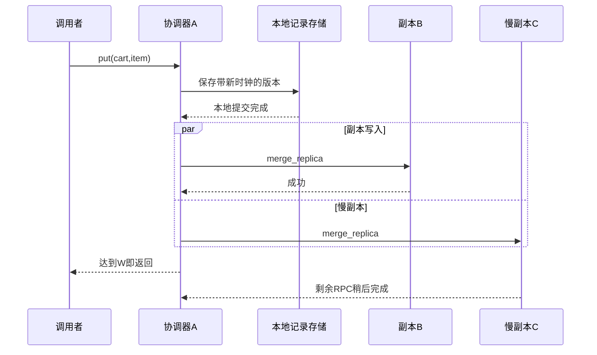

# 第7章：把一次put拆成“本地落盘”和“副本确认”

这个系统有两个必须分别理解的层次：**本地LSM存储**负责重启后找回记录，**副本协调**负责选择节点、等待仲裁和保留因果版本。一次网络put会把“值和版本元数据”作为同一条存储记录保存；它不等于在三台机器各写一个裸字节串。

## 案例：三副本，写二读二

配置 `N=3,W=2,R=2`，三个节点为A、B、C。向A写入 `key="cart"`、`value=b"item"`。A推进自己的向量时钟，先保存本地版本，再向选定副本并发提交。获得两个成功确认即可返回；C若很慢，返回时它的RPC仍可能在进行中。

随后从另一协调节点读取cart，收集两个成功响应并合并版本。这里“两个成功响应”也包括明确的键不存在 `[]`；RPC失败返回 `None`，不能把二者混淆。



本页追踪节点运行时使用的 `ReplicaCoordinator`。仓库还保留较早 `RequestCoordinator` 的独立测试；读运行时行为时先确认 `KVNode` 的实际装配，不能因类名相似就混用结论。

## 哪些状态承担正确性

| 状态 | 真实字段或对象 | 用途 |
|---|---|---|
| 业务版本 | `Version(value, clock, timestamp)` | 保留并发siblings及墓碑；`value=None`表示删除 |
| 向量时钟 | 节点ID → 递增计数 | 判断因果支配，而非依赖墙钟选赢家 |
| 本地存储记录 | 编码后的版本集合 | 值与元数据同一WAL/SSTable记录 |
| WAL/MemTable/SSTable | 日志、内存表和有序表 | 不同阶段的持久化与查询表示 |
| Merkle树 | 按键记录摘要 | 派生修复索引，必须与可读存储一致 |
| hints | 目标、键、版本载荷 | 副本暂不可达时的持久补送信息 |
| `_tasks/_reserved` | 在途RPC和准入预留 | 仲裁返回后仍由系统拥有的有限工作 |

## 七站源码阅读路线

1. [KVNode.put](../src/kv_store/node.py#L275)：确认公共入口委托给哪个协调器，避免从旧测试适配器反推运行时路径。
2. [ReplicaCoordinator._write_admitted](../src/kv_store/replication/service.py#L137)：从key、bytes和客户端时钟建立新Version；找到本地保存先于副本扇出的顺序。
3. [ReplicaRecords._merge](../src/kv_store/replication/records.py#L145)：同一键的旧版本与新版本合并，编码后交给存储；下一站看因果筛选。
4. [reconcile](../src/kv_store/replication/records.py#L105)：删除被因果支配的版本，保留不可比较的siblings；不能简单按timestamp取最后一个。
5. [StorageEngine.put](../src/kv_store/storage/engine.py#L131)：WAL后MemTable，再考虑flush；在这一层理解崩溃恢复。
6. [ReplicaCoordinator._collect](../src/kv_store/replication/service.py#L77)：并发副本达到W后返回；剩余有界RPC继续由协调器持有，关闭时排空。
7. [ReplicaCoordinator._get_admitted](../src/kv_store/replication/service.py#L204)：从R个响应合并版本；最后再追踪hint与反熵修复。

## 微观一：仲裁成功不表示全部副本都完成

[service.py:77](../src/kv_store/replication/service.py#L77)

```python
async def _collect(self, tasks, required):
    pending, responses = set(tasks), []
    while pending and len(responses) < required:
        done, pending = await asyncio.wait(
            pending, return_when=asyncio.FIRST_COMPLETED
        )
        for task in done:
            result = task.result()
            if result is not None:
                responses.append(result)
    if len(responses) < required:
        raise QuorumNotMetError(required, len(responses))
    # Remaining bounded RPCs continue and are owned until close().
    return responses
```

循环等最先完成的任务，只把非None结果计入成功响应；达到required就退出。没达到则抛 `QuorumNotMetError`。注意返回后没有取消所有pending RPC：它们继续执行并由 `_tasks` 持有，不能因此无限接受新请求。

准入 [ReplicaCoordinator._admit](../src/kv_store/replication/service.py#L113) 在第一次await前预留副本容量；[ReplicaCoordinator.close](../src/kv_store/replication/service.py#L230) 会取消并等待请求和后台RPC，完成资源归属的闭环。



图假设本地A属于选定副本集合；若协调器不在偏好列表，本地先保存不应被自行算成目标副本的确认。

## 微观二：并发版本保留，而非时间戳覆盖

[records.py:105](../src/kv_store/replication/records.py#L105)

```python
def reconcile(versions: list[Version]) -> list[Version]:
    """Keep causal siblings; equal clocks with different values remain conflicts."""
    unique = {}
    for version in versions:
        identity = (version.value, tuple(sorted(version.clock.to_dict().items())))
        previous = unique.get(identity)
        if previous is None or version.timestamp > previous.timestamp:
            unique[identity] = version
    candidates = list(unique.values())
    return [
        v
        for v in candidates
        if not any(other.clock.dominates(v.clock) for other in candidates)
    ]
```

首先按value与clock去掉重复版本，再保留没有被其他时钟支配的候选。两个互不支配的时钟即使timestamp不同，也会并存。相同时钟不同值同样保留冲突，不会把异常历史静默覆盖掉。

读取出现多个版本时，结果带 `has_conflict` 与 `conflicting_values`。客户端合并业务意图、携带合并时钟再写入，才能把冲突变成一个因果后继。

## 失败案例：超时不等于写入完全没发生

本地记录在副本扇出前已经提交。若后来仲裁不足，调用方收到错误，但某些节点仍可能保存新版本。因此重试和恢复要以记录身份、时钟和幂等合并理解，不能假设错误自动回滚所有副本。

- [test_quorum_returns_before_slow_replicas_and_shutdown_drains](../tests/test_runtime_cluster.py#L158)：这个测试显式使用ConsistencyLevel.ONE，远端RPC仍被阻塞时靠本地确认返回，关闭后 `_tasks` 应清空。它验证资源归属，与上面W=2案例的确认数不同。
- [test_quorum_remains_available_with_one_failed_replica](../tests/test_runtime_cluster.py#L296)：观察三副本中停掉一个后，剩余节点能否按配置的仲裁完成写读；用它对照前面的故障容忍条件。
- [test_conflicts_and_tombstones_survive_restart](../tests/test_runtime_cluster.py#L89)：并发值与删除版本重启后仍保留，后续显式合并可以解决冲突。
- [test_cancelled_record_commit_finishes_wal_memtable_and_merkle](../tests/test_durability_review.py#L63)：取消不能让WAL已提交但内存和修复索引永久落后。

## 自查与练习

- **`b""`和删除相同吗？** 不同，空bytes是合法值，删除使用版本中的None墓碑。
- **W+R>N就保证任何条件下强一致吗？** 还要考虑稳定副本集合、并发版本、故障替代与读写时序，不能只看这个不等式。
- **墙钟回退应让新因果版本消失吗？** 不应；版本记录层与存储排序需要协同保护因果进展。

用真实运行时测试的节点搭建方式，故意延迟一个副本，观察W=2时的返回与关闭排空；再让两个目标不可达，预期仲裁失败，同时检查本地记录是否已经存在。运行与部署边界见 [README_CN.md](../README_CN.md)。


---

[返回全仓库学习导航](../../docs/learning-guide_cn.md) · [项目运行说明](../README.md)

[导读原稿](../../tools/learning_guides/key-value-store.md)。正文与图按当前实现编写；源码链接和摘录由生成器绑定到当前定义。修改行为后应同时复核案例、时序和解释，再重新生成；定义与链接校验不等同于业务回归测试。
