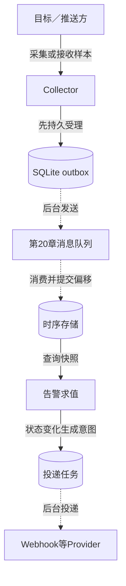
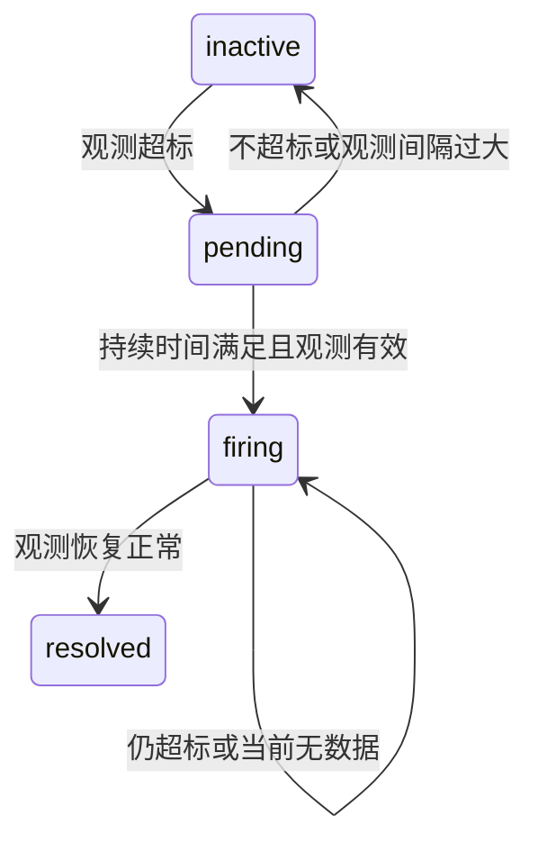

# 第21章：从一条CPU样本读懂监控与告警

先记住三件事：Collector负责可靠接收，时序库负责查询，告警器负责把查询结果变成通知。它们之间有队列和持久任务，所以“采集接口成功”“查询看到样本”“收到告警”是三个不同时间点。本项目使用第20章真实HTTP队列；通知可以指向实验自有webhook，不能据此推导商业告警平台的可用性。

## 用一个场景建立全貌

假设固定测试时钟，主机`host`上报`cpu=90`，规则为`cpu > 80`且持续60秒。第一次评估应进入`pending`；30秒后上报10再评估，不能触发持续告警。只有满足规则的后续有效观测才支持进入`firing`。这个例子对应[AlertTests.test_pending_flapping_firing_no_data_and_resolution](../tests/test_alerts.py#L65)，阅读时不要把“时间过去了”当成“持续观测到了超标”。



实线表示本阶段内的调用或写入，虚线表示后台推进；图中SQLite是本地持久状态，不是分布式TSDB。先掌握此路径，再学习降采样、采集归属和跨序列聚合。

## 数据究竟归谁管

| 对象 | 关键字段／身份 | 含义与阅读重点 |
|---|---|---|
| 样本 | `metric/type/labels/timestamp/value` | 标签与指标共同决定序列；同时间的冲突值不能静默覆盖 |
| Collector `outbox` | `partition/status/due/lease/owner/payload` | 发布前的持久意图；失败后保留原负载重试 |
| `spool_state.bytes` | 当前积压字节 | 与outbox受理／发送完成保持事务一致，用于背压 |
| 时序存储 | 批次身份与样本身份 | 接收重复批次和重复样本的契约都要检查 |
| 告警状态 | `state/since/updated/transition` | “何时开始超标”与“上次有观测”是两条时间线 |
| 投递任务 | 状态变化身份、重试状态 | 求值成功不等于外部通知已送达 |

## 按这六站读源码

1. [Collector.enqueue](../src/metrics_monitor/collector.py#L94)：看输入样本怎样变成有容量限制的持久outbox。输入是一批样本，输出是受理结果；此处先不追网络。
2. [Collector.flush_once](../src/metrics_monitor/collector.py#L190)：看任务如何领取以及网络调用发生在事务外。输入是队列适配器，输出是本轮是否成功发送；继续追`queue.publish`。
3. [consume_once](../src/metrics_monitor/pipeline.py#L16)：核对“先落库、后确认消费位置”的顺序。问自己：确认丢失后重放是否安全？
4. [Store.ingest](../src/metrics_monitor/storage.py#L54)：找到批次去重、样本冲突和基数限制。先关注事务整体回滚，再看具体索引。
5. [next_state](../src/metrics_monitor/alert_evaluation.py#L12)：暂时离开数据库，给纯状态函数输入前态、90、测试时钟和规则，手算下一个状态。
6. [Evaluation.evaluate](../src/metrics_monitor/alert_evaluation.py#L174)与[Delivery.notify_once](../src/metrics_monitor/alert_delivery.py#L55)：前者负责接受求值结果，后者处理投递。沿这条分界理解重复评估和重复通知。

## 微观一：发送在事务外，确认要带领取身份

[collector.py:190](../src/metrics_monitor/collector.py#L190)

```python
def flush_once(self, queue):
    owner = uuid.uuid4().hex
    with self.transaction(True) as db:
        now = self._now()
        item = db.execute(
            """SELECT o.* FROM outbox o WHERE o.status='pending' AND o.due<=? AND o.lease<=?
            AND NOT EXISTS(SELECT 1 FROM outbox p WHERE p.status='pending' AND p.partition=o.partition AND p.rowid<o.rowid)
            ORDER BY o.rowid LIMIT 1""",
            (now, now),
        ).fetchone()
        if not item:
            return False
        db.execute(
            "UPDATE outbox SET owner=?,lease=? WHERE id=?",
            (owner, now + 120, item["id"]),
        )
```

第一段SQL不仅找“到期任务”，还排除同分区更早的pending记录。因此同分区队首失败会阻止越过它，其他分区仍可推进。`owner`是这次领取的身份，不是永久Worker ID。

领取事务结束后才执行`queue.publish`，避免把网络等待放在SQLite写事务内。发送成功后的UPDATE还要求owner匹配；否则旧发送者可能把新领取者的任务清掉，并让字节数重复扣减。对应[PipelineTests.test_stale_claim_cannot_clear_new_claim_or_decrement_bytes_twice](../tests/test_pipeline_reliability.py#L133)：重点看旧claim完成后，积压计数和新claim是否仍正确。

## 微观二：告警不是一个布尔值

[alert_evaluation.py:34](../src/metrics_monitor/alert_evaluation.py#L34)

```python
    if active:
        if old not in ("pending", "firing"):
            since, state = now, "pending"
        if old == "firing" or now - since >= rule["for_seconds"]:
            state, emit = "firing", old != "firing"
    else:
        state, since, emit = (
            ("resolved" if old == "firing" else "inactive"),
            now,
            old == "firing",
        )
return state, since, transition + int(emit), emit
```

`since`保存本轮持续超标的起点，`for_seconds`决定何时可从pending进入firing。`emit`只在需要发布状态变化时为真；长期保持firing不等于每轮都生成一个新变化。上方完整函数还处理观测中断和无数据：已有firing不会仅因没有新数据就自动等同恢复。



该图省略静默与投递任务，避免把“状态求值”与“是否发送外部通知”混为一步。

## 跟踪一次失败

队列发布异常后，outbox保留pending并更新`attempts/due`，本轮返回False。下次尝试应复用负载，而不是重新采一条替代旧样本。存储端临时故障同样不能直接当坏消息确认丢弃；看[PipelineTests.test_temporary_storage_failure_is_not_poison_acknowledged](../tests/test_pipeline_reliability.py#L286)，观察消费确认是否被保留。

学习运行方式见[README_CN.md](../README_CN.md)。先读上述单元测试，再运行需要真实队列的示例；不必一开始同时调试全部实验进程。

## 检查自己是否理解

- **Collector返回成功，为什么查询可能还没有样本？** 成功是outbox受理，后台发送与消费入库尚未完成。
- **第一次90，60秒后没有新观测，能必然告警吗？** 不能，必须结合`max_age`和状态函数的缺测规则。
- **去掉owner条件会怎样？** 旧请求可能确认新领取任务，造成状态与字节计数错误。

练习：把上述规则持续时间从60改成0，预测第一次90会直接进入firing；再保持60并在30秒输入10，预测不会产生持续触发。用同一个测试时钟验证，不用真实等待一分钟。


---

[返回全仓库学习导航](../../docs/learning-guide_cn.md) · [项目运行说明](../README.md)

[导读原稿](../../tools/learning_guides/metrics-monitoring-system.md)。正文与图按当前实现编写；源码链接和摘录由生成器绑定到当前定义。修改行为后应同时复核案例、时序和解释，再重新生成；定义与链接校验不等同于业务回归测试。
