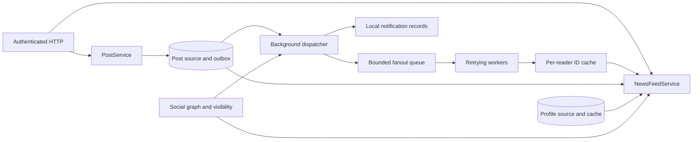

# Chapter 12 design

The application has separate publication and read paths. `NewsFeedAPI` composes storage, policies, caches, the queue and owned background tasks. See [requirements](requirements.md), [tasks](tasks.md) and the [chapter audit](chapter12-review.md) for acceptance criteria, book coverage and verification evidence.

## Responsibilities

- `post_service.py`: request snapshot/validation, authentication, admission and source acceptance. The API defers distribution to its owned dispatcher; standalone PostService can dispatch during publication for compatibility.
- `storage.py`, `sqlite_graph.py`, `policy.py`: authoritative post/profile stores, indexed graph and persistent mute adapter. Post ID conflicts are rejected. SQLite commits post data with a pending publication flag.
- `fanout_service.py`: choose push/pull by follower count and apply the shared visibility rule.
- `queue.py`, `worker.py`: capacity reservations survive claim/retry; receipts fence stale acknowledgements. Retries are idempotent at the feed ID cache.
- `news_feed_service.py`: merge a bounded page of push and pull candidates, enforce visibility, keyset pagination and hydrate display data.
- `http.py`: one shared event loop for all request threads, bounded HTTP concurrency and error translation. `api.py` owns startup, recovery and shutdown.

## Reads and consistency

Ordinary authors push batched IDs. Celebrities are queried by `(author_id, created_at, post_id)` index. A cold or expired first-page window and all historical cursor pages query eligible authors with at most 16 fixed tasks by default. A warm complete window reuses ordinary-author feed IDs and pulls celebrity posts. At most one page plus per-task query batches is held during merge. A bounded coverage ledger tracks relationship/mute/classification signatures and a non-sliding repair deadline.

Sort and cursor keys include timestamp and post ID. New posts cannot shift the cursor to repeat an earlier page. Follow/mute/sharing rules are checked again before return. Hydration reads content and author caches with source fallback, plus the local action/counter caches. Media remains a client-loadable URL.

The outbox confirms local dispatch rather than durable worker completion. Restart reconstructs feed content from indexed source; proactive notification delivery is not durable. Caches, engagement state and quotas are process-local. SQLite mute snapshots and graph caches require explicit refresh or TTL for external writes. Normal feed updates are eventually consistent.

## Read concurrency and request observations

The read service uses one shared fixed-worker pattern for cache-ID content loading, author classification, indexed author reads and profile hydration. Each phase is capped by `read_concurrency` (default 16), without one task per ID or author. Results are assembled in chronological order. Author pages merge as they arrive; completed author-page lists do not accumulate across the full graph. Failure/cancellation cancels sibling tasks and drains blocking source work before returning.

A fixed array of 64 async profile locks coalesces concurrent misses for the same author; it never grows with author count. Cache hits bypass these locks. Locks can serialize unrelated authors that hash to the same stripe; they protect process-local cache loading rather than cross-instance profile consistency.

`metrics.py` owns short thread-safe counter updates around public API operations. `api.metrics()` returns aggregate request/outcome/in-flight counts, lifetime latency count/total/mean/max in seconds, and request starts across 60 one-second buckets divided by 60 for approximate recent QPS. Labels are fixed to publish/retrieve; no per-request samples or identity/payload labels are retained. Measurement holds no lock across the operation. Publish success is source acceptance; HTTP pre-API rejection and asynchronous fanout completion are outside these counters. External aggregation/export/alerts remain integrations.

## Defaults and extension points

Queue capacity 10000 counts pending, delayed and claimed jobs; worker concurrency 4, batch size 100, retry count 3, dead-letter retention 100. Per-reader feed capacity 500; first-page repair interval 30 seconds; page size 20, maximum100; maximum following 5000. Most limits are configured via immutable validated config classes; worker retry and queue diagnostic limits are constructor options.

PostStore/UserStore protocols and Authenticator/SocialGraph interfaces isolate adapters. Replicated storage, shared cache/broker, consistent-hash sharding, global quotas, media/CDN provisioning, real push providers and multi-region control planes remain deployment integrations. The tests validate local behavior, not ten-million-DAU scale.
