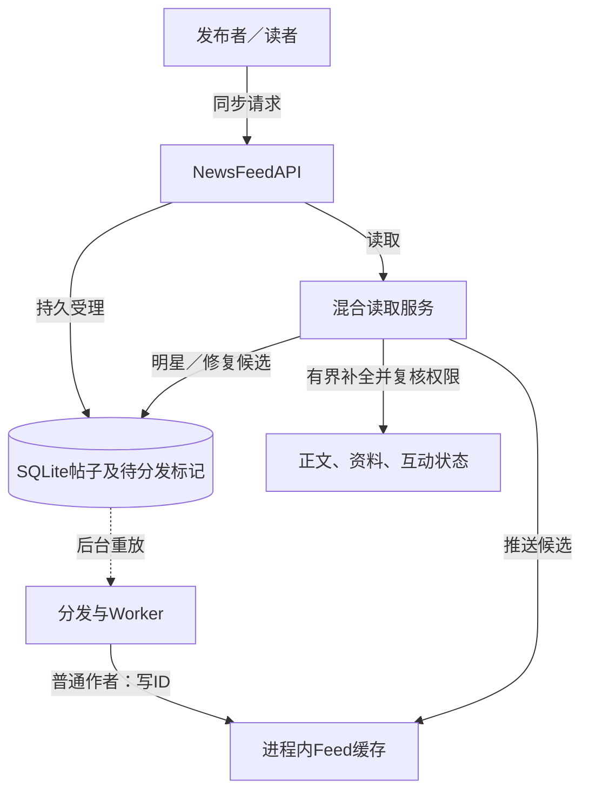
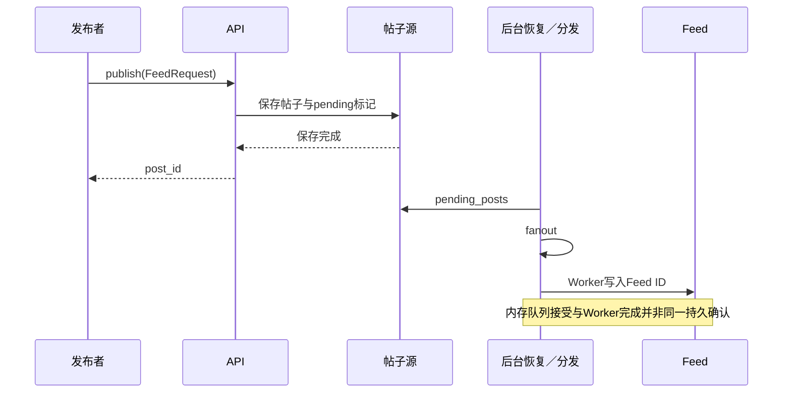

# 第12章：从一条动态看懂新闻动态系统

这个项目维护两件不同的东西：**作者确实发过什么**，以及**读者打开首页时应看见什么**。帖子存储负责前者，Feed缓存和混合推拉读取负责后者。先抓住这一区分，再看队列和缓存就容易理解。

本文选择带 `database_path` 的单机SQLite源存储方案。Feed、资料缓存和工作队列仍在进程内；真实推送、共享消息队列及跨机复制属于扩展边界。可先读 [README_CN.md](../README_CN.md) 的运行方式。

## 用这个例子贯穿读写

读者reader关注普通作者author和明星celebrity。为缩小例子，把明星阈值设为2，另一个用户也关注celebrity。

- author有动态n1、n3，时间分别为1、3；celebrity有动态c2，时间为2。
- reader请求首页，`page_size=2`，应得到n3、c2；author的资料、点赞状态和计数一并组装。
- 首页返回后出现更新的动态，旧游标继续翻页时仍应按原先的排序边界读取，不把新动态插回第二页。
- 读者静音或取消关注后，读取末尾仍要复核可见性，不能只相信此前写入的Feed。

这组输入和断言直接来自后面的混合读取测试。先记住返回顺序，再沿源码验证。

## 一眼看清谁保存什么



图中的虚线是后台阶段，发布返回和后台完成之间有时间差。Feed保存的主要是帖子身份与排序信息，正文没有必要复制到每个读者的Feed中。

| 数据 | 关键字段／结构 | 哪一层负责 | 阅读时的判断 |
|---|---|---|---|
| 帖子 | `post_id, author_id, created_at, content` | PostStore | 已受理事实，缓存丢失可回源；FeedEntry另用timestamp字段表示排序时间 |
| 待分发标记 | 帖子是否pending | 同一帖子源存储 | 与帖子接受一起提交 |
| Feed候选 | 帖子ID和时间 | NewsFeedCache | 有界派生数据，可能冷、旧或缺失 |
| 用户资料 | `user_id, username` 等 | UserStore／UserCache | 多条同作者动态可共用一次回源 |
| 可见性 | 关注、静音、选择性分享 | Graph／MuteStore及策略 | 返回前复核当前规则 |
| 游标 | 时间与帖子身份形成的边界 | cursor编码 | 不是简单的offset |

## 按这六站读代码

| 顺序 | 打开位置 | 这一站必须弄懂 | 下一站 |
|---|---|---|---|
| 1 | [NewsFeedAPI.__init__](../src/news_feed_system/api.py#L41) | 配置怎样选择SQLite；哪些组件仍在内存中；publisher为何关闭发布内直接分发 | publish |
| 2 | [NewsFeedAPI.publish](../src/news_feed_system/api.py#L189) | 输入FeedRequest，输出post_id；活动发布如何参与关闭屏障 | PostService |
| 3 | [PostService.publish](../src/news_feed_system/post_service.py#L43) | 先鉴权限流，再保存帖子；返回只承诺受理 | _dispatch |
| 4 | [PostService._dispatch](../src/news_feed_system/post_service.py#L79) | 待分发检查、投递和标记的次序；异常时为什么defer | fanout |
| 5 | [FanoutService.fanout](../src/news_feed_system/fanout_service.py#L144) | 普通作者推给关注者，明星作者避免大扇出 | retrieve |
| 6 | [NewsFeedService.retrieve](../src/news_feed_system/news_feed_service.py#L130) | 候选合并、补全、最终权限复核和next_cursor | 测试 |

不要先遍历五种缓存的所有方法。先把“受理→分发→读出一页”讲顺，再分别深入缓存淘汰或重试。

## 微观一：成功返回究竟发生在什么时候



[post_service.py:57](../src/news_feed_system/post_service.py#L57)

```python
)
# Source and pending outbox are committed atomically by cache.put.
await run_sync(self._post_cache.put, post)
if not self._dispatch_on_publish:
    return post.post_id
try:
    await self._dispatch(post)
except Exception:
    logger.exception("Post %s accepted; fanout pending", post.post_id)
return post.post_id
```

先观察`run_sync(...put...)`，再观察`dispatch_on_publish`。API的组合配置把分发交给后台恢复循环，因此响应不等待慢分发。直接构造PostService时默认配置可以不同；不要把单个类的默认值误当作API实际组装。

## 微观二：一次分发为什么可以重放

[post_service.py:79](../src/news_feed_system/post_service.py#L79)

```python
async def _dispatch(self, post: Post) -> bool:
    async with self._dispatch_lock:
        if not await run_sync(self._post_cache.store.is_pending, post.post_id):
            return False
        try:
            await self._fanout_service.fanout(post)
            if self._notification_service is not None:
                await self._notification_service.notify_followers(
                    post.author_id, post.post_id
                )
            await run_sync(self._post_cache.store.mark_dispatched, post.post_id)
        except Exception:
            await run_sync(self._post_cache.store.defer, post.post_id)
            raise
        return True
```

这段代码要按三件事读：

1. `is_pending`避免同一条源记录被重复推进；检查和分发受本服务的分发锁保护。
2. 正常路径先执行fanout／本地通知，再`mark_dispatched`。这不是分布式事务，部分工作可能已经发生。
3. 异常路径调用`defer`保留重放机会；Feed追加和任务处理也必须支持幂等，不能靠“永不重复”维持正确性。

## 微观三：为什么读取要重新找候选

从 [NewsFeedService._candidates](../src/news_feed_system/news_feed_service.py#L171) 看普通Feed与作者拉取如何合并，再看 [NewsFeedService._hydrate_posts](../src/news_feed_system/news_feed_service.py#L286) 如何保序补全。

例子里n3与c2来自不同路径，最终必须在同一个排序空间内比较。补全的并发完成顺序不能改变页面顺序；同作者资料未命中也不能让每条帖子都独立回源。最后的`can_view`检查覆盖读取过程中发生的静音或关注变化。

## 用两组测试检验理解

- [test_hybrid_hydration_and_stable_cursor_with_new_posts](../tests/test_chapter12.py#L98)：先预测首页为n3、c2，再检查资料、点赞状态和计数。继续阅读后半段，观察新帖出现后游标仍保持旧边界。
- [test_api_publication_accepts_before_slow_fanout](../tests/test_api_lifecycle.py#L92)：分发钩子故意报错，publish仍能返回，且post_store能读到帖子。该测试使用内存后端，只证明源受理不等待分发，不能单独证明SQLite持久化。
- [test_restart_recovers_posts_profiles_graph_and_mutes](../tests/test_chapter12.py#L151)：使用同一SQLite路径重建API，Feed缓存最初为空，解除静音后仍能从持久源恢复帖子和资料。用它核对本文所选SQLite方案的恢复边界。
- [test_parallel_hydration_rechecks_follow_and_mute_policy](../tests/test_chapter12_read_audit.py#L172)：观察测试何时改变关系，以及返回结果为何需要在最后再次过滤。

## 读懂了吗

**Feed丢了是否等于帖子丢了？** 不等于。Feed是派生候选，帖子源支持回源和修复；但普通热Feed仍存在最终一致窗口。

**为什么不能只取Feed里前两条就返回？** 可能包含已不可见帖子，也可能缺少明星或历史候选，需要继续补足页面并保持游标语义。

**发布成功是否保证用户已收到推送？** 不保证。源受理、内存队列处理和真实外部推送是不同阶段，这里通知也只是本地记录。

## 一个小练习

沿用n1、n3、c2的例子，把reader静音author。先预测第一页只剩celebrity的可见候选，再运行相关读取测试。重点观察过滤后是否继续补页；不要通过修改时间戳来掩盖排序问题。


---

[返回全仓库学习导航](../../docs/learning-guide_cn.md) · [项目运行说明](../README.md)

[导读原稿](../../tools/learning_guides/news-feed-system.md)。正文与图按当前实现编写；源码链接和摘录由生成器绑定到当前定义。修改行为后应同时复核案例、时序和解释，再重新生成；定义与链接校验不等同于业务回归测试。
