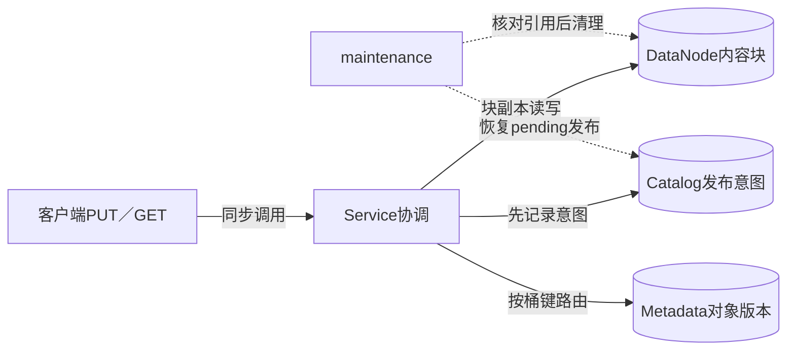
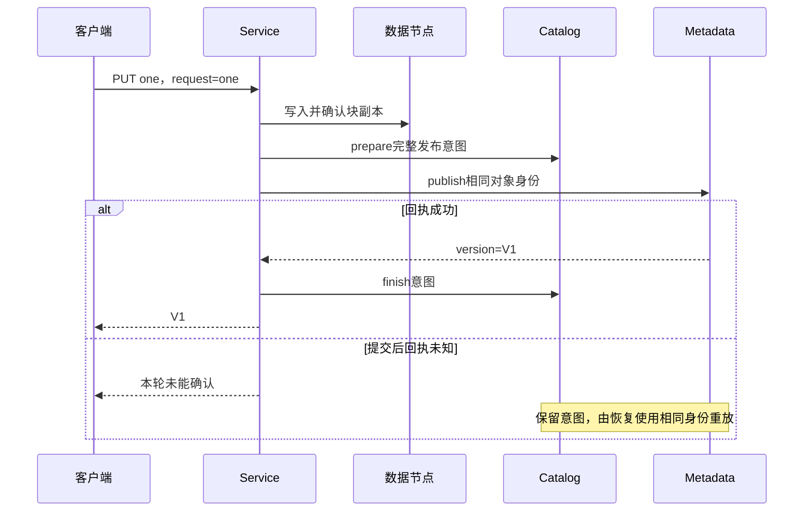

# 第25章：一个对象何时才算真正写成功

把对象拆成两层理解：数据节点保存内容块，元数据保存“哪个对象版本由哪些块组成”。块已经写入不代表新对象已经对读者可见。协调器通过持久发布意图连接这两层，才能在元数据请求超时后恢复，而不是贸然删除可能已发布的块。

本导读选择普通单次PUT路径。实验默认一个API目录协调器、两个元数据分片、三个数据节点，写入确认数由配置控制。它使用真实本机HTTP，不代表AWS S3协议兼容或生产耐久性承诺。

## 贯穿案例：上传one，再删除最新可见版本

对已有本人桶`bucket`的键`key`上传`b"one"`，幂等身份为`one`，大小3，校验值为其SHA256。成功得到版本V1。同内容、同身份再上传，应该仍是V1。之后发布delete marker，默认GET应视为已删除；显式历史版本仍保留其版本语义。



学习时先忽略多部分上传、稳定列举与压缩文件。先证明一次PUT的“块、意图、版本”分别何时存在，再展开其他功能。

## 三层数据不是同一回事

| 数据 | 关键字段 | 可否直接代表对象可读 |
|---|---|---|
| 数据块 | 内容hash、物理位置、块size | 不可；可能是未完成上传或旧版本引用 |
| `manifest` | 每块`hash/size` | 是拼装说明，仍需被某个有效对象版本引用 |
| 发布意图 | bucket/key/request及完整清单 | 表示可恢复的发布请求，不等于发布已确认 |
| Metadata版本 | `id/bucket/key/manifest/size/sha/marker` | 决定读者获取哪个对象版本 |
| delete marker | `marker=1` | 默认最新读返回删除语义，不是物理立即清空全部块 |

## 按这六站深入

1. [Service.put](../src/object_storage/service.py#L135)：从不可变bytes检查到store_bytes、publish，先明确响应前有哪两阶段。
2. [ChunkIO.store](../src/object_storage/chunk_io.py#L74)和[ChunkIO.write](../src/object_storage/chunk_io.py#L12)：输入对象bytes，输出块清单；这里才是副本写入与确认数量。
3. [Service.publish](../src/object_storage/service.py#L90)：找到prepare_publication、元数据RPC和finish_publication的顺序。
4. [Catalog.prepare_publication](../src/object_storage/catalog.py#L214)：核对完整意图如何持久保存，重试和相同身份冲突怎样处理。
5. [Metadata.publish](../src/object_storage/metadata.py#L45)：看同一对象请求如何得到同一version，版本记录才是可见性的依据。
6. [Service.get](../src/object_storage/service.py#L145)与[Service.maintenance](../src/object_storage/service.py#L280)：先从元数据读清单，再读块并核对整对象；最后理解pending发布为何影响GC安全。

## 微观一：检查整对象后才存块

[service.py:135](../src/object_storage/service.py#L135)

```python
def put(self, bucket, key, key_id, data, expected):
    object_key(key)
    identifier(key_id)
    if not isinstance(data, bytes) or len(data) > 4 * 1024 * 1024:
        raise Error(413, "single upload requires at most 4 MiB immutable bytes")
    if sha(data) != checksum(expected):
        raise Error(400, "whole-object checksum mismatch")
    manifest = self.store_bytes(data)
    return self.publish(bucket, key, key_id, manifest, len(data), expected)
```

这里的`expected`是调用方提供的整对象校验。先验证bytes大小与hash，再拆块，避免错误请求留下一批无意义块。`manifest`虽然已经生成，仍要调用publish才形成可见版本；`return`的含义跨越了两个存储子系统。

## 微观二：发布必须有可恢复意图

[service.py:93](../src/object_storage/service.py#L93)

```python
manifest = publication(
    bucket, key, key_id, manifest, size, checksum_value, marker
)
self.catalog.prepare_publication(
    bucket, key, key_id, manifest, size, checksum_value, marker
)
```

这几行先冻结／验证清单，再持久prepare意图，后面才调用元数据分片。元数据RPC如果提交后丢应答，意图仍可用原bucket、key、request、manifest重放。只有回执形状及version有效才finish。单纯“网络失败就删块”会误删已经发布版本的数据。



## 读取也必须验证身份和内容

GET不是“拿到一个manifest就信任它”。实现检查回执的bucket、key和可选version是否匹配，检查marker，读取所有块后再核对总size和sha。来源出错或数据损坏应明确失败，不能返回拼装出的错误内容。

案例中的删除也有两步入口：通过[Service.publish](../src/object_storage/service.py#L90)传入`marker=True`发布删除标记，默认GET随后按最新marker返回删除语义；再到[Metadata.remove](../src/object_storage/metadata.py#L95)读显式版本移除逻辑。移除marker版本会改变默认读取所见的最新版本，使V1重新可见。版本的`removed`标记改变逻辑可见性，实际块回收则要继续看maintenance和引用检查，不在删除标记时立即执行。

[CoreTests.test_versions_markers_idempotency_and_retention](../tests/test_core.py#L79)是本案例的最短阅读入口：同一request得到同一版本、改内容冲突、删除标记隐藏对象、移除标记后旧版本再可见。

[PublicationIntentTests.test_prepare_is_durable_and_pending_contains_complete_replay_payload](../tests/test_publication_intents.py#L37)检查恢复负载完整；[PublicationIntentTests.test_corrupt_payload_or_checksum_blocks_recovery_and_collection](../tests/test_publication_intents.py#L149)检查损坏时不能继续恢复或冒险回收。

## 自查与练习

- **块副本确认后客户端断开，能立刻GC吗？** 不行，可能存在未完成但需要恢复的发布意图或已发布引用。
- **同一幂等键换内容是否创建新版本？** 应冲突；换新请求身份才是另一次业务写入。
- **marker表示数据已经物理删除吗？** 不表示，历史版本和引用回收有自己的条件。

练习：按版本测试先发布one，再发布marker；记录默认GET与显式V1的不同结果。移除marker后默认GET应重新指向V1。网络实验与配置见[README_CN.md](../README_CN.md)。


---

[返回全仓库学习导航](../../docs/learning-guide_cn.md) · [项目运行说明](../README.md)

[导读原稿](../../tools/learning_guides/object-storage-system.md)。正文与图按当前实现编写；源码链接和摘录由生成器绑定到当前定义。修改行为后应同时复核案例、时序和解释，再重新生成；定义与链接校验不等同于业务回归测试。
