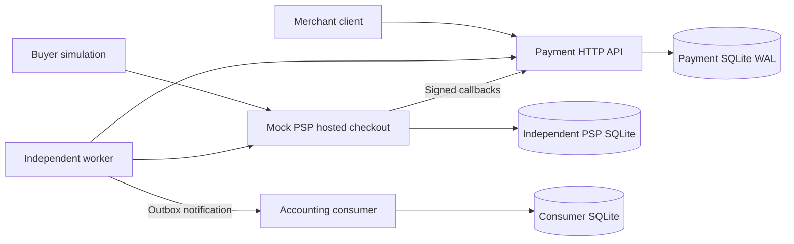
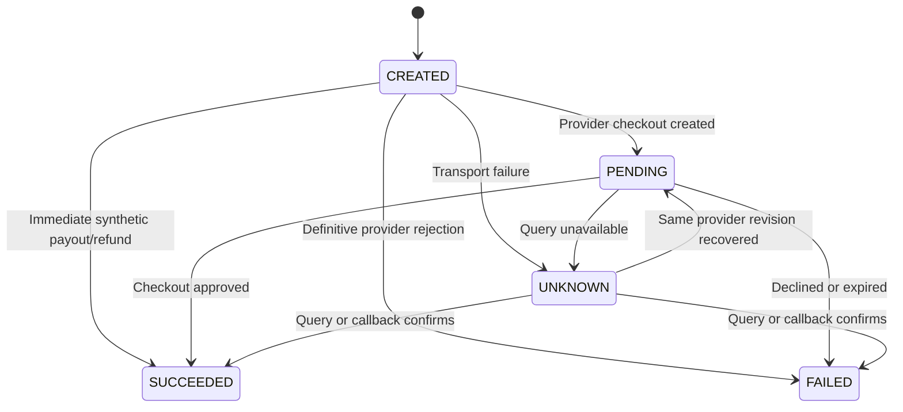

# Chapter 27 — Payment System Design

## Scope and topology

Based on root `System Design Interview.md`, chapter 27. This reference implements one USD pay-in per merchant order, tokenized synthetic checkout, payouts, partial refunds, wallet reservations, balanced ledger posting, provider recovery and asynchronous reconciliation. It does not use real payment services.

These are four real processes with three independent databases, rather than four simulated in-memory objects. The payment database remains a single authority. The merchant wallet is a projection updated inside the same transaction as the authoritative ledger, not a separately deployed wallet service. Separating it would require additional consistency and recovery protocols.

## Durable model and transaction boundary

`operations` freezes merchant, type, original order/parent payment, amount, currency and destination reference at acceptance. `(merchant, request_key)` ensures transport retry idempotency across operation types; the stored canonical request hash detects changed content. `(merchant, kind, order_id)` separately prevents charging an order with a different key. Refund and payout order IDs are null; their request keys identify distinct instructions.

`executions` is an append-only worker claim/outcome history. `jobs` is both execution queue and transactional outbox, with status, attempts, consecutive failures, due time, lease and claim token. `inbox` commits callback fingerprint/result in the same transaction as application. `ledger` headers and `lines` contain the operation ID, provider transaction ID on final entries and immutable balanced debits/credits. `wallets` caches available and held liability balances. `reviews` retains deterministic, deduplicated manual investigation records; `reconciliations` tracks asynchronous runs.

SQLite `BEGIN IMMEDIATE`, WAL, foreign keys and FULL synchronous writes serialize monetary mutations. Acceptance atomically creates an operation, reserves funds if needed, and inserts an execution job. Final application atomically posts the ledger, updates wallet and operation, acknowledges the execution job and inserts the terminal notification. Exceptions before commit roll back every effect. A process crash after commit leaves durable jobs for another claim.

All amounts are positive integer cents, bounded to 100,000,000 per instruction. JSON booleans/floats are rejected. Account identifiers reserve `:` as an internal separator. Payment API accepts exact fields and opaque test tokens only; it never accepts PAN or bank numbers.

## Ledger semantics

Merchant balances are liabilities; PSP clearing is a synthetic asset representing money held at the provider for merchants. It is not proof of actual bank settlement. For a pay-in of 10,000 cents, debit PSP clearing and credit merchant available. Reserving a 3,000-cent payout debits available and credits held. Its success debits held and credits PSP clearing; definite failure reverses the reservation. Refunds use the same reserve/settle/release pattern and retain the parent pay-in ID.

SQL triggers require a new header to start unposted, at least two nonzero one-sided lines, and zero debit-minus-credit sum before posting. Once posted, neither header nor lines may be changed or deleted. Unique `reserve:<operation>`, `settle:<operation>` and `release:<operation>` identities ensure local effects are applied once. Wallet updates require nonnegative results inside the same transaction. SQL administrators who can alter schema/triggers are outside the application security boundary.

Refund authorization checks both original charge success and `sum(nonfailed refunds) + requested <= original amount`; pending and unknown refunds count toward the cap. A merchant cannot refund another merchant's payment. Reservations protect available funds against concurrent payouts/refunds. Partial refunds can be refused after merchant funds have already been paid out; negative merchant balances/credit facilities are not implemented.

## State transitions and provider protocol

`UNKNOWN` is local uncertainty, never a provider terminal state. A ten-minute provider checkout remains pending until approval/decline, or expiration observed by query/checkout submission. A local timeout does not release payout/refund holds. A terminal operation cannot change terminal outcome; a conflicting terminal callback becomes a review. Older provider revisions are ignored. A pending result with the same provider revision can restore local UNKNOWN after query recovery.

The worker always queries using the immutable local operation ID. Only provider 404 permits creation; any ambiguous/unavailable response retries the query, not a fresh payment identity. The mock PSP independently stores a request hash keyed by operation ID and returns the same provider ID on replay. A query-404/create race is therefore safe even with overlapping workers. This relies on provider idempotency; a real adapter must document its retention, lookup and timeout guarantees before use.

Two-second leases permit recovery after worker loss; each claim gets a fresh token. Finishing with an old token fails. A slow worker may overlap a later claim, so leases alone do not guarantee single execution: PSP idempotency, revision checks and unique ledger identities are the effect boundary. A late signed terminal callback can complete an operation even if its execution job is in retry/dead state.

Five consecutive communication/processing failures dead-letter a job, recording a manual review. Exponential delays start at 0.2 seconds and reach 3.2 seconds on the fifth failure; no sixth automatic execution occurs. Normal PENDING polling uses 0.2 seconds without counting failures. Manual operation retry resets the same job/PSP identity; generic dead-job retry also preserves notification or reconciliation identity. Exhausted reconciliations report `failed`. Operators must restore dependencies before retrying; this reference has no production scheduler/alerting integration.

## Webhooks and internal events

Webhook signatures cover `timestamp + '.' + exact HTTP body bytes` using HMAC-SHA256 and constant-time comparison. A ±300-second timestamp check limits stale replay; durable inbox IDs suppress in-window replay. Reusing an event ID with another canonical payload returns 409. Callback fields are checked against the frozen operation, bound provider ID, supported status and monotonic revision. Validly signed mismatches are recorded for investigation and acknowledged without altering funds, to avoid an endless provider retry storm. A valid signature authenticates the mock provider, not the truth of an accounting claim; immutable-field checking remains necessary.

The PSP commits checkout changes together with durable callback jobs. Its single background dispatcher retries callbacks until acknowledged. Delivery may repeat after a crash or lost acknowledgement. Terminal notifications are independently delivered by the worker to a consumer with durable event-ID/hash deduplication. Consumer ACK loss results in repeated HTTP delivery but one event effect. A dead outbox job can be manually requeued with the same event ID. Exactly-once effects depend on these stores and IDs; no exactly-once network transport is claimed.

## Reconciliation

An admin request creates a durable reconciliation job. The worker fetches a complete, bounded mock-provider snapshot and asks the authority to compare:

- Frozen operation identity, amount/currency, bound provider ID and status against provider rows.
- Successful local operations against unique posted settlement entries.
- All wallet projections against account totals derived from posted lines.
- Total clearing assets against total merchant available plus held liabilities.
- Successful local transactions missing at the provider and orphan provider rows.

Differences create manual reviews and do not move money. The provider snapshot and local transaction are not a global atomic snapshot: in-flight operations can yield temporary provider-ahead differences. Re-run after jobs settle before concluding an accounting defect. Earlier reviews remain open pending human disposition even if a later run matches. No auto-repair, settlement-period cutoff, external signed bank statement, review resolution UI or streaming historical audit is implemented.

## Validation and operational limits

See `../benchmarks/REPORT.md` for reproducible commands and actual results. Tests inject failures both before local commit and after independent provider/consumer commits. HTTP tests exercise role isolation, hosted HTML, signature rejection, duplicate/reordered callbacks, restart with ambiguous funds, dead-letter recovery and statement drift.

Loopback-only HTTP and separate generated bearer tokens isolate the local exercise. This is not production TLS, key rotation, user checkout authorization, PCI compliance or real transaction processing. Merchant registration is static configuration. Checkout tokens are bearer capabilities. Mock control endpoints require admin credentials.

SQLite serializes writes and has no authority replica/automatic failover. The single demo worker polls rather than using a high-throughput broker; pending checkouts can increase queue/query load. PSP history is capped at 10,000 operations and HTTP responses at 8 MiB; ledger responses fail explicitly above 100 transactions, and status exposes the first 100 open reviews. Backups, partitions, reconciliation pagination, review pagination, production SLOs, atomic multi-merchant external charges, chargebacks, tax, fee allocation, multiple currencies and real PSP integrations remain outside this reference.

## Chapter 27 engineering review — 2026-10-27

Added trusted checkout orchestration: `POST /internal/checkouts` accepts
`{checkout_id,orders}` with1..20 orders. Each order contains merchant,order_id,
amount (integer USD cents) and currency. The internal credential is required;
a merchant token cannot create orders for other merchants. All operation IDs and
jobs are persisted in one SQL transaction; a bad later order rolls the whole
acceptance back. Reusing the checkout ID with changed content returns409.
`GET /internal/checkouts/{id}` returns the current independent order states.
External authorizations/settlements are independent: this is not one atomic
cross-merchant PSP charge. `GET /v1/payments/{id}` is a pay-in-only alias for the
existing owned operation view.

The Store facade separates schema, operation transitions, jobs, ledger,
reconciliation, checkout orchestration and value contracts. Values are frozen
before writer waits; one finite clock is sampled after acquiring each writer.
Ledger duplicate IDs verify the full original posting rather than silently
ignoring different accounts, amounts or provider identities. Provider-version
fingerprints persist independently of UNKNOWN state, so a previously observed
revision cannot change content and release a hold. Conflicts enter review.
Pre-upgrade revisions without a stored fingerprint cannot be retroactively
verified; their current state checks and independent reconciliation still apply.

The worker owns four executor threads by default (`worker_concurrency=1..16`).
HTTP claims use30-second leases, and each job shares a20-second total I/O budget.
Only an explicit provider404 permits creation with the original operation ID.
The returned receipt must match that claimed operation before application.
Finishing checks token and expiry, even if no replacement worker has claimed it.
Unknown outcomes retain funds and the original retry identity. Callback dispatch
uses separate15-second fenced claims and5-second I/O budgets; stale acknowledgements
cannot overwrite newer attempts. Notifications verify the consumer's event ID.

Reconciliation validates the complete bounded simulated statement, checksum,
unique operation/provider IDs and strict receipts before mutation. It requires
a live job claim at the internal HTTP boundary and preserves completed results.
Differences stay in the investigation queue; no automatic monetary adjustment.
Both authority and simulator cap operations at10000. Large histories still need
streaming snapshots, retention and an operational reconciliation process.

Direct HTTP disables proxies/redirects and validates JSON/framing. HTTP admits32
requests with15-second budgets; normal JSON input is1MiB, internal statements
up to8MiB, RPC responses8MiB. Strict paths/headers/roles reject ignored fields.
Bindings precede dispatcher startup; stop cancels sockets and drains owned threads.
Deadlines do not forcibly terminate arbitrary SQL/CPU/DNS/custom providers.

Final48tests passed21.561s, no skips, -Werror; baseline13tests16.541s.
Five tests use four independent processes. The new demo verified stable checkout
IDs, independent SUCCEEDED/FAILED outcomes across two merchants, payout/refund,
available500/held0,other wallet0,five postings,four unique PSP operations and
matching reconciliation. Original demo still balances5000cents/five postings.
20pay-ins/four clients:6.67completed/s,p50/p95537.585/697.339ms. The sample remains
below the book's10TPS example and is not sustained capacity or a controlled
speedup comparison. [Review](chapter27-review.md),[measurements](../benchmarks/REPORT.md).

No real PSP/card/bank service, AML/fraud provider, PCI certification, authority HA,
TLS,bank settlement,FX,fees,taxes,chargebacks or finance-review resolution UI has
been implemented or verified. All money is simulated. No commit or push.

Provider transaction IDs are also globally unique across local operations;
reuse enters review before posting. The database unique index is a second guard.
Legacy duplicate bindings must be audited before upgrading.
