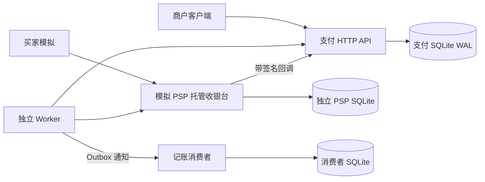
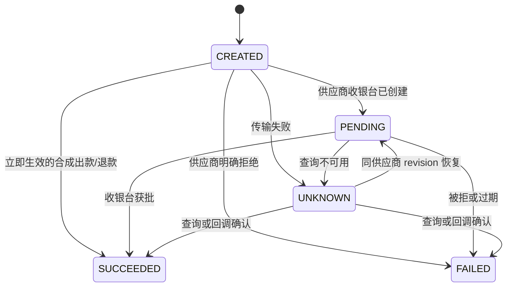

# 第27章 —— 支付系统设计

## 范围与拓扑

参考根目录《System Design Interview.md》第 27 章。本参考实现涵盖每笔商户订单一次 USD 入金、合成化模拟收银台、出款、部分退款、钱包预留、平衡式账本过账、供应商恢复以及异步对账。实现未接入任何真实支付服务。

以上是四个真实进程、三套独立数据库，而非同一进程内的四个模拟对象。支付数据库是唯一权威源。商户钱包是在与权威账本同一事务内更新的投影，并非独立部署的钱包服务；若拆分为独立服务，需额外实现一致性与恢复协议。

## 持久化模型与事务边界

`operations` 在受理时冻结商户、类型、原始订单/父支付、金额、币种及目标引用。`(merchant, request_key)` 保证跨操作类型的传输重试幂等性；持久化的规范请求哈希用于检测内容变更。`(merchant, kind, order_id)` 独立地防止对同一订单使用不同键重复扣款。退款和出款的 order_id 为 null，它们的 request_key 用于标识不同的指令。

`executions` 是只追加的 worker 申领/结果历史。`jobs` 同时充当执行队列和事务性 Outbox，包含状态、尝试次数、连续失败数、到期时间、租约和申领令牌。`inbox` 在与业务应用同一事务内提交回调指纹/结果。`ledger` 的 header 与 `lines` 存储操作 ID、最终条目中的供应商交易 ID 以及不可变的平衡借贷。`wallets` 缓存可用余额与负债中被占用余额。`reviews` 保留确定性、去重的人工调查记录；`reconciliations` 跟踪异步对账运行。

SQLite 的 `BEGIN IMMEDIATE`、WAL、外键与 FULL 同步写入将金额变更串行化。受理阶段以原子方式创建 operation、按需预留资金并插入 execution job。最终入账阶段以原子方式过账账本、更新钱包与 operation、确认 execution job 并插入终态通知。提交前发生的异常会回滚所有效果；提交后进程崩溃则将持久化的 job 留给其他 worker 申领。

所有金额均为正整数美分，单条指令上限 100,000,000。JSON 布尔值/浮点数会被拒绝。账户标识符保留 `:` 作为内部分隔符。支付 API 只接受精确字段和不透明测试令牌，绝不接收 PAN 或银行账号。

## Ledger（账本）语义

商户余额是负债；PSP 清算是一种合成资产，表示供应商代为商户持有的资金，并非实际银行结算的证明。一笔 10,000 美分的入金，应借记 PSP 清算并贷记商户可用余额。为一笔 3,000 美分出款预留资金时，借记可用余额并贷记占用余额；出款成功则借记占用余额并贷记 PSP 清算；明确失败则回滚预留。退款采用相同的预留/结算/释放模式，并保留父入金 ID。

SQL 触发器要求新建 header 以未过账状态开始、至少两条非零单向 line、过账前借贷差为零。一旦过账，header 与 line 均不得修改或删除。唯一的 `reserve:<operation>`、`settle:<operation>` 和 `release:<operation>` 标识保证本地效果只应用一次。钱包更新要求同一事务内结果不为负。有权修改 schema/trigger 的 SQL 管理员在应用安全边界之外。

退款授权检查原扣款是否成功，并验证 `sum(未失败退款) + 本次申请 <= 原金额`；pending 和 unknown 状态的退款都计入上限。一个商户不能对另一商户的支付发起退款。预留机制保护可用资金，防止并发出款/退款。在商户资金已出款后，部分退款可能被拒绝；不支持负商户余额或授信额度。

## 状态转换与供应商协议

`UNKNOWN` 是本地不确定性，绝不是供应商的终态。供应商收银台在获批/被拒前保持 pending，或在查询/收银台提交中观察到过期。本地超时不会释放出款/退款的占用。终态 operation 不能再变更终局结果；冲突的终态回调会成为 review。较旧的供应商 revision 会被忽略。同一供应商 revision 下的 pending 结果可在查询恢复后将本地 UNKNOWN 还原为 PENDING。

Worker 始终使用不可变的本地 operation ID 发起查询。只有供应商返回 404 才允许创建；任何不明确/不可用的响应都会重试查询，而非创建新的支付身份。模拟 PSP 独立存储以 operation ID 为键的请求哈希，重放时返回同一供应商 ID，因此即使有重叠的 worker，query-404/create 的竞争也是安全的。这依赖供应商幂等性；真实适配器使用前必须记录其保留、查询和超时保证。

两秒租约允许在 worker 丢失后恢复，每次申领获取新令牌。使用旧令牌结束任务会失败。慢速 worker 可能与后续申领重叠，因此租约本身不能保证单次执行：PSP 幂等、revision 检查以及唯一的账本身份才是效果边界。迟到的带签名终态回调仍可完成 operation，即使其 execution job 已处于重试或 dead 状态。

连续五次通信/处理失败将 job 置为死信并记录人工复核。指数退避从 0.2 秒开始，第五次失败时达到 3.2 秒；不会进行第六次自动执行。正常 PENDING 轮询使用 0.2 秒，不计入失败次数。人工 operation 重试重置同一 job/PSP 身份；通用死信重试也保留通知或对账身份。耗尽的对账运行报告 `failed`，操作员必须在重试前恢复依赖。本参考实现不包含生产调度/告警集成。

## Webhook 与内部事件

Webhook 签名以 `timestamp + '.' + 精确 HTTP 主体字节` 为输入，使用 HMAC-SHA256 和恒定时间比较。±300 秒的时间戳检查限制陈旧重放；持久化 inbox ID 抑制窗口内重放。使用另一条规范负载重用同一事件 ID 返回 409。回调字段会与冻结的 operation、绑定的供应商 ID、支持的状态和单调递增的 revision 进行比对。有效签名下的字段不匹配会被记录为调查对象并在不改变资金的前提下被确认，以避免触发无休止的供应商重试风暴。有效签名只证明来自模拟供应商的认证，并不证明记账主张的真实性；不可变字段检查仍然必要。

PSP 将收银台变更与持久化 callback job 一并提交。其单一后台分发器重试回调直到被确认。崩溃或丢失确认后投递可能重复。终态通知由 worker 独立投递到带有事件-ID/哈希去重的消费者。消费者 ACK 丢失会导致 HTTP 重复投递，但同一事件只会有一次效果。死信的 outbox job 可手动以相同事件 ID 重新入队。恰好一次效果依赖上述存储与 ID，而非网络层恰好一次投递。

## Reconciliation（对账）

管理员请求创建持久化的对账 job。Worker 获取完整、有界的模拟供应商快照并让权威源进行比对：

- 冻结的 operation 身份、金额/币种、绑定的供应商 ID 与状态 vs. 供应商数据行。
- 本地成功 operation vs. 唯一已过账结算条目。
- 所有钱包投影 vs. 由已过账 line 汇总的账户总额。
- 总清算资产 vs. 商户可用余额与占用负债之和。
- 供应商侧缺失的本地成功交易、孤立的供应商数据行。

差异会创建人工复核，不会直接改动资金。供应商快照与本地事务并非全局原子快照：运行中的 operation 可能产生临时的供应商领先差异。应在所有 job 结算完成后再次运行，才能判断是否存在记账缺陷。早先的复核在得到人工处理前保持打开，即使后续运行已匹配。不实现自动修复、结算期截止、外部签名银行对账单、复核解决 UI 或流式历史审计。

## 校验与运行限制

可复现的命令和实际结果见 `../benchmarks/REPORT.md`。测试覆盖本地提交前和独立供应商/消费者提交后的故障注入。HTTP 测试覆盖角色隔离、托管 HTML、签名拒绝、重复/乱序回调、资金不明确状态下重启、死信恢复和账本漂移。

仅回环 HTTP 和分别生成的 bearer token 隔离了本地演练。这不代表生产 TLS、密钥轮换、用户收银台授权、PCI 合规或真实交易处理。商户注册使用静态配置。收银台令牌是 bearer 能力。模拟控制端点需要管理员凭据。

SQLite 串行化写入，没有权威副本或自动故障转移。单 worker 进程以4个执行线程采用轮询而非高吞吐 broker；pending 收银台会增加队列/查询负载。PSP 历史上限 10,000 条 operation，HTTP 响应上限 8 MiB；账本响应超过 100 笔交易时显式失败，状态接口展示前 100 条开放复核。备份、分区、对账分页、复核分页、生产 SLO、跨商户原子外部扣款、拒付、税费、费用分摊、多币种和真实 PSP 集成均不在本参考范围内。

## 第27章工程复核（2026-10-27）

新增可信订单编排 `POST /internal/checkouts`，正文 `{checkout_id,orders}`，每次1..20笔；
订单字段为merchant/order_id/amount/currency，金额仍为USD整数美分。只允许内部令牌，
商户令牌不能为其他商户建单。所有操作ID和任务同一SQL事务持久化，后续订单无效则全部受理回滚；
同checkout ID改变内容返回409。`GET /internal/checkouts/{id}` 查询各笔独立状态。
外部授权/结算逐笔进行，不是跨商户一次原子扣款。新增 `GET /v1/payments/{id}` 为本人pay-in查询别名。

Store门面拆schema/操作/任务/账本/对账/checkout/契约；输入锁前冻结，writer后单次校验采时。
相同账本ID须核对原分录的账户、金额和供应商身份，不静默忽略冲突。供应商revision指纹独立持久化，
即使本地转UNKNOWN，已观察版本也不能改内容释放冻结资金；冲突进入复核。旧版没有记录的历史指纹
无法追溯校验，仍依靠当前状态检查和独立对账。

默认4个执行线程，配置 `worker_concurrency=1..16`。HTTP认领租约30秒，每任务共享20秒I/O预算，
只有明确PSP404才用原操作ID创建，回执必须属于当前任务才可应用。finish同时校验token与到期，
不要求先有新worker重领。未知结果保留冻结和原身份。回调分发独立15秒租约/5秒预算，旧ACK不能
覆盖新尝试；通知核对消费者事件ID。对账先验证完整有界账单、摘要、唯一身份和严格回执，
内部提交须有有效job租约，已完成结果不被重写；差异仅入复核，不自动改资金。
权威与模拟PSP各最多10000操作，生产大历史仍需流式、保留与完整对账运维。

HTTP默认32准入/15秒预算，普通JSON正文1MiB、内部对账8MiB、RPC响应8MiB。
禁代理/重定向，严格JSON/framing/路由/凭据/额外字段；绑定后启动后台，退出取消socket并排空线程。
无法强杀任意SQL/CPU/DNS或自定义provider。最终48项通过21.561秒，无跳过、-Werror；
基线13项16.541秒，其中5项用真实四进程HTTP。新增演示验证两商户独立成功/失败、同ID重试、
出款/退款后可用500/冻结0、另一商户0、5笔分录/4个唯一PSP操作及对账一致；原演示5000美分/5笔分录仍通过。
20笔/4客户端测得6.67笔完成/秒，p50/p95537.585/697.339ms，仍低于原书10TPS示例，
不是持续容量或受控提速证明。见[章节记录](chapter27-review.md)和[实测报告](../benchmarks/REPORT.md)。

真实PSP/卡/银行、AML/反欺诈、PCI认证、权威HA、TLS、银行结算、FX/手续费/税/拒付与复核结案UI
仍未实现或验收；所有资金均模拟。未提交或推送。

供应商交易ID在本地操作间全局唯一，复用先入复核、不入账，数据库唯一索引再次保护；
旧库如有重复绑定须先审计再升级。
