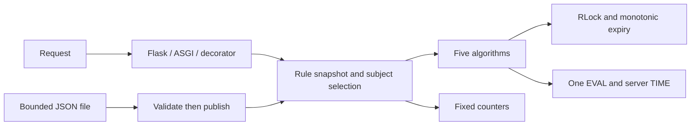

# Chapter 5 implementation design

The policy core depends on algorithm and storage interfaces. Framework adapters
share responses.py; neither storage nor algorithms import a web framework.
rule_files.py owns strict file parsing and an optional joinable poller; queue.py
owns optional FIFO execution. See [review](chapter05-review.md).

## Policy ownership

Configuration and all rules are copied on construction/update. Readers receive
copies. A request snapshots the complete rule list under an RLock, then resolves
paths/keys and performs storage work without the configuration lock. Invalid
updates cannot publish a partial rule set. Polling hashes and parses the same
bounded bytes and retains the old configuration on error.

Path selection uses case-sensitive fnmatch over a query-free URL path. A plain
string subject matches only unfiltered rules. Named key types resolve through
the shared keys module; custom callbacks are trusted application code.
Repeated identical policies within a request are deduplicated.

State identity is SHA256 of policy metadata and SHA256 of the subject, under
prefix:v2:{subject_hash}:scope_hash. Both check() and check_request() isolate
different rules. A 512-entry LRU caches only policy digests, never subjects.
Custom closure identity requires an explicit stable name to distinguish captured
values. The general decorator scopes quota by decorated function qualified name.

Multiple rules charge sequentially, without group rollback; the longest denied
retry delay wins. A later denial can still consume earlier quota. Update/restart
does not migrate old keys. Different policy parameters and the v2 migration
start independent quotas.

## Atomic adapters and clocks

Each algorithm has a Lua implementation and a Python callback. RedisStorage adds
a declared clock key, reads TIME inside EVAL, clamps against a retained watermark,
then runs the algorithm and publishes the clock. MemoryStorage samples inside
the algorithm lock and uses the same watermark policy. Clock regression adds its
offset to retry/reset delays. A failed callback/script does not advance the clock,
but earlier algorithm writes may remain: mutual exclusion is not rollback.

Clock metadata lives for at least two configured windows/bucket drain durations.
Memory TTL deadlines use monotonic time. Redis TTL/server wall time and restart
can discard retained state; no claim covers arbitrary server-clock jumps or data
loss. Client clocks are ignored by Redis. Lua results are checked for five fields,
integer counters, valid flags, finite nonnegative times and consistent decisions;
the core additionally checks the configured response capacity.

Token bucket and virtual leaking bucket use rate=limit/window and optional
capacity. Whole-request leaking admission requires occupancy+1<=capacity; retry
is the exact missing space/drain rate. Sliding log stores accepted requests only,
each with a UUID even at the same timestamp. Sliding counter remains an approximation.

## Resource ownership

Memory keeps at most100000 keys. Routine sweeps touch at most64 expiry entries
per50ms, pressure sweeps at most128; no full live-map scan on each overflow and
no live eviction that would reset quotas. Cleanup is opportunistic, not a timer
thread. Capacity may fail before all expired entries are found. All memory
operations still share an RLock; this is process-local, not global coordination.

Redis has bounded connections and explicit connect/read timeouts. No command is
automatically retried after connection/timeout errors: check-and-charge is not
idempotent. Missing responses can leave uncertain charges. Fail-open/closed are
explicit policies, and storage_errors remains visible in fixed metrics. Redis
script state and arbitrary custom callbacks are not rollback transactions.
Close storage after draining users; use a standalone Redis primary. Sliding
counter derives window keys in Lua, so Cluster/HA are not implemented.

RuleReloader and LeakyBucketQueue are non-daemon, explicitly owned context
managers. Reload close interrupts interval waiting and joins. Queue close cancels
pending Futures and joins the current bounded callback. FIFO pacing limits starts,
not completion times; callbacks may return out-of-band effects without durability.

## Adapter contract

Flask/FastAPI share rejection bodies and header formatting. The two header flags
apply to both outcomes. Retry-After is a positive integer delta in seconds;
X-RateLimit-Reset is a relative, rounded-up algorithm reset horizon. Error bodies
retain fractional retry detail. Default status429 can be configured4xx/5xx.
The universal decorator returns a dictionary unless configured to raise.

ASGI and async decorators offload synchronous checks. A cancelled caller can
leave a running check that still charges quota. Storage I/O does not block the
event loop but thread capacity and storage deadlines still bound service behavior.

Peer IP is the default; forwarded headers need explicit trusted-proxy setup.
Credential hashes are deterministic but do not authenticate input. Composite
keys remain the caller's choice; use unambiguous components if values contain
their separator. Metrics have no subject labels and count rules, not requests.

## Verification and limits

See [measurements](../benchmarks/REPORT.md). Five algorithms are tested with200
concurrent memory checks at a fixed injected time. The separate Redis8.0.5 probe
uses four synchronized processes with skewed timestamps and two real HTTP
instances. Unit tests use fakeredis for portable backend coverage; those are not
the real distributed evidence.

No edge routing, multi-region quota synchronization, durable distributed FIFO,
Redis failover, authentication service or adaptive policy inference is included.
The log intentionally counts accepted requests rather than unbounded denied
attempts; this differs from the book's illustrative log and bounds state.
