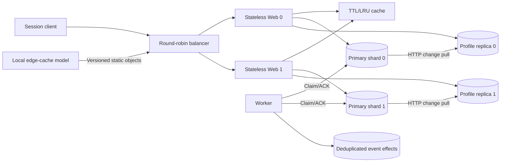

# Chapter 2 — Staged scaling laboratory

## Educational scope

The source chapter moves from a single server to stateless web scaling, database replication, cache, CDN, multiple data centers, queues and data sharding. This implementation makes a bounded subset executable with real local HTTP, while distinguishing models and unimplemented deployment capabilities. It does not assert millions of active users, cloud/CDN integration, multi-region replication or production availability.

The `single` stage runs app/database and a consumer thread in one process. `balanced` has eight service processes with one primary/replica pair; `sharded` has ten with two pairs. Each lab uses independent files, private ports and only owned child cleanup. Transitions are separate deployments, not live migration of the same data directory. DNS, geographic routing, vertical hardware resizing and autoscaling remain design discussion rather than simulated success claims.

## Request routing and sessions

Web nodes own no durable profiles or sessions. Static generated synthetic login credentials are shared configuration, while bearer session hashes/user/expiry live on the routed primary. Tokens carry a validated username prefix for routing and a high-entropy opaque suffix; the suffix is never trusted without a primary lookup. Expiry is one hour. This demonstrates session-independent web routing, not secure production identity lifecycle, password storage, TLS, cookie/CSRF policy or KYC.

The load balancer rotates initial web choice and retries another web on request-time failures. GET is safe to retry; profile mutations carry stable request keys; login is not automatically retried. It forwards no admin/internal routes. This is not a background health/election controller. A primary/session outage can make both web nodes fail for the affected user, which adding web replicas does not fix.

## Primary transactions and static sharding

User routing is SHA256(user) modulo configured primary count. A data file records its count/index and refuses changed topology, preventing silent in-place rehashing. There is no online migration or dynamic membership. User names in the demonstration deliberately route to separate shards; all user writes/reads/sessions use the same mapping.

`users` stores a versioned synthetic profile. `requests` persists per-user command hashes and original results. A SQLite `BEGIN IMMEDIATE` transaction checks expected version and idempotency, updates the profile, appends a change and enqueues a stable outbox event. WAL/FULL synchronous settings preserve local commits. Duplicate identical keys return the original result; changed content or stale expected version is409. Two different concurrent keys using the same expected version cannot both overwrite the profile.

The change stream contains contiguous shard-local sequence, user, new version/profile and checksum. Replica pull applies change and cursor atomically, rejects gaps/corruption/conflicting replay, and ignores identical duplicates. Replicas preserve changes/profile state only; they do not hold primary session/request/outbox state and cannot safely be promoted. Profile history is bounded to1000 mutations per primary in this reference.

## Cache and read consistency

Shared cache is a separate volatile process with32-entry LRU and2-second monotonic TTL. Cache values are copied on get/put to avoid object mutation leakage. Cache-aside reads try cache, then matching read replica, then primary on errors/missing profile. Writes commit before best-effort invalidation; cache failure never rolls back a successful write. Cache restart loses derived data only.

Eventual reads can be stale. Cache fill/invalidate races exist, and a lagging replica can refill stale values after TTL. Therefore the TTL is not a staleness SLA. `min_version` filters cache/replica versions and falls back to primary; `consistency=strong` bypasses both. A required version newer than the primary returns409. No cross-shard atomic read is offered. Session authentication always contacts the primary even for a cache hit, so cache hit reductions describe **profile** queries, not all primary traffic.

Failure of the read replica routes profile reads to the primary; failure of the primary does not trigger promotion. Other shards continue with their own primaries, and worker polling isolates per-shard transport failures. There is no cross-host replication, distributed transaction or independent failure-domain guarantee.

## Durable asynchronous work

Profile change and outbox insertion commit together. A worker claims tasks using a one-second lease plus fresh token, persists a deduplicated effect in its own inbox, then acknowledges the source. Reclaiming after a lost ACK uses the same event ID; repeating delivery increments attempt count but not effect count. Old claim tokens cannot acknowledge a newer claim. In the single-process stage, a local thread uses the same protocol without HTTP.

`lose_ack` fault control deliberately suppresses acknowledgement after recording the effect. Restart recovers the existing inbox and source lease. Effects are synthetic notification/audit records, not real outbound messages. The queue retries indefinitely; it has no dead-letter policy, fairness guarantee, broker replication or ordering guarantee across versions/shards. This is a durable outbox exercise, not the later distributed-message-queue implementation.

## Local edge model and diagnostics

Static origin assets have versioned path identities. A separate local edge process caches their JSON content for30 seconds; edge loss can be handled by explicitly reading origin. There is no provider API, GeoDNS, global POP, TLS, byte-range HTTP cache or browser DNS fallback. The label on edge output explicitly identifies the model.

Per-process diagnostic counters expose balancer fallback, web identity, primary profile reads, replica cursor, cache hits/misses/evictions and job delivery state. Counters are instructional, mostly ephemeral. They are not comprehensive monitoring, tracing, alerts or capacity automation. Benchmark stages are measured separately without a test load; adding extra HTTP hops at tiny local scale may lower throughput even while reducing primary profile reads.

## Validation and production extensions

Nineteen tests cover concurrent idempotency/CAS, session persistence/expiry, replication gap/checksum/replay, LRU/TTL/version reads, lease fencing, topology-change refusal, actual1/8/10-process requests, web/cache/replica failures, primary restart/shard isolation, consumer ACK loss and edge-origin access. See `../benchmarks/REPORT.md` for final commands and measurements.

The experiment is bounded and one-host. Primaries, session dependencies, balancer, consumer and cache/edge each retain individual failure modes. Production extensions require real database HA and recovery fencing, replicated sessions, load-balancer redundancy, real CDN/GeoDNS, regional synchronization, migration protocols, security, independent monitoring and relevant long-running capacity/failure tests. The local sample cannot establish any of those properties by process count alone.

## Engineering organization (2026-10-23)

Routing policy lives in balancer.py; background single-step operations and owned-thread shutdown live in workers.py. Cache owns its lock, copies snapshots outside the metadata lock, and no longer requires HTTP callers to synchronize it. Profile POST retries require its idempotency key; login is never replayed merely because its body contains request_id. Eight additional regressions cover these contracts.
