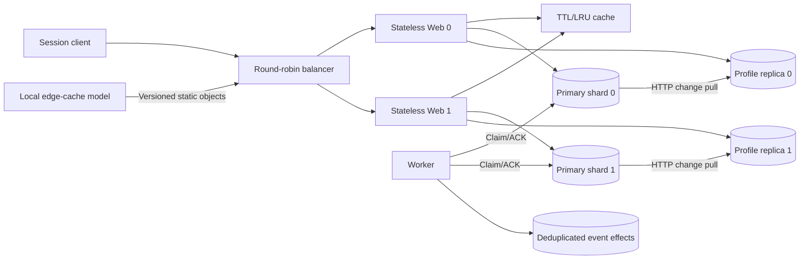

# 第 2 章 — 分阶段扩容实验

## 教学范围

原始章节从单机服务器演进到无状态 Web 扩容、数据库复制、缓存、CDN、多数据中心、队列与数据分片。本实现选取一个有界子集，用真实的本地 HTTP 使其可执行，同时区分设计模型与未实现的部署能力。它不宣称百万级活跃用户、云/CDN 集成、多地域复制或生产级可用性。

`single` 阶段在一个进程内运行应用/数据库和一个消费者线程。`balanced` 阶段有八个服务进程，含一组主从副本；`sharded` 阶段有十个服务进程，含两组主从副本。每个实验使用独立文件、私有端口，并仅清理自己启动的子进程。阶段间切换是独立部署，不是对同一数据目录的在线迁移。DNS、地理路由、垂直硬件调整与自动扩容仍停留在设计讨论层面，不模拟成功实现。

## 请求路由与会话

Web 节点不持有持久化用户资料或会话。静态生成的合成登录凭证作为共享配置；而 bearer 会话哈希、用户标识、过期时间保存在路由到的主库上。令牌携带一个经过校验的用户名前缀用于路由，以及一个高熵的不透明后缀；后缀在未经主库查询前绝不可信。会话过期时间为一小时。本实现演示的是会话无关的 Web 路由，而非安全的生产级身份生命周期、密码存储、TLS、Cookie/CSRF 策略或 KYC。

负载均衡器以轮询方式选择初始 Web 节点，并在请求时故障时重试另一个 Web 节点。GET 请求可以安全重试；资料变更请求携带稳定的请求键；登录请求不会自动重试。它不会转发管理/内部路由。这不是一个后台健康检查/选举控制器。主库/会话中断会导致受影响用户的两个 Web 节点均失败，增加 Web 副本并不能修复此类故障。

## 主库事务与静态分片

用户路由方式为 `SHA256(user)` 对配置的主库数量取模。数据文件记录了分片数量与索引，并拒绝拓扑变更，以防止静默的原地重哈希。不提供在线迁移或动态成员管理。演示所用的用户名刻意路由到不同分片；所有用户的写入、读取、会话均使用相同映射。

`users` 表存储带版本的合成用户资料。`requests` 表持久化每用户命令哈希及原始结果。SQLite `BEGIN IMMEDIATE` 事务检查期望版本与幂等性，更新资料，追加一条变更记录，并将一个稳定的 Outbox（发件箱）事件入队。WAL/FULL 同步设置保障本地提交。相同的重复键返回原始结果；内容变更或期望版本过旧返回 409。两个不同的并发键若使用相同期望版本，不能同时覆盖资料。

变更流包含分片本地的连续序号、用户名、新版本/资料及校验和。副本拉取时以原子方式应用变更与游标，拒绝间隙、损坏或冲突回放，并忽略相同的重复。副本仅保存变更与资料状态；它们不持有主库的会话/请求/Outbox 状态，因此不能安全提升。在本参考实现中，每个主库的资料历史最多保留 1000 次变更。

## 缓存与读一致性

共享缓存是一个独立的易失性进程，使用 32 条目 LRU 与 2 秒单调递增 TTL。缓存值在 get/put 时复制，以避免对象突变泄漏。Cache-aside（旁路）读流程：先尝试缓存，失败则匹配读副本，错误或资料缺失时回退主库。写入先提交，再尽力而为地失效缓存；缓存失败绝不回退已成功的写入。缓存重启仅丢失派生数据。

最终一致的读可能是陈旧的。代际令牌阻止已观察到的失效之前启动的旧填充，保留版本下限拒绝低于观察结果的版本；失效失败、重启或下限逐出时仍可能重新填充陈旧副本值。因此 TTL 不是陈旧度 SLA。`min_version` 可过滤缓存/副本版本并回退主库；`consistency=strong` 同时绕过缓存与副本。若请求的版本比主库还新，则返回 409。不提供跨分片原子读。会话认证即使命中缓存也必须联系主库，因此缓存命中减少描述的是**资料**查询，而非全部主库流量。

读副本故障时，资料读路由到主库；主库故障不会触发提升。其他分片继续使用各自的主库，而 Worker 轮询隔离了每分片的传输故障。不存在跨主机复制、分布式事务或独立故障域保障。

## 持久异步工作

资料变更与 Outbox 插入在同一事务中提交。Worker 使用五秒租约（Store.claim直接调用的兼容默认值仍为一秒）加新令牌来认领任务，在自己的 inbox 中持久化一个去重后的效果记录，然后向源端确认。ACK 丢失后重新认领使用同一事件 ID；重复投递会增加尝试次数但不增加效果次数。旧的认领令牌无法确认更新后的认领。在单进程阶段，本地线程使用相同协议但不走 HTTP。

`lose_ack` 故障控制会在写入效果后故意抑制确认。重启后恢复已有 inbox 和源端租约。效果记录是合成的通知/审计记录，不是真实的出站消息。队列无限重试；没有死信策略、公平性保障、Broker 复制或跨版本/分片的顺序保障。这是一个持久 Outbox 练习，而非后续的分布式消息队列实现。

## 本地边缘模型与诊断

静态源资产拥有带版本的路径标识。一个独立的本地边缘进程缓存其 JSON 内容 30 秒；边缘丢失可通过显式读取源端来处理。不存在运营商 API、GeoDNS、全局 POP、TLS、字节范围 HTTP 缓存或浏览器 DNS 回退。边缘输出上的标签会显式标识此模型。

每进程诊断计数器暴露：负载均衡器回退、Web 身份、主库资料读取、副本游标、缓存命中/未命中/逐出，以及任务投递状态。这些计数器用于教学，大多是短命的。它们不是完备的监控、追踪、告警或容量自动化。各阶段基准独立测量且不带测试负载；在极小本地规模下增加额外 HTTP 跳数，可能反而降低吞吐，即使它减少了主库资料读取次数。

## 验证与生产扩展

66 项测试覆盖：并发幂等/CAS、会话持久化/过期、复制间隙/校验和/回放、LRU/TTL/版本读取、租约栅栏、拓扑变更拒绝、实际 1/8/10 进程请求、Web/缓存/副本故障、主库重启/分片隔离、消费者 ACK 丢失以及边缘-源端访问。最终命令与测量结果见 `../benchmarks/REPORT.md`。

本实验是有界的单机实现。主库、会话依赖、负载均衡器、消费者与缓存/边缘进程各自保留独立的故障模式。生产扩展需要真实数据库 HA 与恢复栅栏、复制会话、负载均衡器冗余、真实 CDN/GeoDNS、区域同步、迁移协议、安全措施、独立监控，以及相关的长时间容量/故障测试。本地样例仅凭进程数量无法建立这些属性。

## 2026-10-27复审后的协议

最新行为以此节及README为准：contracts统一冻结/类型，profiles/sessions/jobs/replication/consumer/schema分离持久职责，runtime/transport/server_runtime/routes分离截止时间/HTTP。保留旧导入，不跨章节运行时依赖。

缓存get返回实例代际令牌/观察版本下限；put核对令牌，失效会推进代际，即使当时没有值。最多32项/512KiB值、1000个版本下限。写入成功后尽力失效，失败/重启/下限逐出仍可能读旧，TTL不限制副本滞后。并发开始的读可以返回旧快照，但不能把失效前结果重新缓存；后续读会尊重仍保留的下限。强读/显式min_version语义保持。

主库持久ID和复制已绑定源ID不因普通重启变化。feed携带after/previous_hash/count/head/source_id，核对完整100条以内后缀及逐用户版本，同事务提交整批与绑定。历史触发器禁止改删。它仍不是数据库HA，首次旧前缀绑定、旧inbox来源无法追溯，需停机备份后整组升级。

worker使用5秒租约；写锁后每事务取一次有限clock，ACK核对实际到期/令牌/负载/源。Consumer按源+事件ID去重，源不可用不饿死其他分片。每服务HTTP32/15秒、64KiB/8MiB，RPC继承请求/周期截止时间；SQL/CPU不能强杀，退出保持所有权直至完成。后台非daemon，绑定失败不启动，关闭异常仍排空。

Web池支持1–8预配置节点的在线增减；不取消在途请求、不持路由锁等待网络，重启恢复配置；数据库分片映射仍静态。edge支持受保护失效，客户端helper显式回源；均为本机模型。无GeoDNS/地区同步、真实主库提升、迁移或生产容量证明。详见[章节记录](chapter02-review.md)。
