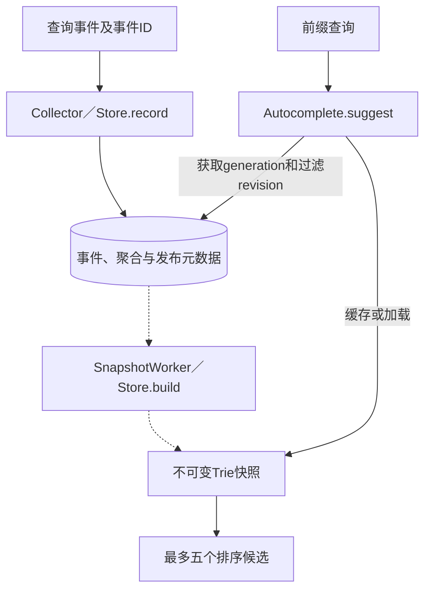
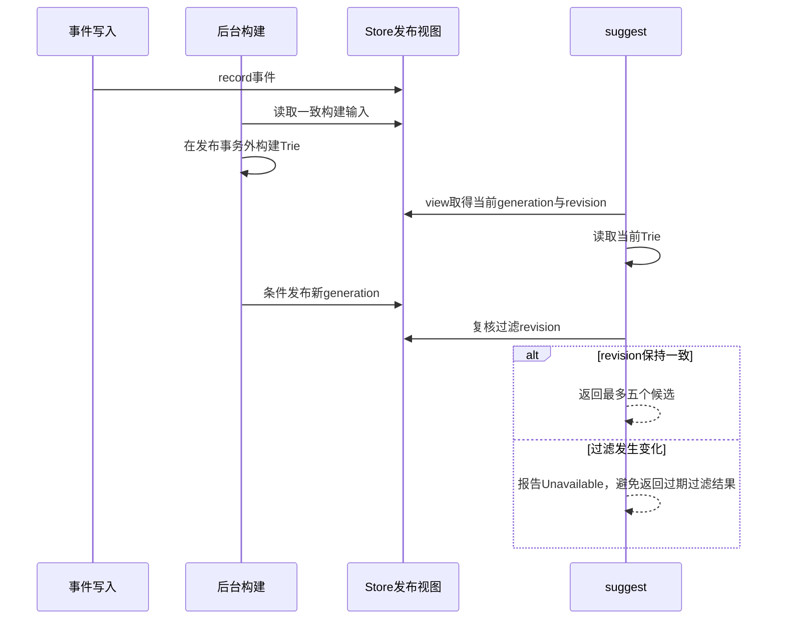

# 第14章：用一次“new”查询理解自动补全

自动补全的两个速度不同：输入请求要很快返回，历史查询的统计和Trie构建可以稍后完成。项目通过**后台发布不可变快照，前台查询已发布视图**把二者分开。

先学习单Store、单Autocomplete实例。HTTP协调器还支持多副本和分片查询，但“多个快照混在一起是否一致”的问题应在理解本地generation和filter revision后再看。

## 贯穿案例

记录两条事件：查询词“  NEW   YORK ”和“newark”，时间相同、事件身份不同。构建覆盖这批事件的快照后，执行suggest("new")。

预期返回 `(("new york", 1), ("newark", 1))`：输入会规范化，同频按词序稳定排序。尚未发布快照时，不应把空结果伪装成“查无匹配”；服务会报告Unavailable。

接着提高某个查询的频次。新事件已写入不代表前台立刻变更，直到后台发布新generation，读者才切换到新快照。

## 宏观：写统计，读快照



| 数据 | 字段／概念 | 属性 | 读者先问什么 |
|---|---|---|---|
| 查询事件 | 事件ID、规范化query、timestamp | 持久输入 | 重复事件是否只计一次 |
| 聚合 | query及frequency | 派生统计 | 统计窗口到底覆盖哪些事件 |
| 发布视图 | active generation | 当前可查询版本 | 构建中版本是否已经可见 |
| 过滤视图 | revision与blocked集合 | 查询约束 | 旧缓存会不会泄漏刚屏蔽的词 |
| Trie | 前缀节点及排名候选 | 不可变快照 | 查询不必扫描全部原始事件 |
| 服务缓存 | generation／revision／shard关联的Trie | 可丢失加速 | 未命中可加载，不能改变答案 |

## 六站阅读路线

| 顺序 | 源码入口 | 输入→输出 | 重点 |
|---|---|---|---|
| 1 | [Store.record](../src/search_autocomplete/store.py#L158) | 事件ID、词、时间→接受结果 | 规范化、去重与内容冲突 |
| 2 | [Store.aggregate](../src/search_autocomplete/store.py#L245) | 时间窗口→频次统计 | 事件时间和聚合边界 |
| 3 | [Store.build](../src/search_autocomplete/store.py#L316) | 统计与分片配置→发布快照 | 慢构建与短发布事务分开 |
| 4 | [SnapshotWorker.run_once](../src/search_autocomplete/worker.py#L60) | 当前时间／窗口→一轮构建 | 后台推进与过滤清理 |
| 5 | [Autocomplete.suggest](../src/search_autocomplete/service.py#L82) | prefix及可选版本→候选元组 | 固定一致视图，不读取半成品 |
| 6 | [Trie.suggest](../src/search_autocomplete/trie.py#L143) | 规范化前缀→节点候选 | 前缀定位和缓存候选的收益 |

先跑“记录两词→build→suggest”这条路，再读HTTP协调器如何散发到多个副本。后者不能替代本地版本一致性。

## 微观一：固定版本后再查Trie

[service.py:99](../src/search_autocomplete/service.py#L99)

```python
prefix = search_autocomplete.trie.normalize(prefix, empty=True)
for value, label in (
    (version, "version"),
    (revision, "revision"),
    (shard, "shard"),
):
    if value is not None:
        _identifier(value, label)
active, actual_revision, blocked = self.store.view()
version = active if version is None else version
if version == 0:
    raise search_autocomplete.store.Unavailable(
        "no snapshot has been published"
    )
if revision is not None and revision != actual_revision:
    raise search_autocomplete.store.Unavailable(
        "filter revision changed; retry"
    )
```

这里的变量不是重复的版本号：

- `active`决定默认使用哪份generation；版本0说明尚未发布。
- `actual_revision`与`blocked`描述当前屏蔽规则。
- 显式提供的版本和revision需要校验，不能因为缓存温热就省略身份检查。

接着沿 [Autocomplete._check_revision](../src/search_autocomplete/service.py#L76) 阅读查询末尾的栅栏。查询期间过滤规则可能变化，前面检查过一次并不能保证返回时还有效。



后台构建没有要求所有读者停止。读者可以继续使用旧的完整快照；关键是旧构建不能在完成得更晚时覆盖已经发布的新版本。

## 微观二：同频排序是契约

“new york”和“newark”的频次相同。观察 [ranked](../src/search_autocomplete/trie.py#L37) 如何定义排序，而不要依赖字典插入顺序。规范化也在构建和查询两侧一致使用，大小写和重复空格不应生成两套不可兼容的键。

屏蔽词过滤不是简单裁掉最终五个词就够了：如果前五个里有屏蔽词，Trie需要能补到更深的合法候选。先读对应Trie测试，再理解这一点对节点缓存的影响。

## 并发失败：较早开始的构建较晚结束

设构建A暂停，构建B读到更新数据并完成发布，随后A恢复。正确结果是仍保留B。应检查Store.build的条件发布，而不是仅靠单个进程的锁；项目测试使用两个连接制造这个交错。

另外，revision在查询中途改变时服务允许报Unavailable。这是有意拒绝混合视图，调用方可以重新获取新视图后重试。

## 用测试检查预期

- [test_ties_trie_and_phrase_normalization](../tests/test_autocomplete.py#L60)：两条不同输入最终规范化并稳定排序；对照本页案例。
- [test_chapter_ranking_and_prefixes](../tests/test_autocomplete.py#L44)：查看TW和twin前缀的结果，理解“最多五个”与分片合并。
- [test_older_build_cannot_overwrite_newer_cross_connection_publication](../tests/test_store_reliability.py#L76)：按事件屏障读A、B发布先后，预测恢复A后哪个generation仍有效。
- [test_cache_hit_fences_mid_request_filter_change](../tests/test_service_reliability.py#L65)：温缓存也必须遵守过滤栅栏。

## 自查与练习

**每次按键都重新聚合历史事件吗？** 不会。前台读取已发布Trie，聚合属于后台更新路径。

**没有发布和没有匹配是否相同？** 不同。前者是Unavailable，后者是合法的空候选。

**本地锁能防止另一个Store连接旧构建覆盖新构建吗？** 不能单靠它，发布必须有持久版本条件。

练习：用两个词各记录一次并build，查询new；再给newark记录一个新事件但暂不build。预期旧快照不变；重新build后newark频次更高、排名提前。


---

[返回全仓库学习导航](../../docs/learning-guide_cn.md) · [项目运行说明](../README.md)

[导读原稿](../../tools/learning_guides/search-autocomplete-system.md)。正文与图按当前实现编写；源码链接和摘录由生成器绑定到当前定义。修改行为后应同时复核案例、时序和解释，再重新生成；定义与链接校验不等同于业务回归测试。
