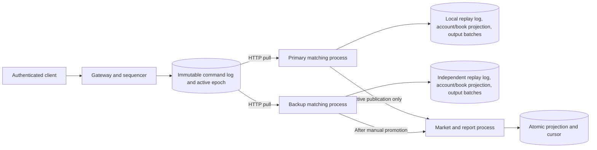

# Chapter 29 — Stock Exchange Design

## Scope and topology

Based on root `System Design Interview.md`, chapter 29. This is a simulated limit-order equity exchange with new/cancel instructions, integer-cent prices, integer shares, reservations, basic session/volume risk, price-time matching, reporting and recoverable market data. There are no external financial side effects.

The four processes and four database files are independent, using actual loopback HTTP. They remain on one host. The gateway/sequencer is the only command authority and is not replicated. Matching replicas are projections of that authority, not two independent places to submit orders. A backup replaying a trade does not create another external money movement.

Books are logically partitioned by symbol and match only the same symbol. All books and accounts share a single serialized matching process per replica, so cross-symbol buying power checks are local/atomic. Per-symbol independent process sharding and distributed account reservations are outside this reference.

## Gateway, ordering and risk boundaries

Static bearer credentials map to provisioned owners through `IdentityProvider`. Separate role credentials protect administration/internal replicas. Only the gateway accepts client mutations. Prices and quantities reject floats, booleans and extra fields. A request key is unique within owner across new and cancel commands; canonical content hashes detect conflicts. Order IDs are globally unique. Two different request IDs intentionally represent separate commands.

SQLite `BEGIN IMMEDIATE`, WAL and FULL synchronous persistence atomically assign the next global sequence and store the request deduplication index plus command. A returned acceptance means journal durability, not risk approval, replica acknowledgement or a fill. If the response is lost, retrying the same key returns the same sequence. There is no new-key retry on ambiguity.

The sequenced command freezes source owner, request body, global sequence and ingress simulation timestamp. Matching order is the sequence, not a caller timestamp or physical packet arrival. Concurrent clients are ordered by sequencer transaction acquisition; the implementation does not claim external network-arrival fairness.

Trading risk is a deterministic part of the matching reducer. `SessionPolicy` currently checks configurable UTC weekdays/minute windows. The generated lab pins the simulation to 2026-10-21 14:00 UTC and allows 09:30–16:00 UTC weekdays. Administrators advance that clock monotonically. This is deliberately not an NYSE timezone/calendar implementation and has no holiday/DST/live clock feed.

`RiskPolicy` currently limits total **accepted new-order quantity** per owner/symbol/UTC day. Both sides count their accepted submissions; cancellation does not refund the quota. Insufficient funds or another rejection does not consume quota. This conservative rule is different from a pure executed-volume cap and avoids repeatedly reserving exposure with canceled orders. Production aggregated risk, KYC, compliance certification and credential lifecycle are not implemented. Replacing policy logic must preserve replay compatibility; it is not a nondeterministic live plugin call during replay.

## Matching and reservation accounting

Each account contains available/held cash plus available/held positions per symbol. Each accepted order stores frozen owner, symbol, side, limit, original quantity, remaining, filled, acceptance sequence/time, day and status. Commands rejected by business checks remain in the journal/results but do not create an accepted order record.

New orders pass known-symbol/session/daily-cap checks and reserve resources in the same reducer step that matches them:

- Buy: move `limit_price * quantity` from available cash to held cash.
- Sell: move quantity from available shares to held shares; no shorting is allowed.

Eligible opposite orders are sorted by best price, then smallest acceptance sequence. The incoming order fills against that list at the resting maker's price. For a fill of q at execution price p:

1. Remove `buy_limit * q` from buyer held cash.
2. Return `(buy_limit - p) * q` to buyer available cash.
3. Add `p * q` to seller available cash.
4. Remove q from seller held shares, add q to buyer available shares.
5. Update both orders' remaining/filled/status and append one stable trade.

Trade IDs use the sequenced taker command and fill index; buy/sell execution report IDs use trade ID plus side. There are no random IDs or network calls inside the reducer. Fees, FX, corporate actions, shorting and external settlement are absent, so total cash and total shares per symbol are conserved.

Open remainders keep exact reservations. Cancel releases only remaining resources; already filled amounts are retained. A fully filled order cannot be canceled. Repeating a cancel for an already canceled owned order is harmless; an unowned/missing order yields a business rejection. In cancel-versus-fill races, the earlier sequenced instruction determines the outcome.

Self-trade prevention cancels the incoming remainder when it reaches a resting order owned by the same account. Earlier fills against other accounts remain valid. The resting own order retains its priority and reservation. This rule avoids wash trades without silently skipping an older same-owner best-priced order.

Orders are DAY orders. Before each new/cancel command, the reducer expires prior-UTC-day open orders and releases resources. There is no independent timer sweep: if the simulation clock advances while no commands arrive, the prior-day book remains until the next sequenced command. Cancellations are allowed outside the new-order session. Timestamp values and all expiration effects are therefore reproducible.

## Durable replay and matching replication

The first sequencer record is genesis containing synthetic accounts, instruments, session rules and risk limit. Restart with changed genesis settings is refused. Every record has contiguous sequence, previous hash, canonical event and SHA256 checksum. SQL triggers block update/delete. Matching processes pull batches after their local applied sequence and independently reduce each command.

Each engine transaction atomically appends the replicated command, updates its complete account/book read projection, and inserts a derived output batch. Duplicate identical prefixes are ignored; gaps, conflicting entries or command/journal sequence mismatch fail closed. Restart validates the full local chain and rebuilds the projection. Asynchronous backup lag does not stop acceptance or active-engine results; the retained sequencer is the catch-up source.

Engine snapshots capture replay state, sequence and head checksum, fsync a temporary file and atomically replace the prior file. Startup validates the entire history and the snapshot against its prefix, then replays the tail. Corrupt snapshots/logs stop recovery. Snapshot validation does not skip prefix scanning or enable log compaction. Replay computes local projections only, never reissues client commands.

## Manual active-node selection and fencing

The sequencer durably stores active node and epoch. Promotion fetches the candidate's applied sequence/head and, inside the sequencer transaction, requires it to equal the current complete journal tail. A concurrent command can make a candidate stale; promotion then returns409 until it catches up. A successful active-node change increments epoch and survives gateway restart.

Before serving active snapshot/feed requests, an engine fetches current sequencer control, records the maximum epoch seen locally and checks that its role and requested epoch match the active owner. Old nodes and stale requests receive409; a regressing control epoch is rejected. Missing control service prevents active publication. Raw authenticated administrative replica inspection is separate and intentionally remains available.

An inactive engine can continue replaying the identical prefix as a standby. Only the gateway-selected projection is exposed as the trading view, and only the active engine supplies publisher feeds. Output trade identities are deterministic across replicas; the consumer deduplicates by sequence, so retries/switches do not add another fill. This avoids dual independent matching authorities but does **not** supply election, sequencer redundancy, control-disk loss recovery or exactly-once external settlement.

An in-flight read begun before promotion can still return an older valid prefix. It cannot independently append orders or spend funds, because all mutations originate in the single sequencer. Fresh publication checks use the current active epoch. Operators must retain the original sequencer disk; recreating it from an empty/stale database is unsupported. Replicas are assumed to run the same compatible reducer version; the lab compares their state hashes after catch-up.

## Market data, gaps and report projection

Each processed command produces an output batch, including business rejections/commands with no book change. Batches preserve the global sequence and command-chain previous/head hashes, ensuring consumers can distinguish an empty update from a lost update. Book changes give absolute quantity per price level, zero for deletion. Batches also contain changed accepted orders and new trades for the authenticated report projection.

The engine retains a bounded configured output window. The independent market process persists its book/order/trade projection and cursor in one transaction. It ignores duplicate batches, requires consecutive sequence/previous hash, and resnapshots on410 when it has missed the window. Snapshot replacement includes accepted-order/trade history, so private reports recover together with books. The matching command log is retained even when derived batches are dropped.

Public `/market/deltas` retains eight sanitized batches, removing owner and order identities. Clients initialize from `/market/snapshot`, then apply absolute L2 changes in order and resnapshot on410. Public depth views expose only aggregated levels. Private reports require owner credentials and emit one owned fill per trade side. Reporting is asynchronous; every result includes applied sequence. Rejected command results are queried at the gateway rather than mixed into accepted-order reports.

OHLCV buckets use the sequenced trade timestamp, preserving open/close by execution order, with integer quantities/prices. Resolution is1–86400 seconds; empty buckets are omitted. The reference uses HTTP polling, not FIX, multicast, WebSockets or a production time-series service.

## Auditing and limitations

Audit verifies total cash, total shares per symbol, nonnegative balances, and held cash/shares against the exact open-order remainders. It independently replays the local journal and compares its state with the stored projection. Matching, reservation updates, execution outputs and projection commit together locally. Integrity checks detect accidental corruption, not an adversary with privileges to rewrite schema and all hashes.

Actual tests and p99 measurements are in `../benchmarks/REPORT.md`. The implementation bounds configuration to100 symbols/accounts and history to1000 commands; it uses full JSON state copies, linear order scans, full local replay, whole-state internal reads and retained history. These choices favor a small inspectable reference over capacity.

There is no real venue routing, production compliance, KYC certification, bank/clearing integration, sequencer HA, automatic failover, cross-host durability, symbol-process partitioning, regulatory audit retention, replacement/market orders, fees or shorting. Billion orders/day, millisecond tail latency and99.99% availability remain design goals, not demonstrated properties.
