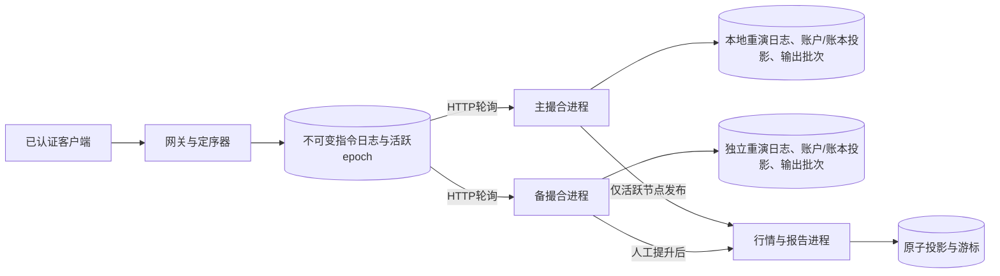

# 第29章 —— 证券交易所设计

## 范围与拓扑

基于根目录《System Design Interview.md》第29章。这是一个模拟限价股票交易所，支持新单/撤单指令、整数美分价格、整数股数、预留、基础时段/成交量风控、价格—时间撮合、报告及可恢复行情数据。不存在真实的金融副作用。

四个进程和四个数据库文件相互独立，使用真实的回环 HTTP。它们全部运行在同一台主机上。网关/定序器是唯一的指令权威，不做复制。撮合副本是该权威的投影，而非两个独立的下单入口。备份节点重放一笔成交不会触发另一笔外部资金变动。

账本按股票代号逻辑分区，仅撮合同一代号。所有账本与账户在每个副本上共享单一串行撮合进程，因此跨股票购买力校验具有本地原子性。每股票独立进程分片与分布式账户预留不在本参考实现范围内。

## 网关、定序与风控边界

静态 bearer 凭据通过 `IdentityProvider` 映射到预置的所有者。独立角色凭据保护管理端/内部副本。仅网关接受客户端写操作。价格与数量拒绝浮点数、布尔值及额外字段。请求键在同一所有者下的新单与撤单之间唯一；规范化内容哈希用于检测冲突。订单 ID 全局唯一。两个不同的请求 ID 被有意视为两条独立指令。

SQLite 的 `BEGIN IMMEDIATE`、WAL 与 FULL 同步持久化机制原子性地分配下一个全局序号，并存储请求去重索引及指令。返回接单成功表示日志已持久化，而非风控已通过、副本已确认或成交已发生。如果响应丢失，用相同键重试会返回同一序号。在歧义情况下不会生成新键重试。

定序后的指令冻结源所有者、请求体、全局序号与入口模拟时间戳。撮合顺序由序号决定，而非调用者时间戳或物理报文到达时间。并发客户端的排序由定序器事务获取顺序决定；本实现不宣称具备外部网络到达公平性。

交易风控是撮合 reducer 的确定性组成部分。`SessionPolicy` 当前检查可配置的 UTC 工作日/分钟窗口。生成的实验将模拟时钟固定在 2026-10-21 14:00 UTC，允许工作日 09:30–16:00 UTC 交易。管理员以单调方式推进此时钟。本实现有意不模拟 NYSE 时区/日历，不含节假日/夏令时/实时时钟源。

`RiskPolicy` 当前限制每个所有者/股票/UTC日的 **受理新单总量**。双方的受理提交都计入配额；撤单不退回配额。资金不足或其他拒绝不消耗配额。这一保守规则不同于纯成交量上限，避免通过撤单反复预留敞口。生产级聚合风控、KYC、合规认证和凭据生命周期未实现。替换策略逻辑必须保持重演兼容性；它不是重演过程中的非确定性在线插件调用。

## 撮合与预留记账

每个账户包含可用/冻结现金，以及每股票可用/冻结持仓。每条受理订单存储冻结的所有者、股票、方向、限价、原始数量、剩余数量、已成交量、受理序号/时间、日期与状态。被业务检查拒绝的指令仍保留在日志/结果中，但不会创建受理订单记录。

新订单在通过已知股票/时段/日额度校验后，在同一 reducer 步骤中预留资源并撮合：

- 买入：将 `限价 × 数量` 从可用现金转入冻结现金。
- 卖出：将数量从可用持仓转入冻结持仓；不允许卖空。

合格的对手方订单按最优价格排序，再按最小受理序号排序。进入的订单以挂单 maker 的价格与该列表成交。对于以执行价 p 成交 q 股：

1. 从买方冻结现金中减去 `买限 × q`。
2. 将 `(买限 − p) × q` 返还买方可用现金。
3. 将 `p × q` 加入卖方可用现金。
4. 从卖方冻结持仓中移除 q，将 q 加入买方可用持仓。
5. 更新两笔订单的剩余/已填/状态，并追加一条稳定成交记录。

成交 ID 使用有序 taker 指令与成交索引；买/卖成交报告 ID 使用成交 ID 加方向。reducer 内部不生成随机 ID 或发起网络调用。手续费、外汇、公司行为、卖空与外部结算均不存在，因此总现金与每股票总股数守恒。

未成交部分保留精确预留。撤单仅释放剩余资源；已成交金额保留。已全部成交的订单不可撤。对同一所有者已撤订单重复撤单是无害的；对非所有者订单或不存在的订单会触发业务拒绝。在撤单与成交的竞态中，较早定序的指令决定最终结果。

自成交防护在进入订单遇到同一账户的挂单时，取消进入订单的剩余部分。之前与其他账户的成交仍然有效。挂单的己方订单保留其优先级与预留。这一规则避免 wash trade，同时不会静默跳过同一所有者的较早最优价订单。

所有订单为 DAY 单。在每条新单/撤单指令之前，reducer 会过期上一 UTC 日的未成交订单并释放资源。没有独立的定时器扫描：如果模拟时钟在没有指令到达时推进，前一日的账本会一直保留到下一条有序指令。撤单允许在新单交易时段之外执行。因此时间戳与所有过期效果都可重现。

## 持久重演与撮合复制

第一条定序器记录是 genesis，包含合成账户、标的、交易时段规则与风控限额。重新启动时如果 genesis 设置变更会被拒绝。每条记录具有连续序号、前一个哈希、规范化事件与 SHA256 校验和。SQL 触发器阻止更新/删除。撮合进程在其本地已应用序号之后拉取批次，并独立地对每条指令执行 reduce。

每个引擎事务原子性地追加复制的指令、更新完整的账户/账本读投影，并插入派生的输出批次。重复的相同前缀会被忽略；缺口、冲突条目或指令/日志序号不匹配则进入 fail-closed。重启时校验完整本地链并重建投影。异步备节点滞后不会阻塞接单或主引擎结果；保留的定序器是追平的权威来源。

引擎快照捕获重演状态、序号与头校验和，fsync 临时文件后原子替换旧文件。启动时校验完整历史与快照前缀，然后重演尾部。损坏的快照/日志会阻止恢复。快照校验不跳过前缀扫描，也不启用日志压缩。重演仅计算本地投影，绝不会重新向客户端发指令。

## 人工主节点选择与 fencing

定序器持久存储活跃节点与 epoch。提升时获取候选节点的已应用序号/头，并在定序器事务内部要求它等于当前完整日志尾部。并发指令可能导致候选节点过期；此时提升返回 409，直到其追平。成功的主节点切换会递增 epoch 并在网关重启后保留。

引擎在提供活跃快照/行情请求之前，会获取当前定序器控制、记录本地见过的最大 epoch，并校验其角色与请求的 epoch 是否匹配当前活跃所有者。旧节点和过期请求会收到 409；回退的控制 epoch 会被拒绝。缺失的控制服务会阻止活跃发布。原始的已认证管理端副本检查是独立的，并被有意保留可用。

非活跃引擎可以作为 standby 继续重演相同的前缀。仅网关选定的投影暴露为交易视图，仅活跃引擎提供发布行情。输出成交 ID 在副本间确定；消费者按序号去重，因此重试/切换不会重复成交。这避免了两个独立的撮合权威，但 **不** 提供选举、定序器冗余、控制盘丢失恢复或恰好一次的外部结算。

在提升之前开始的在读操作仍可返回较旧但有效的前缀。它不能独立追加订单或动用资金，因为所有写操作都源自单一的定序器。新发布检查使用当前活跃 epoch。操作员必须保留原始定序器磁盘；不支持从空/过期数据库重建。假设副本运行相同版本的兼容 reducer；本实验在追平后比较它们的状态哈希。

## 行情数据、缺口与报告投影

每条已处理指令产生一个输出批次，包括业务拒绝/无账本变化的指令。批次保留全局序号与指令链前一个/头哈希，确保消费者能区分空更新与丢失更新。账本变化给出每个价位的绝对数量，删除时为零。批次还包含变更的受理订单与新成交，用于已认证的报告投影。

引擎保留可配置的有界输出窗口。独立行情进程在一个事务中持久化其账本/订单/成交投影与游标。它忽略重复批次，要求连续序号/前一个哈希，错过窗口时返回 410 并重做快照。快照替换包含受理订单/成交历史，因此私有报告与账本一起恢复。撮合指令日志即使在派生批次被丢弃后仍保留。

公开的 `/market/deltas` 保留八个已脱敏批次，移除了所有者和订单身份。客户端从 `/market/snapshot` 初始化，然后按序应用绝对 L2 变化，错过窗口时重拉快照。公开深度视图仅暴露聚合价位。私有报告需要所有者凭据，对每个成交方向发出一条属于该所有者的成交。报告是异步的；每条结果包含已应用序号。被拒绝的指令结果在网关查询，而不是混入受理订单报告。

OHLCV 桶使用有序成交时间戳，按执行顺序保留开盘/收盘，使用整数数量/价格。分辨率为 1–86400 秒；空桶被省略。本参考实现使用 HTTP 轮询，而非 FIX、多播、WebSocket 或生产级时序服务。

## 审计与局限性

审计校验总现金、每股票总股数、非负余额，以及冻结现金/持仓与精确的未成交订单剩余量。它独立重演本地日志并与存储的投影比较状态。撮合、预留更新、执行输出与投影提交在本地一并完成。完整性检查可检测意外损坏，但无法对抗有权重写 schema 和所有哈希的攻击者。

实际测试与 p99 测量见 `../benchmarks/REPORT.md`。本实现将配置限制在 100 个股票/账户，历史记录限制在 1000 条指令；使用完整 JSON 状态拷贝、线性订单扫描、完整本地重演、全状态内部读取和保留历史。这些取舍倾向于一个可检查的小型参考实现，而非容量。

不具备真实的场所路由、生产合规、KYC 认证、银行/清算所集成、定序器高可用、自动故障切换、跨主机持久化、股票进程分区、监管审计留存、替换/市价单、手续费或卖空。十亿级日订单、毫秒级尾延迟和 99.99% 可用性仍是设计目标，而非已验证的特性。
