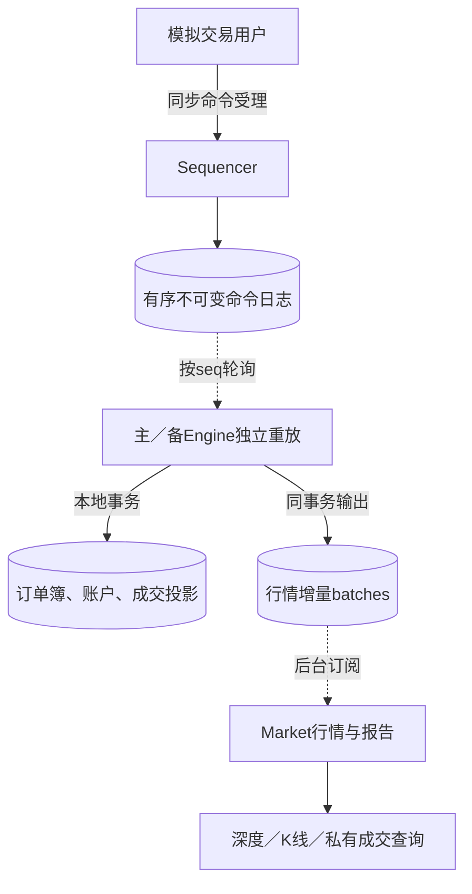
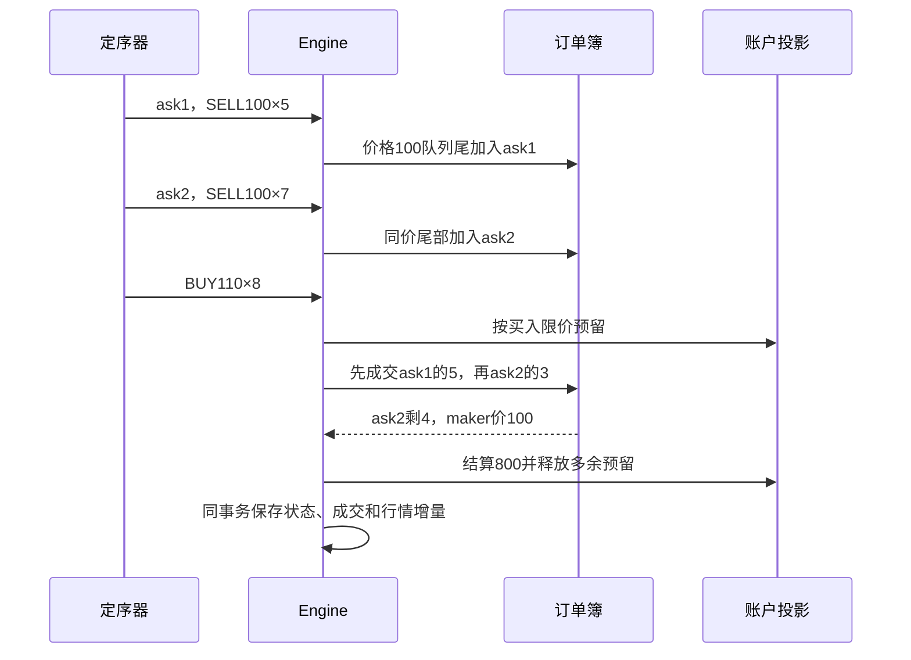

# 第29章：从一笔部分成交读懂有序日志与撮合

先把系统分成三个角色：定序器决定命令先后，撮合机按顺序确定性地改变订单簿，行情服务发布这些变化。`ACCEPTED`只说明命令已进入日志；订单是否被接受、成交多少，要看撮合结果。所有账户、行情时钟和订单均为模拟，不连接真实交易所。

## 贯穿案例：两张同价卖单，买入8股

按测试默认账户与交易时段，先提交bob的`ask1: SELL 100×5`，再提交carol的`ask2: SELL 100×7`，最后alice提交`BUY 110×8`。预期以maker价格100成交：先吃ask1的5股，再吃ask2的3股；ask2剩4股。alice实际花800美分，不是按限价110花880，未使用的预留金额应归还。



主备撮合可人工切换，但定序器仍是单点；不要把两套独立重放理解为自动共识选主。

## 先认清数据层次

| 数据 | 关键字段 | 在案例中的作用 |
|---|---|---|
| 接收身份 | owner＋request_id及内容hash | 网络重试不能再分配一条新命令 |
| 命令日志 | `seq/previous/event/hash` | 先ask1、再ask2、最后买单的确定顺序 |
| 订单 | `side/price/quantity/remaining`等 | ask2从7变4，未成交部分继续留盘 |
| 账户 | cash与持仓的available／held | 下单预留与成交／撤单释放分开 |
| 成交 | 买卖order、quantity、price | 本例两笔数量5、3，价格都100 |
| 行情增量 | seq、head、books、orders、trades | 从同一撮合事务导出，缺口需补快照 |

## 六站源码路线

1. [Sequencer.submit](../src/stock_exchange/storage.py#L111)：输入owner、kind和body，输出seq及ACCEPTED。看去重索引和日志怎样同事务提交。
2. [Engine.apply](../src/stock_exchange/storage.py#L297)：核对前缀、序号和hash，确定哪些命令可以应用。
3. [reduce_command](../src/stock_exchange/matching.py#L46)：核心业务。先跟new订单的校验、资金／持仓预留，再跟撮合循环。
4. [OrderBook.best](../src/stock_exchange/order_book.py#L88)与[OrderBook.consume](../src/stock_exchange/order_book.py#L77)：看最佳价格如何定位，以及同价队列怎样保留时间顺序。
5. [market_batch](../src/stock_exchange/storage.py#L209)：比较新旧状态，把该命令的增量输出读清楚，别误认为行情会重新撮合。
6. [Market.apply](../src/stock_exchange/market.py#L86)及[Engine.replay](../src/stock_exchange/storage.py#L253)：前者检查行情增量，后者从命令重建权威撮合状态。

## 微观一：已收到的seq也不能无条件忽略

[storage.py:303](../src/stock_exchange/storage.py#L303)

```python
with self.transaction() as db:
    tail = self.tail(db)
    seq = row["seq"]
    if seq <= tail["seq"]:
        old = db.execute(
            "SELECT body FROM events WHERE seq=?", (seq,)
        ).fetchone()
        if old is None or json.loads(old[0]) != row:
            raise Error(409, "matching replica prefix conflict")
        return
    if row != entry(tail["seq"] + 1, tail["hash"], row["event"]):
        raise Error(409, "command sequence/checksum gap")
```

重放旧seq时要比较完整日志行；只有内容完全相同才返回。下一条新命令必须由当前tail接上正确的previous和hash，否则报gap。这防止“序号一样但内容不同”的请求污染副本。

## 微观二：订单簿承担价格与时间优先

[order_book.py:88](../src/stock_exchange/order_book.py#L88)

```python
def best(self, symbol, taker_side):
    maker_side = "SELL" if taker_side == "BUY" else "BUY"
    side = self.value[symbol][maker_side]
    sign = -1 if maker_side == "BUY" else 1
    while side["heap"]:
        key = str(side["heap"][0] * sign)
        level = side["levels"].get(key)
        if level is not None:
            return level["head"]
        heapq.heappop(side["heap"])
```

`best`按taker方向选择对手盘，返回最佳价格层的队首订单；它并不判断这个价格是否满足taker限价。真正的可成交判断在[reduce_command](../src/stock_exchange/matching.py#L46)的撮合循环：买单遇到maker价格高于买限价就停止，卖单遇到maker价格低于卖限价也停止。找到最佳候选与判断能否成交是两步。

同价排序不是按订单ID字典序，而是由命令进入订单簿的顺序形成。取消和部分成交不能让后来的订单突然插队。



## 崩溃与重放要检查什么

[MatchingTests.test_price_time_partial_fill_and_price_improvement](../tests/test_matching.py#L54)直接给出本案例断言：成交卖单顺序ask1、ask2，数量5、3，ask2剩4，alice现金available为999200、held为0。

[SafetyTests.test_command_rollback_keeps_projection_events_and_batches_together](../tests/test_safety.py#L188)检查事务中途失败不会留下“有成交但没行情”或相反的部分结果。[MatchingTests.test_storage_replay_snapshot_tail_immutability_and_gap](../tests/test_matching.py#L147)检查日志重放、快照与缺口。

真实的恢复不是拿旧snapshot就信任它：快照必须与日志前缀及状态校验一致，再应用尾部。行情增量保留窗口以外的消费者要重新拉快照，而不是静默跳过丢失的book变化。

## 自查与练习

- **同价买单谁先成交？** 在同一价格层按进入订单簿的时间顺序，受确定命令顺序约束。
- **买限价110为什么成交100？** 对手方maker价格100更优，未用预留需释放。
- **Engine已经apply但应答丢失会重复成交吗？** 相同seq和完整内容重放返回，不再次归约。

练习：把两张卖单改为ask1价格105、ask2价格100，再买入3股。预期先吃价格100的订单，即使它更晚到达；这说明先比较价格，再比较同价时间。配置与模拟交易时段见[README_CN.md](../README_CN.md)。


---

[返回全仓库学习导航](../../docs/learning-guide_cn.md) · [项目运行说明](../README.md)

[导读原稿](../../tools/learning_guides/stock-exchange-system.md)。正文与图按当前实现编写；源码链接和摘录由生成器绑定到当前定义。修改行为后应同时复核案例、时序和解释，再重新生成；定义与链接校验不等同于业务回归测试。
