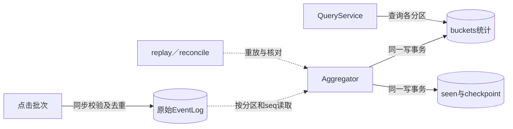
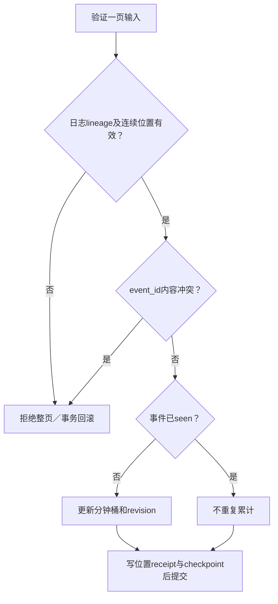

# 第22章：从一个重复点击读懂聚合与重放

把系统想成两份账：原始事件日志记录发生了什么，聚合表记录这些事件的统计结果。Worker靠输入位置连接两份账，去重身份防止重放重复加一。水位线说明查询窗口是否已经走过预期等待期，不意味着所有晚到事件都被禁止。

## 贯穿案例：e1为什么只能贡献一次

给某个分区输入点击`event_id=e1`，广告`ad1`，`click_timestamp=960`；其分钟桶起点为960。第一次应用后，ad1计数为1；重新读取并应用同一页，计数仍为1，checkpoint不倒退。若同一e1改成另一个广告，应冲突并回滚该页。测试时使用固定时钟和分区选择，数据形状参考{{file:tests/test_core.py}}中的`click`辅助函数。

日志已接受事件不表示所有聚合分区都已推进；全局查询需要检查各分区进度。先在一个分区理解幂等，再看热点广告加盐与跨分区汇总。

## 三种身份不可混淆

| 数据 | 字段 | 本案例中的作用 |
|---|---|---|
| 点击事实 | `event_id`与内容hash | e1只能代表同一内容；相同ID不同内容是冲突 |
| 输入位置 | `lineage/partition/seq` | 说明来自哪份日志、哪个位置，不等于事件ID |
| 分钟统计 | `minute/ad_id/user_id/ip/country/count/revision` | `960/ad1/...`对应的一行可被迟到事件修订 |
| `checkpoint` | `seq/max_event/watermark/late/lineage` | 既跟踪恢复位置，也提供窗口完成度信息 |
| `input_positions` | `seq/event_id/hash/accepted` | 重放旧位置也能检查位置内容是否被替换 |

## 六站阅读路线

1. {{symbol:src/ad_click/log.py:EventLog.append}}：从点击数组到日志receipt。先找事件去重及批次原子性。
2. {{symbol:src/ad_click/log.py:EventLog.read}}：从分区和after位置到连续page。记下page中的lineage和entry结构。
3. {{symbol:src/ad_click/records.py:prepare_batch}}：核对Worker在拿写锁前冻结并验证哪些数据，防止调用方改动输入。
4. {{symbol:src/ad_click/aggregate.py:Aggregator.apply}}：本章重点。依次读lineage检查、旧位置检查、新位置连续性、按事件去重和checkpoint提交。
5. {{symbol:src/ad_click/aggregate.py:Aggregator.totals}}：从查询范围到广告总数，注意`closed`由查询终点与水位比较得出。
6. {{symbol:src/ad_click/recovery.py:replay}}和{{symbol:src/ad_click/recovery.py:reconcile}}：把重放理解为再次应用受验证的日志，而不是直接把总数覆盖成某个猜测。

## 微观一：旧位置也要验证

{{excerpt:src/ad_click/aggregate.py:Aggregator.apply:6:16}}

事务内先检查lineage，再查询seen内容。`seq <= checkpoint`并非无条件返回：后面还会比较原位置receipt。否则，源日志在旧偏移换成不同事件时，消费者会把数据损坏当成成功重放。

状态变化：应用前`seq=0/count=0`；应用e1后`seq=1/count=1`；同一页再应用后仍`seq=1/count=1`。若历史位置内容变了，应用抛错，不能静默推进。

## 微观二：统计与输入进度一起提交

{{excerpt:src/ad_click/aggregate.py:Aggregator.apply:41:17}}

`minute`使用事件时间向下取整，而不是接收时间。`not seen`才允许更新桶；随后即便事件以前出现过，新输入位置仍有单独的receipt和checkpoint推进。由此可以接受“同一事件出现在后续合法位置”，同时不重复累计。

## 崩溃发生在加一之后怎么办

如果`before_commit`抛错，桶、seen和checkpoint都应回滚；重启后重放该页会进行第一次有效统计。这是事务保证，不是依靠“尽量只发送一次”。读{{symbol:tests/test_core.py:CoreTests.test_checkpoint_output_rollback_and_replay}}，关注失败前后`audit`和位置。

接着读{{symbol:tests/test_persistence_reliability.py:PersistenceReliabilityTests.test_same_event_at_a_later_compatible_position_is_not_counted_twice}}：不同seq并不必然意味着不同业务点击。最后看{{symbol:tests/test_core.py:CoreTests.test_late_revision_watermark_and_filters}}，检查晚到事件确实可以修订统计。

## 学完应能回答

- **为什么不能只保存最后消费偏移？** 重放时还要识别业务事件重复与历史内容变化。
- **为什么晚到事件不直接丢弃？** 代码更新桶并增加修订／迟到计数，水位是查询语义，不是绝对封账。
- **checkpoint已经推进但桶没更新可以吗？** 不可以，两者必须来自同一事务结果。

练习：在测试固定时钟下，对同一页apply两次，再把某一事件的ad_id修改后apply。预期前两次总数不变，第三次报冲突且整页没有部分效果。运行命令与字段限制见{{file:README_CN.md}}。
