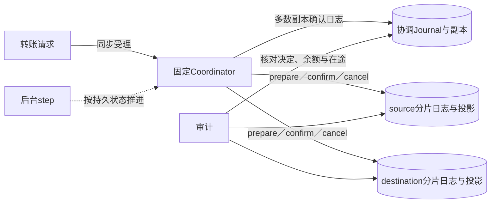
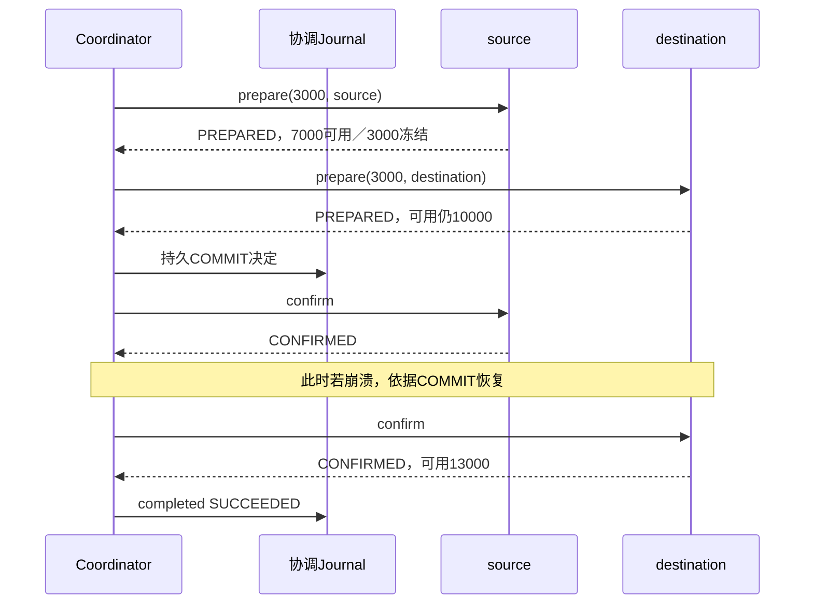

# 第28章：从跨分片3000转账读懂TCC恢复

同分片转账可以放进一个本地事务，跨分片不能直接借用这个原子性。这里用prepare预留、持久决定、confirm或cancel推进参与者；协调日志与分片日志让进程重启后知道哪些事情已经发生。它是固定写入者和人工epoch隔离的参考实现，不包含自动选主；初始余额全为合成数据。

## 贯穿案例：两边各10000，转出3000

选择位于不同分片的source和destination，初始available各10000，held为0。prepare source之后，source变成`available=7000/held=3000`；destination prepare之后available仍10000。confirm source扣掉held，再confirm destination后收款方available变13000。两边confirm之间，系统存在在途资金，不应仅把两个available相加就判断丢钱。

账户分片本身未复制，协调日志副本不能替代账户分片磁盘。阅读顺序先从参与者手算余额，再看协调者怎样驱动它们。

## 状态归属与不变量

| 数据 | 身份／字段 | 本案例的意义 |
|---|---|---|
| 转账意图 | `transaction_id/from_account/to_account/amount/currency` | 同一ID不能更换账户或金额 |
| 协调状态 | `intent/decision/status` | decision在两参与者准备后选择COMMIT或CANCEL |
| 分片参与者 | `role/status` | source与destination承担不同资金动作 |
| 账户投影 | `available/held` | source prepare只冻结，不立即给destination加可用余额 |
| 分片事件日志 | hash链与序号 | 作为重演余额状态的依据 |
| 重试记录 | `failures/due/dead/error` | 控制推进节奏，不等于业务结果已取消 |
| epoch／leader | 隔离凭据 | 旧写入者不能在新纪元继续修改 |

## 六站阅读路线

1. {{symbol:src/digital_wallet/shard.py:Shard.action}}：先看参与者输入，kind和role的组合必须合法，且账户必须路由到本分片。
2. {{symbol:src/digital_wallet/projection.py:reduce_event}}：手算prepare、confirm和cancel对available、held、parts的作用。
3. {{symbol:src/digital_wallet/coordinator.py:Coordinator.create}}：看权限和转账ID去重，返回PENDING不等于双方完成。
4. {{symbol:src/digital_wallet/journal.py:Journal.append}}：理解accepted和decision怎样成为已确认日志，别跳过副本确认。
5. {{symbol:src/digital_wallet/coordinator.py:Coordinator.advance}}：每次只推进当前可以安全执行的动作；把参与者状态代入条件分支。
6. {{symbol:src/digital_wallet/coordinator.py:Coordinator.step}}与{{symbol:src/digital_wallet/audit.py:AuditMixin.audit}}：看失败后的公平重试、恢复及在途资金校验。

## 微观一：重试必须落到同一参与者意图

{{excerpt:src/digital_wallet/shard.py:Shard.action:13:13}}

拿到分片事务后先检查fence。已有transaction_id不仅要核对amount，还要核对整个intent和role；确认已CONFIRMED或取消已CANCELED时可返回旧结果。否则“重试”可能执行另一种资金动作。confirm不能凭空发生在没有prepare的参与者上。

## 微观二：先持久决定，再确认双方

{{excerpt:src/digital_wallet/coordinator.py:Coordinator.advance:14:17}}

两边都PREPARED才能追加COMMIT决定。下一轮看到已持久COMMIT，才逐一confirm。决定不能仅保存在进程变量中：若source已经确认后进程崩溃，新协调者必须从日志知道应继续确认destination，不能改主意取消。

同分片路径不需要人为走跨分片TCC：{{symbol:src/digital_wallet/coordinator.py:Coordinator.advance}}最前面的local分支一次性完成，体现按实际一致性边界选择实现。

## 失败该怎样恢复

准备阶段的明确拒绝可以选择CANCEL；传输超时不能证明参与者没有prepare，需查询并继续恢复。`step`还在操作参与者前同步日志，没有协调日志确认条件时不应继续推进资金动作。

{{symbol:tests/test_wallet.py:WalletTests.test_cross_prepare_confirm_preserves_pending_and_replays_once}}直接对应3000案例：检查冻结、重复confirm不重复加钱、rebuild前后相同。{{symbol:tests/test_wallet.py:WalletTests.test_cancel_tombstones_prevent_late_prepare_and_release_holds}}检查取消墓碑，防止迟到prepare把取消转账复活。

{{symbol:tests/test_safety.py:SafetyTests.test_wrong_participant_receipt_does_not_choose_commit_or_release_hold}}进一步验证错误参与者回执不会选择COMMIT或释放冻结；只检查全局总额相同是不够的，还要检查角色和归属。

## 自查与练习

- **prepare就应给收款人加可用余额吗？** 不应，必须等待持久决定和destination confirm。
- **COMMIT后能因某一侧超时改CANCEL吗？** 不能，恢复应执行原持久决定。
- **取消先到、prepare后到会怎样？** 持久取消状态阻止迟到准备重新冻结。

练习：在3000案例中先只confirm source，记录两边available和held；再confirm destination两次。预期最终source可用7000、destination可用13000，第二次确认无额外资金变化。账户选择与运行见{{file:README_CN.md}}。
