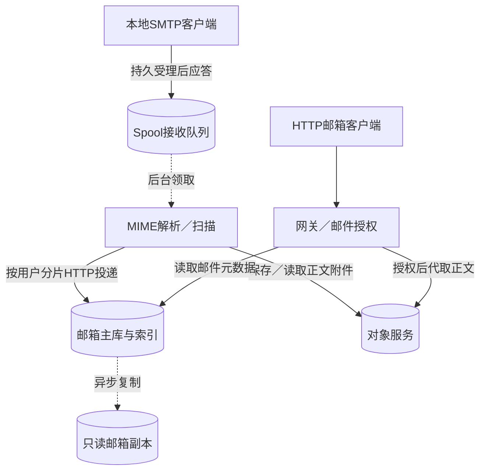
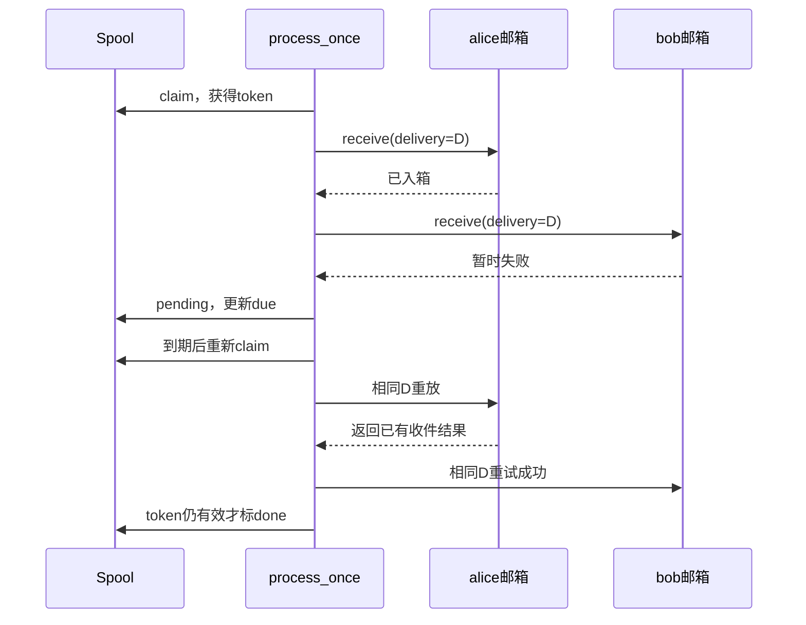

# 第24章：一封邮件怎样在故障中只入箱一次

这套系统先把“收到了邮件”保存下来，再解析、扫描并投递到各收件人的邮箱。邮箱存储保存元数据和搜索索引，正文／附件保存在独立对象服务。理解这两个分离，比先记住九个实验进程更有用。本项目只在配置的本机`local.test`用户间流转邮件，不负责公网邮件投递；测试扫描器也不是真实反病毒产品。

## 用双收件人案例贯穿阅读

发件人为合法本地用户，收件人是`alice@local.test`和`bob@local.test`，RFC消息包含一个稳定的64位十六进制`X-Delivery-ID`。第一次处理时alice入箱成功，bob服务暂时故障。重试会再次调用alice和bob，但二者收到的delivery身份必须与第一次相同；alice邮箱靠该身份去重，最终每位用户只有一份业务邮件。

最后一条是逻辑数据路径：用户不能直接凭对象键读取对象，HTTP网关／邮箱接口先检查邮件所有权，再代取对象。副本复制也不包含可自动提升所需的所有状态。

## 先分清这些持久身份

| 对象 | 关键内容 | 为什么需要 |
|---|---|---|
| 原始RFC对象 | 内容键与SHA校验 | Spool只需保存引用，重试读取相同原文 |
| `spool` | `id/hash/raw/sender/recipients/status/attempts/due/token/lease` | delivery身份保护接受幂等，token隔离一次处理尝试 |
| 邮箱收件记录 | user＋delivery派生的稳定身份 | 部分投递失败后，整封重试不重复入箱 |
| 邮件元数据和倒排词项 | 正文引用、文件夹、read、version | 主库同事务更新邮件与搜索结果 |
| 复制位置 | lineage与position | 副本知道自己应用的是哪个主库前缀 |

## 六个源码阅读停靠点

1. {{symbol:src/distributed_email/spool.py:Spool.accept}}：输入原始bytes和信封地址，输出稳定delivery及实验丢应答标志。找原文存储与数据库受理的边界。
2. {{symbol:src/distributed_email/spool.py:Spool.claim}}：输入当前队列，输出带新token和lease的任务；注意服务器取时发生在获得写锁以后。
3. {{symbol:src/distributed_email/spool.py:Spool.process_once}}：在循环收件人前先解析／扫描，逐个发HTTP；标记失败后下一次从何处重来。
4. {{symbol:src/distributed_email/mail.py:parse_received}}：只先追descriptor、body和扫描决定，后续再深入MIME附件限制。
5. {{symbol:src/distributed_email/store.py:MailStore.receive}}：核对同一用户相同delivery怎样返回已有结果，以及元数据与索引怎样一起落库。
6. {{symbol:src/distributed_email/spool.py:Spool.settle}}：看成功、可重试异常与永久拒绝分别写什么状态；最后再读{{symbol:src/distributed_email/replication.py:Replication.apply}}理解只读副本。

## 微观一：受理丢应答也不能换身份

{{excerpt:src/distributed_email/spool.py:Spool.accept:19:13}}

`prior`不是“看到同一ID就接受”：必须先比较hash。ID相同、原文／信封不同会409。`INSERT OR IGNORE`让完全相同的重试不会再建一条任务。实验`lose_ack`发生在事务完成之后，因此SMTP客户端以为失败时，服务端可能已经持久接受。

## 微观二：一次处理尝试不等于一封邮件

{{excerpt:src/distributed_email/spool.py:Spool.settle:0:7}}

函数中后续UPDATE同时检查`status='pending'`、token和未过期lease。过期尝试即使最终网络调用返回成功，也不能清除新领取者的任务。token属于尝试；delivery属于业务邮件；二者不能互换。

## 从测试观察恢复结果

{{symbol:tests/test_delivery_reliability.py:SpoolReliabilityTests.test_partial_delivery_retries_same_recipient_ids}}检查第一次与重试alice的身份完全相同，最终spool为done。它不声称网络层只调用alice一次；它证明重试身份稳定。

{{symbol:tests/test_store.py:StoreTests.test_delivery_dedup_search_and_delete_tombstone}}继续验证邮箱端去重、搜索及删除语义。{{symbol:tests/test_delivery_reliability.py:SpoolReliabilityTests.test_expired_and_reclaimed_attempts_cannot_settle}}则让旧尝试提交，观察它不能更改新租约。

扫描器暂时不可用与无效MIME是两种不同失败：前者保留队列重试，后者可永久rejected；未配置扫描器时默认进入隔离策略，不会假装已经安全扫描。对应配置与运行见{{file:README_CN.md}}。

## 自查与练习

- **SMTP应答丢失为什么不重建delivery？** 服务端可能已经提交，重建ID会把重试变成新邮件。
- **alice收到两次内部receive调用就代表重复入箱吗？** 不代表，邮箱端还要按稳定身份去重。
- **副本能直接提升成发信主库吗？** 当前复制不包含全部发送与上传状态，不能自动替代主库。

练习：沿上述部分失败测试，把bob的失败次数改为两次，保留相同delivery。预期内部调用次数增加，但最终每位用户仍只有一份邮件；如果更换delivery则破坏这个预期。
