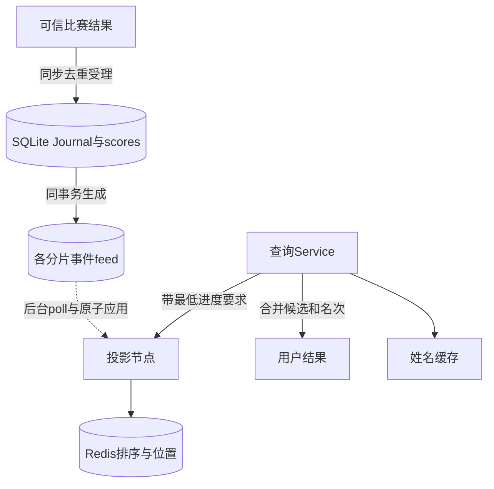
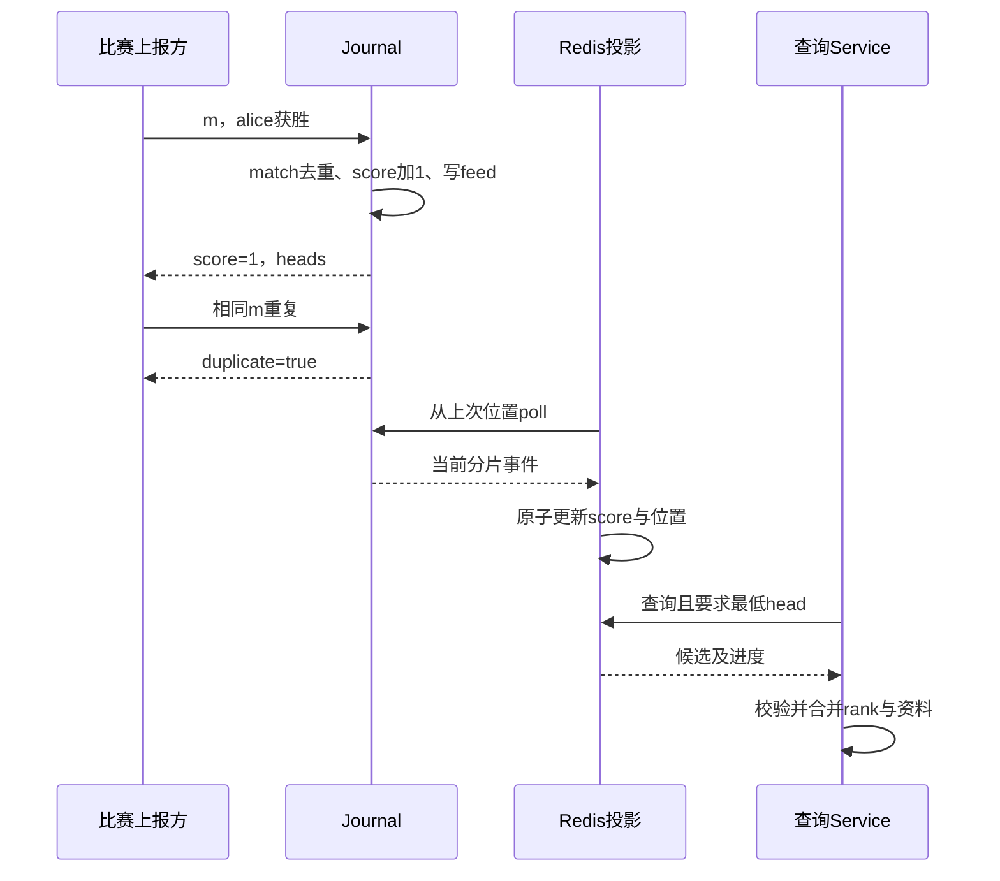
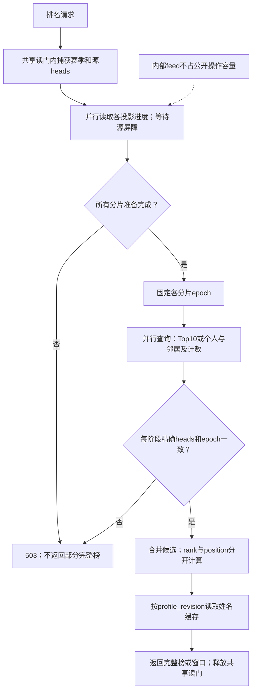

# 第26章：从一场比赛读懂事实日志与排行榜投影

权威比赛日志回答“比赛结果到底是什么”，Redis投影回答“当前谁排第几”。Redis并非唯一事实来源；投影落后或丢失时可以从权威日志恢复。查询层跨分片汇总候选，还必须确认它们属于兼容的赛季、版本和进度。

本项目使用真实Redis与标准库客户端。先读不依赖Redis的Journal测试，再看投影网络实验，避免同时调试业务、HTTP和Redis三个问题。

## 贯穿案例：alice获胜，重复上报20次

测试时钟为2030年1月1日中午，alice和bob已注册。比赛`match_id=m`、winner为alice、players为两人。即使并发上报20次，只有一次receipt的duplicate为False，alice在2030-01赛季的score应是1，比赛事实数量仍为1。把相同m的winner改为bob应冲突。

图中的SQLite scores是权威状态，Redis是可重建查询投影；查询并不是简单在某一台Redis执行一次全局排名命令。

## 要跟住的身份和进度

| 对象 | 关键字段 | 作用 |
|---|---|---|
| 比赛事实 | `match_id/hash/receipt` | 同一场比赛只能产生同一结果 |
| 月赛积分 | `month/user/score` | 胜者加1，不能由客户端任意提交积分增量 |
| 分片日志 | `heads`、lineage与序号 | 告诉投影应该应用哪个前缀 |
| Redis候选 | `user/score/lex` | lex提供稳定显示顺序，score提供竞赛名次 |
| 查询结果 | `rank/position` | 同分rank可相同，position仍是稳定的显示位置 |
| 姓名 | 用户资料 | 可独立更新，不改变比赛积分事实 |

## 六站阅读路线

1. {{symbol:src/gaming_leaderboard/journal.py:Journal.ingest}}：看信任边界。输入是比赛结果，不是用户自报积分；先跟match身份，再跟赛季和注册时间。
2. {{symbol:src/gaming_leaderboard/journal.py:Journal.emit}}：输入新的权威score，输出分片事件；注意和比赛受理处于同一事务。
3. {{symbol:src/gaming_leaderboard/journal.py:Journal.feed}}：从分片偏移返回可验证的事件page，是恢复的源头。
4. {{symbol:src/gaming_leaderboard/projection.py:Projection.poll_once}}与{{symbol:src/gaming_leaderboard/projection.py:Projection.apply}}：先找进度、身份和原子Lua更新，再研究主备读取。
5. {{symbol:src/gaming_leaderboard/service.py:Service.query}}：看查询怎样取得赛季快照、等待投影并检查响应。
6. {{symbol:src/gaming_leaderboard/ranking.py:top}}和{{symbol:src/gaming_leaderboard/ranking.py:ranks}}：手算同分的rank与position，最后再看邻居查询。

## 微观一：比赛去重和积分更新在同一事务

{{excerpt:src/gaming_leaderboard/journal.py:Journal.ingest:0:11}}

若已有match记录，相同hash返回原receipt，不再进入后面的积分增加；不同hash直接409。这同时保证重启去重和并发去重，而不是依赖短期缓存。事务后半段把score、feed与receipt一起写入，避免受理记录存在而积分没增加。

## 微观二：rank不等于列表位置

{{excerpt:src/gaming_leaderboard/ranking.py:top:6:8}}

先按lex排序得到稳定列表；只有分数变化才更新rank。假设分数为`3,3,1`，显示position是`1,2,3`，竞赛rank是`1,1,3`。不能直接把Redis中的位置加一当作竞赛名次。跨分片个人查询还需要统计严格高于该分数的人数。

## 失败时观察什么

Journal提交前异常，比赛、积分及分片头都应回滚。{{symbol:tests/test_journal.py:JournalTests.test_precommit_failure_and_reopen_feed_checksums}}检查heads不变，重开后lineage和去重仍成立。

{{symbol:tests/test_journal.py:JournalTests.test_exactly_once_concurrent_and_conflict}}对应20次并发重报的案例；名称里的exactly_once指本地权威事务的业务效果，不能外推为所有网络传递都恰好一次。

Redis丢失时重建投影需要位置和epoch隔离。真实Lua与恢复行为见{{symbol:tests/test_projection_network.py:ProjectionNetworkTests.test_real_lua_prevalidation_reset_fence_and_idle_aof}}，需要README列出的真实Redis环境。

## 微观三：跨分片查询如何读到同一个比赛前缀

从{{symbol:src/gaming_leaderboard/service.py:Service.query}}进入
{{symbol:src/gaming_leaderboard/service.py:Service._snapshot}}：先捕获赛季、各分片heads、
lineage与资料修订号。这个查询持有共享源读门；其他查询可以同时读取，源写入必须等待。
若新月尚未初始化，先退出读门，再独占补齐零分成员，最后重新捕获快照，避免读锁升级。

{{symbol:src/gaming_leaderboard/service.py:Service._ready}}等待进度；
{{symbol:src/gaming_leaderboard/service.py:Service.scatter}}并行请求每个分片，
{{symbol:src/gaming_leaderboard/service.py:Service._envelope}}在各阶段检查源身份、精确位置和epoch。
查询中途发生reset，不能把新旧Redis代混合成一个排名。
{{symbol:tests/test_service_reliability.py:ServiceTests.test_epoch_change_between_rank_phases_fails_closed}}
与{{symbol:tests/test_service_reliability.py:ServiceTests.test_future_projection_head_cannot_mix_with_source_snapshot}}
验证这些拒绝路径；它们使用SQL支撑的RPC替身，便于精确控制阶段，并不冒充Redis网络实验。

个人名次的关键算式是 `rank = 1 + 各分片严格更高分人数之和`；显示position还计入同分中ID更小的人。
例如分数`3,3,1`的第三人前面有两人，因此rank为3；前两人共享rank1，但position分别为1、2。
Top10、窗口和计数仍从Redis查询，缓存仅存姓名，不会缓存一份可能过期的Top10积分。
{{symbol:tests/test_service_reliability.py:ServiceTests.test_readers_overlap_and_writer_waits_for_complete_snapshot}}
可观察多个读者重叠、写者等待完整查询；真实七进程的同分/邻居验证见
{{symbol:tests/test_network.py:NetworkTests.test_ties_global_rank_neighbors_and_authenticated_results}}。

本地按用户哈希选择独立Redis主从对，不是把一个巨大zset自动拆进Redis Cluster槽。
原章的范围分片和DynamoDB是备选架构，固定源码和边界见{{file:docs/open-source-review_cn.md}}。

## 自查与练习

- **为什么不能直接接受客户端points=100？** 可信输入是受规则约束的比赛结果，积分由服务端生成。
- **查询刚受理的比赛却看不到分数，是数据丢失吗？** 先比较权威heads与投影位置，可能只是尚未应用。
- **同分用户都第一名，为什么邻居仍有前后？** rank与稳定position是不同概念。

练习：注册charlie并保持三人0分，观察三人rank都为1而显示顺序稳定；随后让alice胜一场，预测其他两人的rank与position，再核对查询结果。启动方式见{{file:README_CN.md}}。
