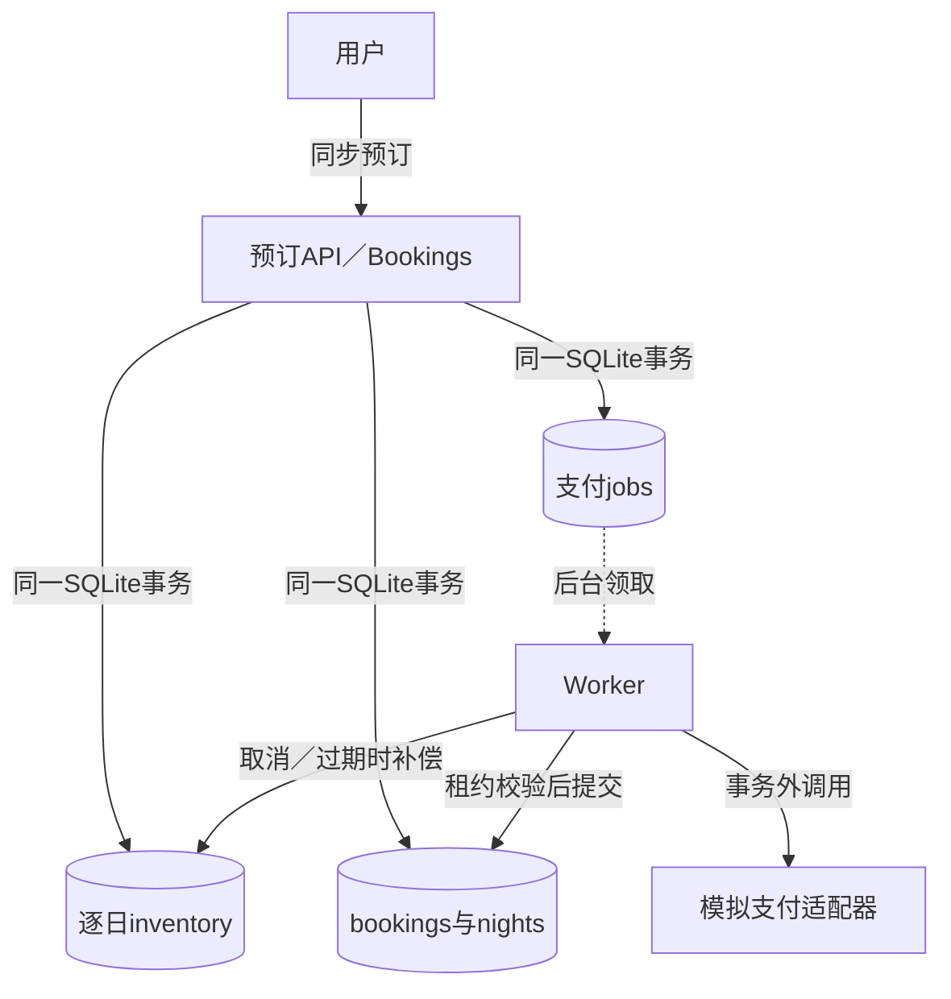
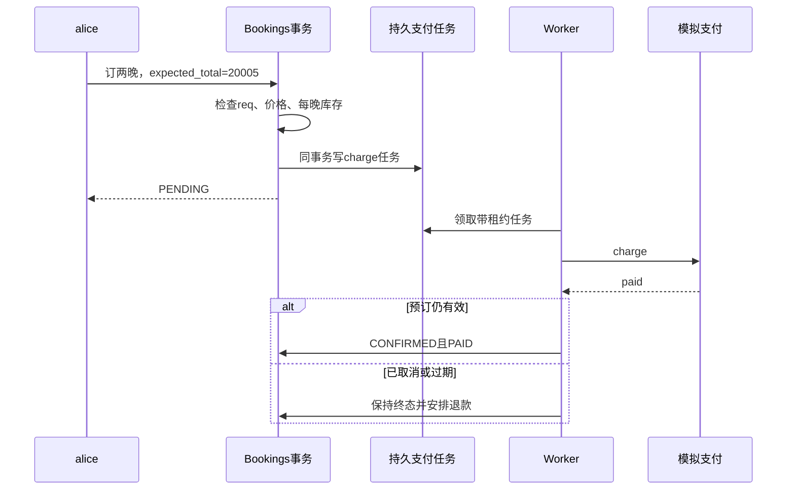

# 第23章：从两晚预订读懂库存事务与支付补偿

酒店预订先做两件事：在数据库里占住房间，再在数据库外收钱。前者可由本地事务原子完成，后者需要异步任务、幂等支付和补偿。把预订`status`与支付`payment`分开看，就不会把“房间已锁定”误读成“已经付款确认”。这里的支付接口只支持模拟方法。

## 贯穿案例：alice预订两晚

沿测试配置：酒店h、房型king，入住`2030-01-02`、退房`2030-01-04`，每天容量10、允许10%超订，价格分别10002和10003美分。alice订1间，提交`expected_total=20005`、`request_key=req`、`payment_method=test-ok`。

受理后两个日期的reserved都加1，预订为`PENDING`，产生charge任务；收到可信paid回执后才确认。相同req和相同内容再次提交返回原预订，不能再占两晚库存。

## 读懂这几个状态就够开始

| 状态／数据 | 本案例的变化 | 谁能决定 |
|---|---|---|
| `inventory.reserved/version` | 两晚各增加1 | 预订写事务，不能由缓存查询结果决定 |
| `bookings.status` | PENDING→CONFIRMED，或CANCELLED等终态 | 受理和Saga状态推进 |
| `bookings.payment` | NONE→PAID，取消后可能REFUND_PENDING | 可信支付结果与补偿任务 |
| `held` | 是否仍占库存 | release只应释放仍持有的库存 |
| `nights.day/price` | 保存两晚价格快照 | 预订受理事务 |
| jobs租约 | 同一次领取的身份与期限 | claim／finish，旧worker不能越权完成 |

## 六站读到核心代码

1. {{symbol:src/hotel_reservation/catalog.py:Catalog.availability}}：先看查询怎样给出当前报价和库存；记住它只是查询。
2. {{symbol:src/hotel_reservation/bookings.py:Bookings.reserve}}：从user和body开始，顺着幂等检查、报价检查、逐日占库、建预订和任务读下去。
3. {{symbol:src/hotel_reservation/saga.py:Saga.claim}}：找到hold过期清理及任务租约，理解后台为什么能够重启。
4. {{symbol:src/hotel_reservation/worker.py:Worker._work}}：标出支付调用与数据库回调的分界，以及未知异常如何变成重试。
5. {{symbol:src/hotel_reservation/saga.py:Saga.finish}}：检查paid结果到来时预订是否仍能确认。付款成功不保证预订还未取消。
6. {{symbol:src/hotel_reservation/bookings.py:Bookings.release}}与{{symbol:src/hotel_reservation/bookings.py:Bookings.cancel}}：跟踪库存释放和必要的退款任务，不要只读状态字符串。

## 微观一：幂等检查必须在占库之前

{{excerpt:src/hotel_reservation/bookings.py:Bookings.reserve:29:9}}

身份范围是hotel、user和request_key，内容hash防止同一身份偷偷更换入住日期或数量。命中后直接返回原结果，绕过第二次占库。如果只在HTTP层做临时去重，重启或并发请求仍可能重复扣库存。

## 微观二：预检查不足以防超卖

{{excerpt:src/hotel_reservation/bookings.py:Bookings.reserve:55:8}}

决定是否成功的是UPDATE中的容量条件与`rowcount`。两晚中任意一晚更新失败就抛错，由外层事务回滚已经更新的其他日期。配置允许超订时上限也不是简单capacity；阅读表达式时应把整数房间数与百分比一起算。

## 用失败来检验理解

两个日期中第二晚库存不足时，第一晚不能留下占用；对应{{symbol:tests/test_store.py:StoreTests.test_second_night_failure_and_precommit_exception_rollback}}。模拟支付已经扣款但回执丢失时，不能把未知结果当明确拒绝；重试必须沿原任务身份恢复。

更容易漏掉的是支付调用过程中用户取消。{{symbol:tests/test_worker_reliability.py:WorkerSagaTests.test_cancel_during_payment_requires_compensation_without_confirming}}断言最终不能重新确认取消的预订，而应推进补偿。{{symbol:tests/test_store.py:StoreTests.test_multinight_atomicity_price_snapshot_idempotency}}则验证两晚报价、原子性和重复请求。

## 自查与练习

- **为什么availability说有房，reserve仍可能409？** 查询后库存或价格会变化，写事务必须重新检查。
- **支付成功能直接把所有预订改CONFIRMED吗？** 不能，取消、过期与租约条件仍需复核。
- **重复取消会把reserved减成负数吗？** release依据held保护，测试还需确认只释放一次。

练习：在两晚中只给第一晚足够库存，尝试预订后重新查询两晚。预期失败，第一晚reserved也保持原值。再按req重试已成功订单，预期返回同一预订且库存不变。运行步骤见{{file:README_CN.md}}。
