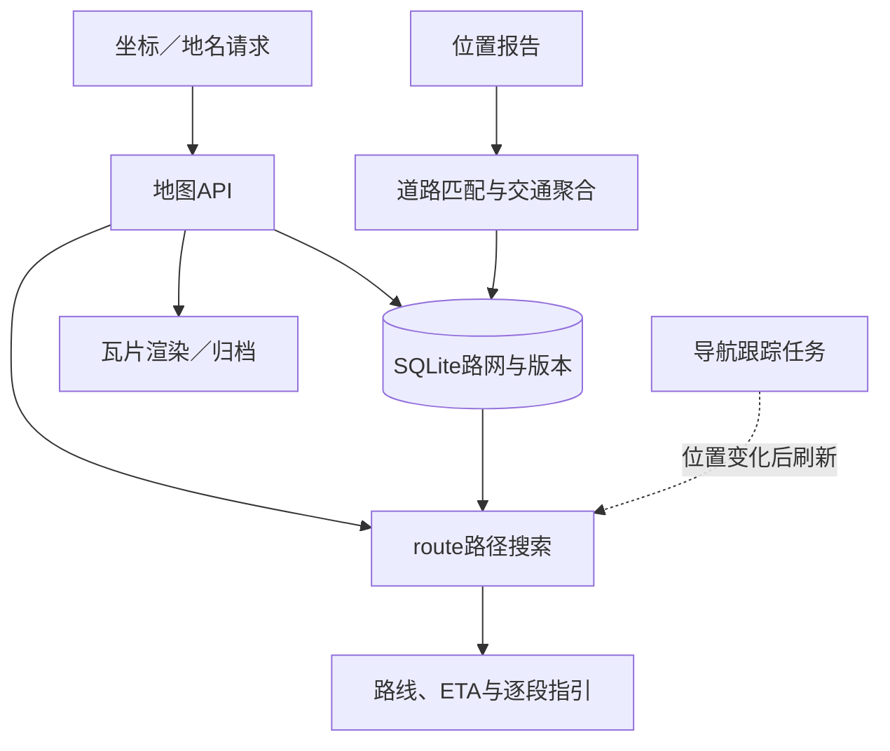
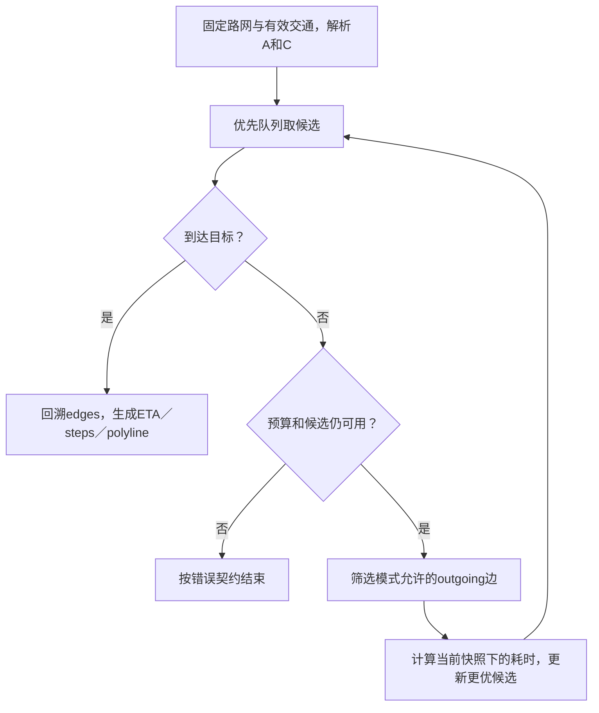

# 第19章：从“同一条路为何忽然绕行”理解地图系统

地图服务不是一张PNG。这个项目同时维护**路网、定位与交通、路线计算、瓦片和导航会话**。初学时先只追一件事：为什么从A到C的路线会随交通状态变化。

本文使用单Store的SQLite路网与交通快照。瓦片归档、副本读取和跨区域演示是后续路径；它们不应混进首次学习的最短路循环。

## 一个可以预测的案例

测试路网里，A→B→C是常用路线，另一条是A→D→E→C。

- 初始driving查询使用正常边代价。
- 把bc边实时速度降到1m/s，并设TTL=30秒，driving会改走ad、de、ec。
- 同一时刻walking仍可走ab、bc，因为步行使用自己的速度与模式规则。
- 时钟推进30秒，过期交通不再生效，driving回到ab、bc。
- 把通向C的两条关键边都关闭，则应返回无可达路线错误，而不是伪造直线导航。

这个案例把几何、道路连接与实时代价分开，正好对应代码中的三层数据。

## 宏观：先固定数据视图，再算路线

| 数据 | 字段／概念 | 学习重点 |
|---|---|---|
| 路网节点 | node id、坐标 | 起终点怎样定位到图 |
| 路网边 | edge id、连接、模式、长度及通行属性 | 道路单向和交通模式不是地理距离 |
| 交通记录 | edge、speed_mps、closed、expires | 只使用未过期视图 |
| 数据版本 | graph与traffic相关版本 | 返回路线使用哪份数据 |
| 搜索队列 | 累计代价、候选节点 | 用代价搜索，而不是贪心选最近点 |
| 返回路线 | edges、eta_seconds、steps、polyline | 指引和ETA必须来自同一结果 |
| 导航会话 | 当前起点及版本／状态 | 后台刷新不能覆盖更新的位置 |

## 六站源码路线

| 顺序 | 位置 | 本站要回答的问题 |
|---|---|---|
| 1 | {{symbol:src/maps_service/store.py:Store.import_graph}} | 节点与边怎样成为可用路网，导入失败是否原子 |
| 2 | {{symbol:src/maps_service/store.py:Store.resolve}} | A、C或坐标怎样解析为图节点 |
| 3 | {{symbol:src/maps_service/navigation.py:route}} | 哪些参数先校验，怎样固定路网与交通视图 |
| 4 | {{symbol:src/maps_service/store.py:Store.outgoing}} | 给定节点和模式，哪些边允许进入搜索 |
| 5 | {{symbol:src/maps_service/telemetry.py:Telemetry.traffic}} | bc速度和期限怎样保存，何时不再参与计算 |
| 6 | {{symbol:src/maps_service/navigation.py:encode_polyline}} | 搜索路径怎样成为客户端几何；再看 {{symbol:src/maps_service/tracking.py:NavigationTracker.run_once}} |

第一次阅读只跟A、B、C几个节点，不必先研究PNG编码。路线主线理解后，再把瓦片看成另一条读取路网的展示路径。

## 微观一：为什么先读交通快照

{{excerpt:src/maps_service/navigation.py:route:19:18}}

事务里取得ready元数据，解析source与target，再读取expires仍有效的traffic。这样本次搜索不会一半使用旧速度、一半使用新速度。

思考bc=1m/s的例子：距离没有变化，变化的是边的耗时。所以路线变化不应通过修改节点坐标实现。walking有自己的代价规则，也不应机械套用driving实时速度。

## 微观二：一个搜索循环要守住什么

继续在route中定位优先队列、costs和visited：

1. 队列保存当前候选代价；不断取出最值得扩展的候选。
2. outgoing先限定可走边，代价计算再考虑交通、模式和避收费条件。
3. 更优代价才更新候选与前驱，否则会无限重复扩展。
4. 到达目标后根据前驱恢复edges和节点，再从同一交通视图生成ETA和steps。

max_nodes是搜索预算，不是业务上的路程上限。找不到路与超过预算都应按实现的错误契约处理，不能返回尚未到达终点的半条路线。

这张图是阅读算法的顺序线索；具体的备选路线枚举和预算共享仍需核对route后半段，不能把简图当作完整实现。

## 微观三：ETA和指引不能各算一遍不同的交通

如果ETA使用bc旧速度，steps却在之后用新速度重新查库，两者就会自相矛盾。项目测试专门比较单边路线的eta_seconds与step.duration_seconds。

道路关闭也不同于速度很慢：closed边应被排除，不能靠设置一个很大耗时保证“总有路线”。

导航会话还有另一类竞态：旧刷新工作算完时，用户位置可能已更新。它不能把旧origin和路线覆盖回来，阅读tracking时检查版本条件。

## 看测试而非猜地图效果

- {{symbol:tests/test_maps.py:MapsTests.test_traffic_expiry_closure_and_rerouting}}：按本页顺序预测driving绕行、walking不绕、30秒后恢复、双边关闭时报错。
- {{symbol:tests/test_navigation_reliability.py:NavigationReliabilityTests.test_directions_use_same_traffic_snapshot_as_route_eta}}：单边长度222.4m，driving速度20m/s时step应为222.4/20秒，且等于ETA。
- {{symbol:tests/test_tracking_reliability.py:TrackingTests.test_obsolete_refresh_cannot_overwrite_concurrent_position_update}}：观察旧后台结果为何被拒绝发布。

## 自查与练习

**距离最短就一定用时最短吗？** 不一定，实时速度、模式和通行条件共同影响代价。

**交通到期需要改掉路网边吗？** 不需要。交通是有期限的派生状态，读取时过期记录不再作用。

**瓦片画出道路就代表这条路能走吗？** 不代表，路径搜索还要检查模式、方向和关闭条件。

练习：只调整bc速度与TTL，保持几何不变，分别预测driving和walking结果。然后把TTL推进到恰好过期，核对expires比较边界，观察路线与traffic版本的区别。
