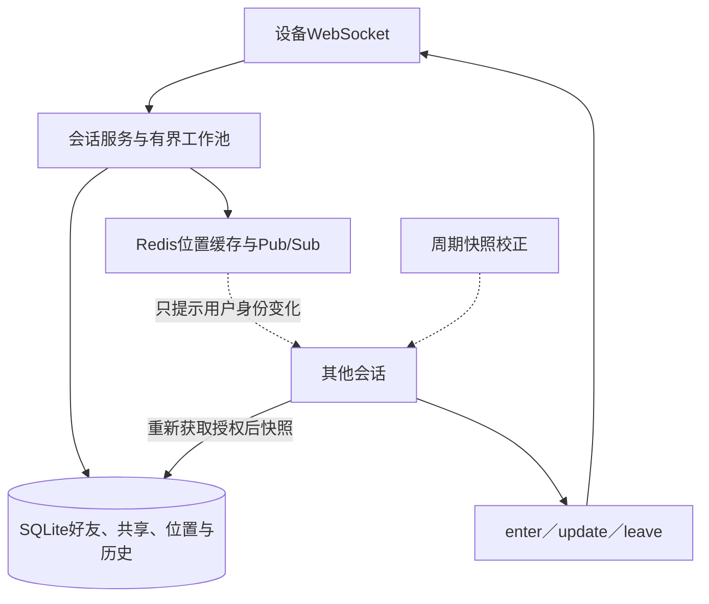
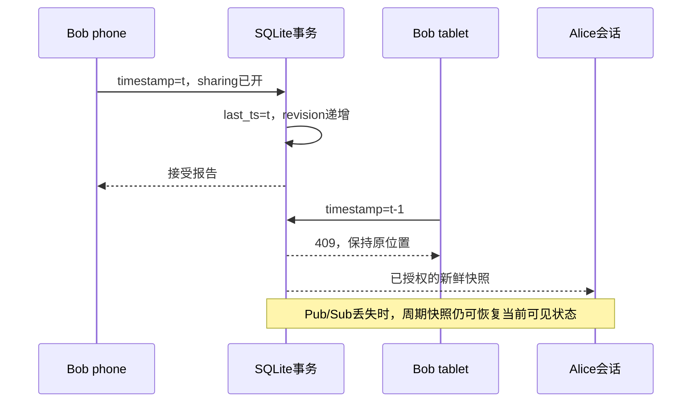

# 第18章：从一次位置上报看懂附近好友

附近好友首先是一个授权与时效问题：**谁允许谁看到哪份仍新鲜的位置**，然后才是距离计算和实时推送。项目把好友确认、共享开关和位置记录放进SQLite，Redis承担位置加速与变化提示，WebSocket会话把当前快照变成enter／update／leave。

本文选本机共享SQLite元数据、Redis及WebSocket节点的实验方案。SQLite文件不是跨主机HA数据库，Pub/Sub也不是可重放消息日志，见 {{file:README_CN.md}} 的部署边界。

## 用Alice和Bob走一遍

Alice、Bob都已开启位置共享并分别上报位置，但还不是双向确认好友，因此Alice的reports里看不到Bob。

Alice发出好友请求，Bob接受后，Alice可看到Bob的新鲜位置。Bob在phone上报timestamp=t，tablet随后发送t-1，后者应被拒绝。换设备不能绕过按用户维护的时间水位。

Bob关闭sharing后立即失去可见性；再打开开关也不能复活旧位置，需要重新上报。最后，让Bob停止上报直到超过TTL，附近快照应移除他。

## 宏观：持久授权、瞬时提示、完整快照

| 状态 | 关键字段 | 谁决定正确性 |
|---|---|---|
| 好友关系 | 请求与已确认关系 | SQLite事务；单向请求不足以查看 |
| 共享开关 | sharing | 当前授权状态 |
| 用户时间水位 | last_ts | 同一用户跨设备必须单调增加 |
| 位置报告 | latitude、longitude、timestamp | 设备提供的位置与事件时间 |
| 接收时刻 | received_at | 服务端取得写事务后采样，用于TTL |
| 位置版本 | revision | 新旧报告与缓存修复身份 |
| 历史许可 | 独立历史设置 | 不能从实时共享直接推导历史授权 |

## 六个源码站点

1. {{symbol:src/nearby_friends/core.py:Store.friendship}}：按friend.request、friend.accept、friend.remove跟踪同一对用户；观察双向可见性何时建立。
2. {{symbol:src/nearby_friends/core.py:Store.setting}}：查看关闭sharing怎样影响旧位置，及再次开启为何不能复用旧报告。
3. {{symbol:src/nearby_friends/core.py:Store.update}}：输入actor和位置body，先校验再在写事务内判断时间；输出带revision与received_at的报告。
4. {{symbol:src/nearby_friends/core.py:Store.reports}}：输入当前用户，查询可见好友的新鲜报告；这是缓存和实时广播必须遵守的事实边界。
5. {{symbol:src/nearby_friends/core.py:Store.read_history}}：检查历史授权、分页和保留期限，区分“现在可见”与“允许保存历史”。
6. {{symbol:src/nearby_friends/core.py:Store.sweep}}：查看过期清理；再进入 {{file:src/nearby_friends/server.py}}，把持久逻辑与会话增量连接起来。

先弄懂reports的结果，再读Redis缓存。缓存中的坐标不能跳过好友和共享校验直接发给别人。

## 微观一：时间检查为什么要放在写锁之后

{{excerpt:src/nearby_friends/core.py:Store.update:0:16}}

顺着例子看三道门：

- `now - ttl < stamp <= now + 30`：过旧或过度超前的报告拒绝。
- `sharing`：还未允许共享时不能上报公开位置。
- `stamp <= last_ts`：相同或更旧报告都不能覆盖当前用户状态，不按device分别放行。

尤其注意now在事务内采样。上报可能排队等待SQLite写者；排队前新鲜的报告，拿到写锁时已经过期，就不能获得一份“重新起算”的TTL。

## 微观二：revision与timestamp分别解决什么

timestamp决定用户事件先后；revision是服务端接受的新版本序号。设备时间不可靠，所以received_at单独记录服务器接收时间。它们不能压成一个字段。

允许更新后，代码增加revision，更新用户last_ts并保存报告。后续Redis暖缓存或延迟修复必须尊重版本，不能把旧报告写回成最新，更不能延长原本的TTL。

## 失败与隐私不是同一种分支

Redis不可用时，读取仍需从持久状态获得完整、已授权的数据，缓存修复要有批次和预算限制。缓存故障不应为每个好友各增加一个长超时。

共享关闭、好友删除或TTL到期时，则应从当前快照移除位置。这不是“重试缓存就能恢复”的临时网络错误。leave增量只携带身份，不应把旧坐标再附带出去。

Pub/Sub只提示发生变化，可能丢失；系统周期核对当前快照。重连恢复的是现在的快照，不是重放丢失的所有移动轨迹。

## 用测试建立边界

- {{symbol:tests/test_core.py:CoreTests.test_authentication_and_mutual_consent}}：双方都有位置仍不可见，确认好友后才出现，remove后消失。
- {{symbol:tests/test_core.py:CoreTests.test_report_validation_and_ordering_across_devices}}：phone后来的tablet旧报告被拒绝；重启也不能绕过last_ts。
- {{symbol:tests/test_core.py:CoreTests.test_privacy_off_requires_new_location_on_reenable}}：再次开启共享不复活旧坐标，必须有新报告。
- {{symbol:tests/test_network.py:NetworkTests.test_reconnect_ttl_and_pubsub_loss_recovery}}：真实Redis／WebSocket实验核对断线、TTL与丢提示恢复，依赖环境按README准备。

## 自查与练习

**TTL使用设备timestamp就够了吗？** 不够。事件时间用于排序；服务器received_at承担接收时效，且必须在取得写资格后采样。

**删除好友需要等缓存过期才隐藏吗？** 不应该靠TTL拖延。当前授权与快照复核负责隐私边界。

**Pub/Sub丢了就丢失位置事实吗？** 不等于。持久位置仍在，周期核对重建当前可见快照。

练习：在受控时钟下，phone报t，tablet报t-1，再报t+1。预期中间一次409且不改变revision，最后一次接受。随后关闭再开启sharing，检查必须重新报告才恢复可见。
