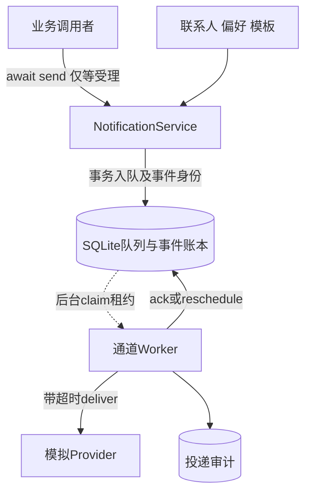
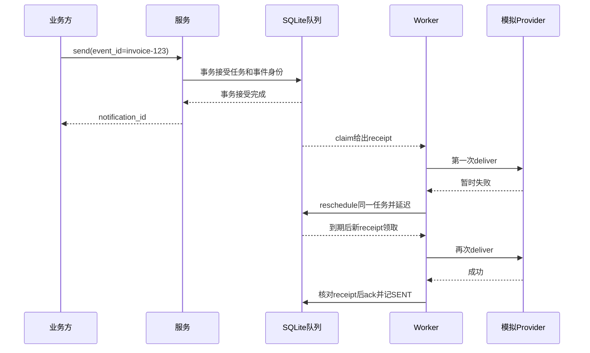

# 第11章：从“受理成功”走到“投递成功”

通知系统把业务请求转换为**可重试的投递任务**。`send` 成功说明任务已接受，Worker稍后才调用Provider；重试和进程重启都发生在这条边界之后。本页选择SQLite持久队列与模拟Provider，避免把默认内存队列的行为误认为已经持久化。

## 案例：同一张发票只受理一次

用户user已配置邮箱 `user@example.com`、开启EMAIL通道。提交 `event_id="invoice-123"`、正文 `"invoice ready"`。得到通知ID后启动Worker；模拟Provider第一次暂时失败、第二次成功。预期始终沿用同一通知身份，最后状态为SENT。

此时即使任务已确认删除、进程重启，再提交同一event_id、recipient和channel，仍应抛重复通知错误并带原通知身份。这里的业务事件账本独立于“队列里还有没有这条任务”。

持久队列保护任务与事件身份；联系人、偏好、限流等默认仍属进程内状态。Provider是模拟实现，不表示已经接入真实邮件、短信或推送服务。

## 用三个身份看懂数据

| 状态 | 关键字段 | 生命周期 |
|---|---|---|
| `NotificationRequest` | recipient_id、channel、event_id、title/body | 业务输入 |
| `NotificationTask` | notification_id、endpoints、attempt、completed_endpoints | 同一通知投递与重试的载荷 |
| `notification_events` | event_id、recipient_id、channel → notification_id | 接受成功后保留，终态后也不删除 |
| `notification_jobs` | id、payload、available、receipt、lease_until | 可领取、执行、延迟重试直至确认 |
| `receipt` | 每次claim新生成的随机凭据 | 防止过期Worker确认新租约 |
| `notification_log` | status、attempt、error_details | 持久审计，不是外部收件人的已读证明 |

## 七站阅读路线

1. {{symbol:src/notification_system/service.py:NotificationService.send}}：检查请求和计划时间，再按收件人条带锁串行受理；返回通知ID。
2. {{symbol:src/notification_system/service.py:NotificationService._accept}}：先检查显式event_id，再解析端点、偏好和模板；找到任务快照在哪里构造。
3. {{symbol:src/notification_system/durable.py:SQLiteMessageQueue._enqueue}}：在写事务里重新检查事件身份并接受任务；这才守住跨实例重复受理。
4. {{symbol:src/notification_system/durable.py:SQLiteMessageQueue._claim}}：输入通道，输出带receipt的任务；数据库不删除任务，只标记租约。
5. {{symbol:src/notification_system/worker.py:Worker._process_claim}}：并行监视投递与续租，处理取消时返回任务或依赖租约恢复。
6. {{symbol:src/notification_system/worker.py:Worker._process_task}}：再查偏好、跳过已完成端点、调用Provider；下一站处理失败。
7. {{symbol:src/notification_system/retry.py:RetryHandler.handle_failure}}：决定重试或终态；最后看 {{symbol:src/notification_system/durable.py:SQLiteMessageQueue._ack}} 如何核验当前租约。

## 微观一：先查去重还不够，接受事务必须再查

{{excerpt:src/notification_system/durable.py:SQLiteMessageQueue._enqueue:0:17}}

`BEGIN IMMEDIATE` 取得写事务；用event_id、收件人和通道查询持久账本。若已经存在直接报重复，未存在才检查通道容量并准备接受。继续向下读：任务插入、QUEUED审计和事件账本都在同一事务。

两个进程可以同时通过服务层的初次查询，但不能都通过这个写事务。进程内条带锁只减少本进程竞争，不能替代数据库唯一键。

## 微观二：旧Worker不能确认新Worker领到的任务

{{excerpt:src/notification_system/durable.py:SQLiteMessageQueue._ack:0:11}}

删除语句同时匹配通知id、receipt和未过期租约。如果Worker停顿到租约失效，另一个Worker已经领取，旧receipt即使携带正确notification_id也不能删除新任务；rowcount为0时必须报错。

这条时序不承诺外部恰好一次：Provider已发送但Worker来不及确认时，恢复可能重复调用。供应商幂等需要额外集成。

## 两个很容易误解的失败结果

队列满不是“接受后等待”：入队拒绝应保持业务可重试，不能顺手耗尽本地限流额度或污染内容去重。已经受理的任务暂时投递失败，则使用延迟重试归还Worker，避免一个失败通知占住唯一Worker睡眠。

- {{symbol:tests/test_runtime_reliability.py:test_event_id_dedup_survives_ack_restart_and_concurrent_acceptance}}：两实例并发只接受一个，任务确认和重启后相同业务事件仍被识别。
- {{symbol:tests/test_runtime_reliability.py:test_durable_lease_recovers_process_exit_and_fences_stale_ack}}：子进程领取后退出，过期任务可恢复；旧receipt不能确认它。
- {{symbol:tests/test_runtime_reliability.py:test_retry_yields_worker_to_other_jobs_and_provider_exception_isolated}}：单Worker的实际投递次序为first、second、first，而非被first的重试等待堵住。

## 自查与练习

- **删除完成队列项会让同一event_id重新受理吗？** 不会，事件账本独立保留。
- **SENT是否说明用户已经阅读？** 不是，它表示Provider调用成功这一层的状态。
- **多设备推送部分成功后是否重试全部端点？** 任务记录已完成端点，重试只处理剩余端点；最终应结合永久拒绝分支检查结果。

按运行示例把同一业务事件提交两次，再重启服务提交第三次；预期只产生一个被接受的通知身份。换成新event_id、相同正文应允许成为新的业务通知。随后在模拟Provider制造一次暂时失败，观察attempt、receipt和审计如何分别变化。运行方式见 {{file:README_CN.md}}。
