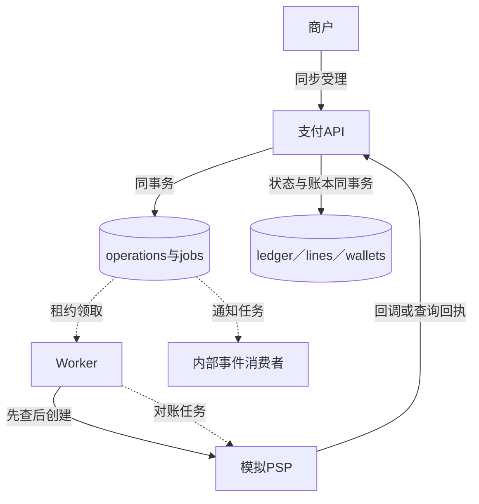
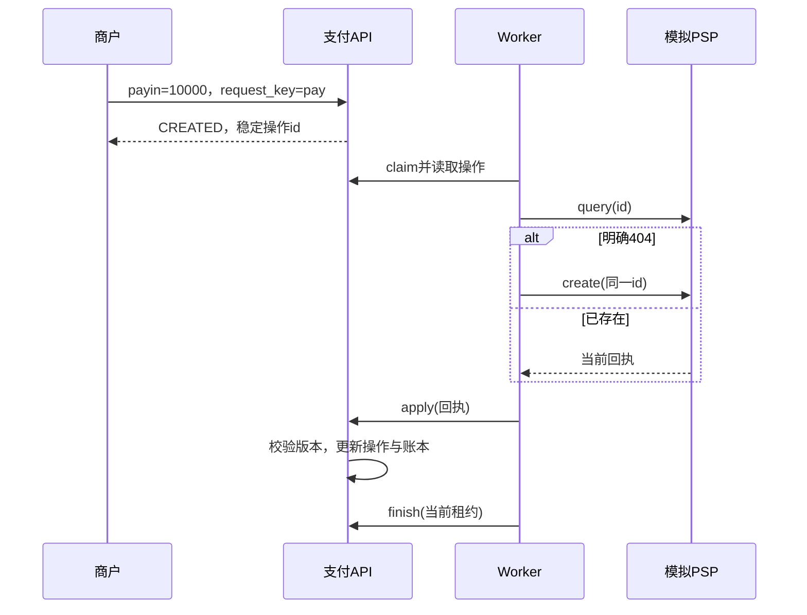

# 第27章：从10000美分收款读懂支付结果与账本

支付服务接受的是一个需要执行的意图，供应商回执才告诉系统外部操作的结果，账本记录结果怎样影响资金。网络超时连接着这三者：它可能发生在供应商成功之后，所以不能简单当成失败退款。这里所有收款、出款、退款和PSP都是本机模拟；金额为整数美分、单币种USD。

## 贯穿案例：seller收款10000

seller提交payin：`request_key=pay`、`order_id=order_pay`、`amount=10000`、`currency=USD`。受理时操作为`CREATED`，可用余额还没有因这次收款增加。模拟PSP给出匹配的SUCCEEDED回执后，可用余额增加10000。重复同一请求／回执都不能再次入账；同一request_key换金额应该冲突。

对账检查“供应商和本地记录是否一致”，不是另一种收款执行。先读一笔payin，再扩展到会预留余额的payout和refund。

## 数据与身份地图

| 对象 | 关键字段／身份 | 什么时候变化 |
|---|---|---|
| 业务操作 | `id/merchant/kind/amount/currency/status` | 受理后有稳定id，外部回执推动状态 |
| 请求去重 | merchant＋request_key及内容hash | 防止同一商户请求被重复执行或换内容 |
| PSP回执 | `provider_id/revision/status`及操作身份 | 版本乱序与同版本冲突都需判断 |
| `inbox` | 回调event_id与hash | 相同回调身份只能代表相同内容 |
| 复式账本 | `ledger`事务与`lines`借贷两行 | 资金变化必须与操作状态一致 |
| `wallets.available/held` | 可用／已冻结 | 出款和退款先reserve，未知结果不应随便release |
| jobs | 持久任务与租约 | 表示待执行工作，死信不是资金已经安全退回 |

## 六站阅读路线

1. {{symbol:src/payment_system/operations.py:OperationMixin.create}}：把请求身份、订单唯一性和余额约束先读懂；输出是CREATED操作及执行任务。
2. {{symbol:src/payment_system/jobs.py:JobMixin.claim}}：找到领取身份、attempt和lease，别把一个操作和一次执行尝试混淆。
3. {{symbol:src/payment_system/worker.py:work_once}}：逐行追先query、只有404才create，再apply和finish的顺序。
4. {{symbol:src/payment_system/operations.py:OperationMixin.apply}}：检查回执字段、版本、inbox以及供应商身份后，才看资金变化。
5. {{symbol:src/payment_system/ledger.py:LedgerMixin.post}}：输入操作与记账方向，检查双边金额、幂等身份和非负余额约束。
6. {{symbol:src/payment_system/reconciliation.py:ReconciliationMixin.reconcile}}与{{symbol:src/payment_system/ledger.py:LedgerMixin.audit}}：比较外部对账单、本地操作、账本和钱包，理解异常为什么进入review。

## 微观一：先查询供应商，再考虑创建

{{excerpt:src/payment_system/worker.py:work_once:19:16}}

核心是`query(op['id'])`在前；只有明确404才调用create。连接断开、500或其他未知错误都不是“供应商一定没执行”。传递同一deadline和cancel让一次工作尝试共享预算，避免每个子调用都重新获得完整超时。

创建后应答丢失时，下次仍先query同一id；不能用新id再扣一遍。创建结果若仍PENDING，当前任务也不能当成已成功收款。

## 微观二：账本方向取决于操作类型

{{excerpt:src/payment_system/ledger.py:LedgerMixin.post:0:14}}

payin结算从`psp:clearing`转到商户available；payout／refund从held转到清算。reserve和release仅在available与held之间移动。这里不是任意两账户都能调用post：后面会核对操作类型、金额和允许方向，再检查已存在的账本身份。

因此10000收款对应一次有效settle；重复回执不能再新增10000。冻结余额时可用余额下降不表示资金已经离开系统，审计还会把available与held一起比较。

## 失败与测试要看什么

{{symbol:tests/test_store.py:StoreTests.test_concurrent_idempotency_and_order_identity}}：相同商户请求并发提交，只能产生同一操作身份；同订单身份也有约束。

{{symbol:tests/test_store.py:StoreTests.test_expired_lease_fencing_and_unknown_recovery}}：旧租约不能完成新尝试，供应商未知结果保留恢复路径。{{symbol:tests/test_store.py:StoreTests.test_balanced_immutable_ledger_and_atomic_rollback}}检查账本借贷平衡以及失败回滚。

更隐蔽的错误是同一个provider交易号给两个操作入账；{{symbol:tests/test_safety.py:PaymentSafetyTests.test_provider_transaction_identity_cannot_credit_two_operations}}应阻止这种情况。读测试时比较钱包值、账本笔数和review结果，不只看HTTP状态码。

## 自查与练习

- **网络超时能证明扣款失败吗？** 不能，可能是提交后回执丢失，需要查询或对账。
- **死信任务能自动释放held吗？** 不能，仅执行失败不等于外部资金结果已知。
- **同一回执重复出现为什么不能直接忽略全部校验？** 同身份不同内容或版本冲突可能表明数据不可信。

练习：用StoreTests的receipt辅助函数对同一payin应用两次SUCCEEDED回执。预期第二次不会再次增加钱包或结算账本；再修改相同身份的金额，预期拒绝或进入明确审查路径，资金不变。运行与模拟收银台见{{file:README_CN.md}}。
