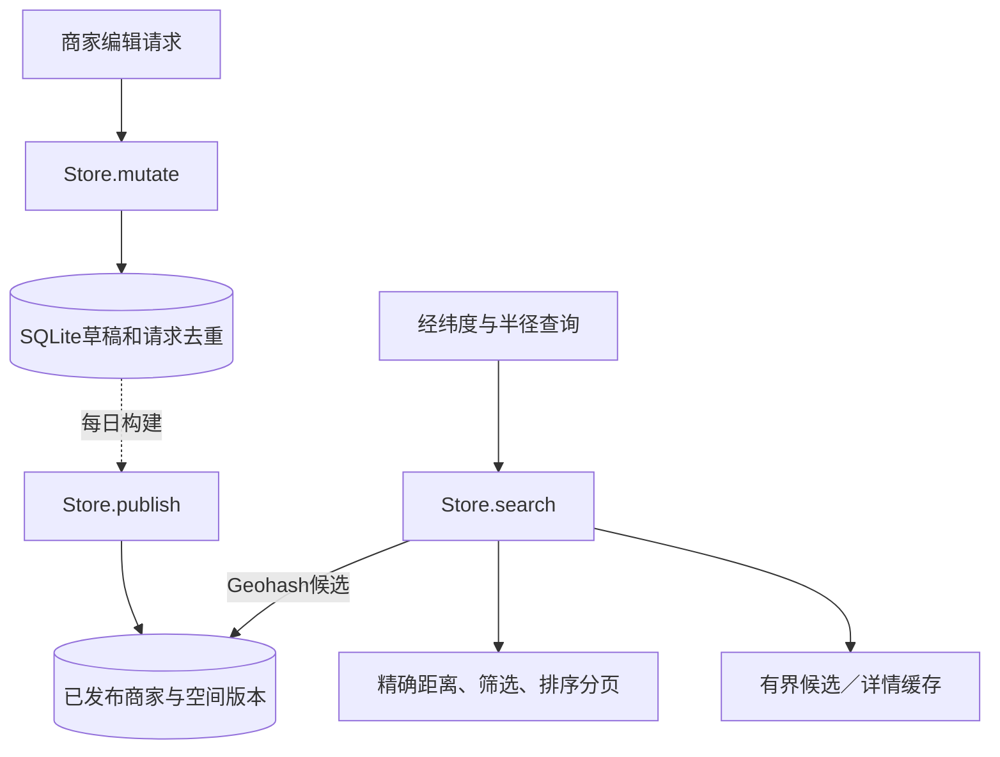
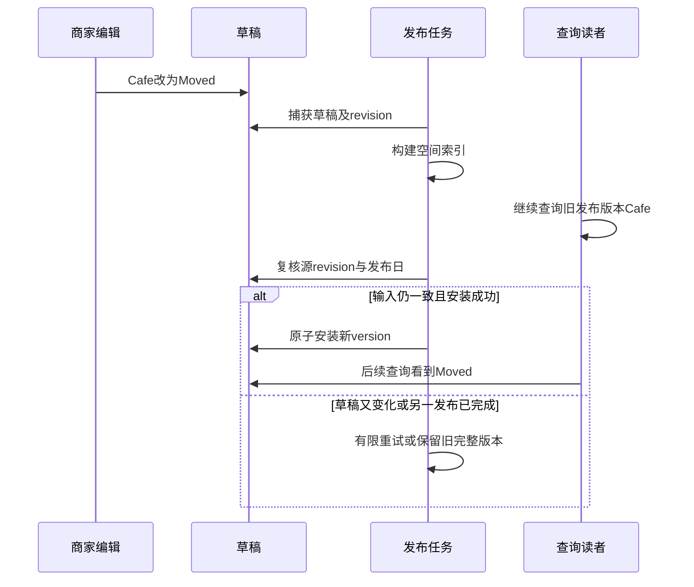

# 第17章：从“附近咖啡店为什么明天才出现”理解商家搜索

本项目的关键不是距离公式本身，而是**商家编辑数据与对外搜索数据使用不同版本**。商家变更先进入草稿，发布任务生成一个完整可读版本；搜索在这个版本中用空间索引缩小候选，再算真实距离。

本文学习单Store＋SQLite方案。HTTP副本路由与快照复制可在主流程清楚后阅读；本地副本实验不代表生产多地域高可用已解决。

## 一个跨两天的案例

在坐标(0,0)新增Cafe，今天搜索附近，total为0。时钟推进一天并发布，total变成1。

随后把Cafe移动到(10,10)，名字改成Moved。今天detail仍看到Cafe，下一天发布后，(0,0)附近不再找到它，重启后detail也能读到Moved。删除同样经过发布边界，不能把编辑成功误解为搜索已经变化。

距离例子使用球面距离；“附近”不是道路行驶距离或导航时间。

## 宏观：编辑路径与搜索路径分开

| 状态 | 关键字段／概念 | 谁使用 |
|---|---|---|
| 草稿商家 | 身份、位置、名称、分类及营业条件 | mutate与构建任务 |
| 草稿revision | 源数据变化标记 | 发布时判断构建输入是否过期 |
| 发布version | 当前查询可读批次 | search、detail与缓存键 |
| lineage | 数据源身份 | 游标和快照校验 |
| 查询fingerprint | 查询位置、半径等参数身份 | 防止游标用于另一查询 |
| 空间候选 | Geohash单元覆盖中的商家ID | 精确距离过滤前的缩小范围 |

## 六站源码路线

| 顺序 | 入口 | 输入→输出与学习目标 |
|---|---|---|
| 1 | {{symbol:src/proximity/store.py:Store.mutate}} | 编辑操作→草稿结果；先找请求幂等与归属校验 |
| 2 | {{symbol:src/proximity/store.py:Store.publish}} | 当前时间与草稿→可读发布版本；关注并发构建竞争 |
| 3 | {{symbol:src/proximity/store.py:Store._prepare}} | 草稿快照→待安装空间数据；这是慢构建阶段 |
| 4 | {{symbol:src/proximity/store.py:Store._install}} | 准备好的数据→原子安装；避免半份版本 |
| 5 | {{symbol:src/proximity/store.py:Store.search}} | 坐标、半径、cursor→一页商家；版本与参数先固定 |
| 6 | {{symbol:src/proximity/geo.py:cover}} 与 {{symbol:src/proximity/geo.py:distance}} | 前者生成候选格子，后者决定真实半径；别混成一种过滤 |

查单个商家时再读 {{symbol:src/proximity/store.py:Store.detail}}，比较它与搜索是否使用同一可读版本。

## 微观一：search为什么先触发publish却还能返回旧版本

{{excerpt:src/proximity/store.py:Store.search:10:12}}

注意三个位置：

1. cover根据坐标和半径决定候选单元，不能只搜索中心格子。
2. `publish(wait=False)`允许尝试推进到期发布，但读取不必一直等待一个已经在进行的慢构建。
3. 事务里取得metadata，游标同时检查查询fingerprint、version和lineage。换查询参数或换数据源后，不应无声沿用旧游标。

缓存必须以对应发布身份隔离；否则新版本已经切换，旧位置候选还可能被错误复用。

## 微观二：为什么读者要继续使用旧完整版本

这个选择让慢构建不必阻塞全部查询。代价是明确的发布延迟。应当在产品语义中接受它，而不是把它当作缓存失效Bug随意删掉。

## 边界：空间候选不是最终答案

某商家与查询点处于相邻Geohash格子，仍可能只隔几十米；同一个格子里也可能有超出半径的点。cover必须覆盖相邻格子，distance必须再做精确过滤。

分页游标也依赖版本。如果页间发布切换，代码应该按游标契约处理版本不匹配，不能把不同version的offset当作稳定快照继续读取。

## 用测试看见版本

- {{symbol:tests/test_service.py:StoreTests.test_next_day_restart_and_delayed_deletion}}：逐步预测total的0→1→0，再检查改名与删除何时可见。它也验证重启后的发布数据。
- {{symbol:tests/test_publication_reliability.py:PublicationTests.test_readers_serve_old_generation_while_due_build_runs}}：用事件暂停_prepare，查询仍应及时返回旧Cafe，而不是半成品Moved。
- {{symbol:tests/test_publication_reliability.py:PublicationTests.test_offline_build_retries_changed_draft_revision}}：构建期间再编辑，观察发布如何处理旧输入。

## 自查与练习

**编辑返回成功，为什么搜索没变化？** 编辑确认草稿接受；当前搜索承诺的是已发布版本。

**加大缓存TTL能解决漏搜边界商家吗？** 不能。漏搜首先可能是空间cover不完整，缓存只会延长错误结果。

**发布构建失败应清空搜索数据吗？** 不应该。旧完整版本仍可服务，失败不能发布半套新数据。

练习：在测试时钟下新增商家，保持时间不变查询，再推进一天查询。预期只在发布边界切换可见性；随后改位置但不推进日期，旧版本仍维持一致。
