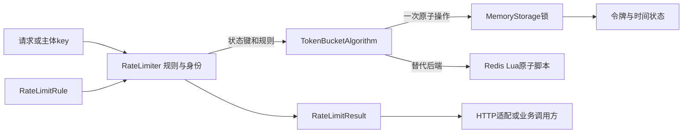
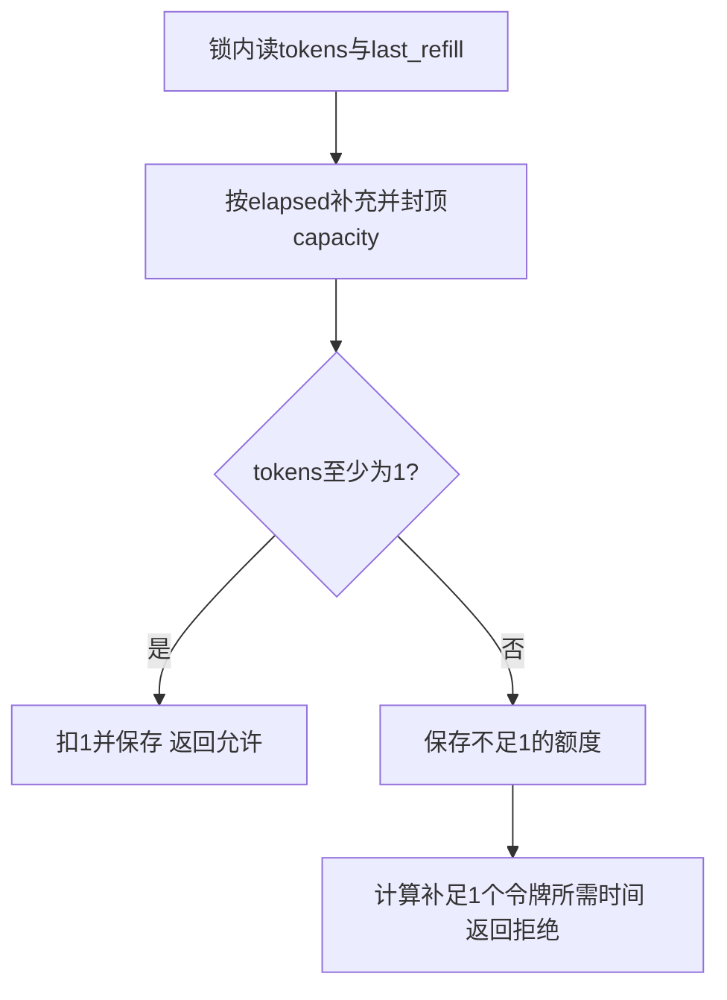

# 第5章：用三次请求读懂限流器

限流器把“请求是谁、适用什么规则”转换成一次**原子额度更新**。入口负责规则和身份，算法负责计算，存储负责让并发请求不能同时花掉同一份额度。先选一种算法和一种存储读通，再比较其他策略。

## 案例：每秒补1个令牌，最多存2个

选择 `TOKEN_BUCKET`、内存存储、`limit=1`、`window=1`、`capacity=2`，注入可控时钟，主体固定为 `user:alice`。在同一时刻连续检查三次：前两次允许，剩余额度依次为1和0；第三次拒绝，至少再补到1个令牌才允许。把时钟推进1秒，下一次允许。

不要用真实时间的快速循环验证这个例子；可控时钟才能区分算法补充额度与测试执行耗时。

图中的Memory与Redis是两种后端选择，学习案例使用Memory。普通业务调用返回结果对象；HTTP 429由接入层生成，不是 `check` 自动发送的响应。

## 状态到底归谁

| 数据 | 本例含义 | 归属 |
|---|---|---|
| `limit/window` | 持续补充速率1 token/s | 规则配置 |
| `capacity` | 突发上限2 | 规则配置，不等于持续速率 |
| `tokens` | 可用令牌，可为小数 | 存储中的额度事实 |
| `last_refill` | 上次计算时间 | 与tokens同一次原子更新 |
| `clock-v2` | 已观察到的时间水位 | 存储，防止时钟回退重置额度 |
| `remaining/retry_after` | 本次判定后的展示值 | 派生结果 |
| `_metrics` | checks/allowed/denied/storage_errors | 实例观测，不承担跨实例限流 |

## 六站阅读路线

1. {{symbol:src/rate_limiter/config.py:RateLimitRule.__post_init__}}：先确认持续速率和capacity含义，非法规则应在接收请求前失败。
2. {{symbol:src/rate_limiter/core.py:RateLimiter.check}}：输入主体字符串与规则，输出判定；规则被复制，调用方后续修改不影响这次检查。
3. {{symbol:src/rate_limiter/core.py:RateLimiter._state_key}}：同主体但不同规则参数必须隔离状态。读完后再观察Redis或内存中的实际键。
4. {{symbol:src/rate_limiter/algorithms/token_bucket.py:TokenBucketAlgorithm.check}}：计算capacity、refill_rate，把算法参数交给存储；此处还没有直接扣额度。
5. {{symbol:src/rate_limiter/storage/memory.py:MemoryStorage.execute_algorithm}}：在锁内取得时间水位并调用算法实现；这一步把并发读改写变成一个整体。
6. {{symbol:src/rate_limiter/algorithms/token_bucket.py:_memory_token_bucket_script}}：读令牌、补令牌、决定是否扣1并写回；返回后再看 {{symbol:src/rate_limiter/core.py:RateLimiter._evaluate}} 的异常策略和指标。

## 微观一：额度与时间必须在同一把锁内

{{excerpt:src/rate_limiter/storage/memory.py:MemoryStorage.execute_algorithm:8:13}}

锁内先清理过期状态，再取得当前时间；`now=max(wall,previous)` 不让已经观察过的时间倒退。随后整个Python算法在这把锁内运行，同时写令牌与补充时间，最后保存水位。

这保护的不是“一个加法”，而是“取旧额度 → 按时间补充 → 判断 → 扣除 → 保存”这个整体。如果每步分别加锁，第三个并发请求仍可能读到未扣除的额度。

## 微观二：令牌不足也要保存补充状态

{{excerpt:src/rate_limiter/algorithms/token_bucket.py:_memory_token_bucket_script:39:18}}

先算 `elapsed`，按时间补充并受capacity限制。足够1个就扣除；剩余小数会保存，返回给调用方的 `remaining` 则取整数。继续读函数后半部：拒绝时也保存当前令牌和时间，再用 `(1-tokens)/refill_rate` 得到等待时间，避免丢失部分补充。

## 两种失败要分开理解

额度不足是正常业务拒绝。存储异常则由 `_evaluate` 依据 `fail_open` 决定放行还是拒绝，同时增加 `storage_errors`。放行策略提高可用性，也可能让依赖故障期间失去限流约束；它不是算法计算出的“额度足够”。

多规则检查 {{symbol:src/rate_limiter/core.py:RateLimiter.check_request}} 会组合结果，但不是跨规则事务。即使最终被某条规则拒绝，其他规则的原子检查也可能已消耗额度。

- {{symbol:tests/test_chapter05_review.py:test_shared_memory_has_exact_concurrent_admission}}：多个线程并发检查同一主体，允许数量应恰好等于额度。
- {{symbol:tests/test_chapter05_review.py:test_clock_regression_never_resets_quota}}：时钟回退不能凭空恢复已消耗额度。
- {{symbol:tests/test_chapter05_review.py:test_burst_capacity_is_independent_of_steady_rate}}：capacity允许短时突发，持续补充速率仍由limit/window决定。

## 自查与练习

- **两个独立MemoryStorage能限制同一个全局主体吗？** 不能，它们各有自己的额度；共享同一对象或使用共享Redis才共享状态。
- **拒绝后等待retry_after再重试一定允许吗？** 不保证，期间其他并发请求也可能消耗新令牌。
- **capacity从2改为20是否把持续吞吐改成20/s？** 不会，补充速率仍是1/s。

把案例时钟只推进0.5秒后再检查，预期仍拒绝，且距补足1个令牌还需0.5秒；再推进0.5秒应允许。用返回值和存储状态解释这两个结果。安装与运行方式见 {{file:README_CN.md}}。
