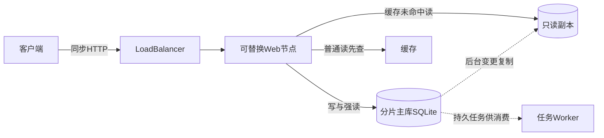
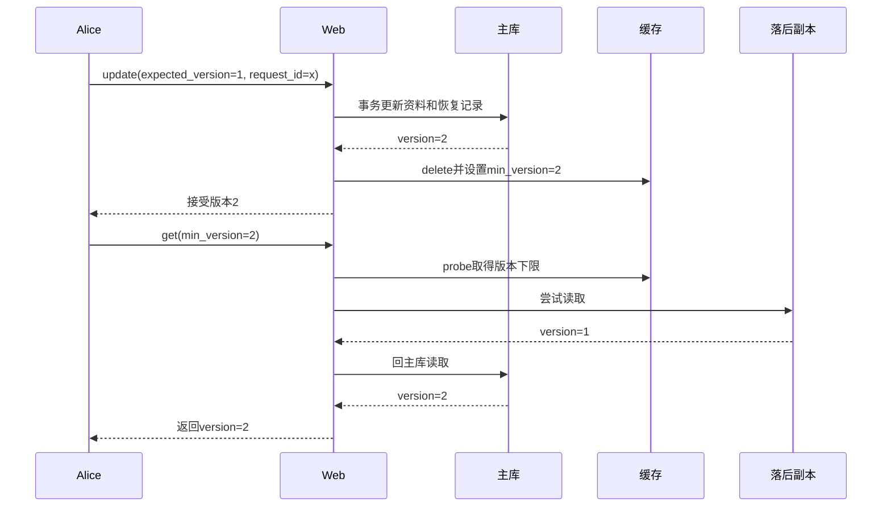

# 第2章：用一次资料更新理解缓存、复制和扩容

这个项目把一个用户资料服务拆成Web入口、分片主库、副本、缓存和后台任务。学习时先抓住一件事：**资料版本由主库事务决定，副本和缓存是有延迟的读取途径**。加机器之后，能否读到自己刚写入的版本，比组件数量更值得先理解。

## 案例：Alice把城市改为Shanghai

Alice当前资料是版本1。提交带唯一 `request_id`、`expected_version=1` 的修改，主库接受后应返回版本2。此时副本可能仍是1：普通读取允许最终一致；传 `min_version=2` 的读取必须跳过落后副本，不能把版本1当成成功结果。

本页先选择网络拆分方案。若给 `App` 注入本地 `store`，会直接访问该存储并绕过网络缓存／副本路径；这两个学习入口不能混为同一个部署。

虚线表示后台推进；SQL主库写入不等待副本追赶。GeoDNS、提升租约和缓存集群是进一步的故障处理层，先读通这里的单分片版本路径再扩展。

## 主数据和派生状态放在哪里

| 状态 | 字段或内容 | 对案例的意义 |
|---|---|---|
| `users` | id、version、profile | 版本2资料的事实来源 |
| `requests` | user、id（请求request_id）、hash、result | 相同请求重试返回原结果，不二次加版本 |
| `changes` | seq、user、version、profile、校验 | 副本按源顺序复制的持久变更 |
| `jobs` | 变更载荷、领取和完成状态 | 异步消费可恢复，不靠内存通知 |
| 缓存 `values` | TTL、资料版本和值 | 可淘汰的读取副本 |
| `floors/generation` | 已观察版本下限、回填票据 | 防止旧回源在失效后重新污染缓存 |

## 按这六站进入代码

1. {{symbol:src/scale_from_zero/app.py:App.update}}：输入Alice和修改体，输出带Web节点的版本记录。先确认主库结果被验证后才失效缓存。
2. {{symbol:src/scale_from_zero/profiles.py:ProfileMixin.update}}：真正的版本检查和事务写入。找到 requests/users/changes/jobs 同事务提交的位置。
3. {{symbol:src/scale_from_zero/app.py:App.get}}：带 `strong`、`min_version` 的读策略；输入版本下限，输出资料及 `source`。
4. {{symbol:src/scale_from_zero/cache.py:Cache.probe}}：缓存不仅返回value，还返回generation与版本下限。下一站看这些元数据怎样约束回填。
5. {{symbol:src/scale_from_zero/cache.py:Cache.put}} 与 {{symbol:src/scale_from_zero/cache.py:Cache.delete}}：失效会使旧票据无效，旧版本无法借未完成读重新写入。
6. {{symbol:src/scale_from_zero/replication.py:ReplicationMixin.replicate}}：后台读取变更并推进副本；最后再看 {{symbol:src/scale_from_zero/leadership.py:Fence.promote}}，理解为何落后副本不能直接提升。

## 微观一：请求身份和资料版本是两层保护

{{excerpt:src/scale_from_zero/profiles.py:ProfileMixin.update:9:14}}

写事务内先查同用户、同request_id：若找到且hash相同，返回原result；hash不同则409冲突。只有未接受过的新操作才继续检查 `expected_version`。

因此“网络超时后重试同一请求”不会再把版本2改成3；而一个新的修改请求如果仍声称基于版本1，则应遇到版本冲突。向下读可见资料、变更、幂等结果和任务一起写入，不能只保存users却忘了恢复信息。

## 微观二：缓存失效后，旧读不能复活旧值

{{excerpt:src/scale_from_zero/cache.py:Cache.put:7:11}}

回填先检查generation票据是否仍属于当前代，并检查值版本是否低于floor。案例里若旧读拿到版本1，随后版本2写入触发delete，旧票据会失效；即使旧读现在才返回，也不能把1重新放进缓存。

generation与floor解决不同问题：前者阻止失效前已经开始的读，后者阻止失效后从落后副本新读出的旧值。

## 失败后应看到什么

缓存故障时更新已经可能提交主库；`App.update` 记录缓存错误并返回已经确认的写结果。若主库响应没有达到 `min_version`，`App.get` 返回409，而不是伪称读到了新版本。需要严格主库读取时使用 `strong=True`，它会跳过缓存和副本。

- {{symbol:tests/test_app_safety.py:AppSafetyTests.test_inflight_read_cannot_repopulate_cache_after_write_invalidation}}：把旧回源停在中途，再完成写和失效；观察旧读回填被拒绝。
- {{symbol:tests/test_app_safety.py:AppSafetyTests.test_observed_write_floor_bypasses_stale_replica}}：副本落后时带版本要求的读回主库。
- {{symbol:tests/test_cache_safety.py:CacheSafetyTests.test_generation_is_not_reused_after_cache_restart}}：缓存重启后也不能把旧实例票据当作有效票据。

## 检查自己是否读懂

- **增加Web节点为什么不必把Alice会话固定在某个节点？** 会话验证走共享主库路径，Web节点不把会话事实只存在自己的内存中。
- **副本提升能只靠“旧主库连接失败”决定吗？** 不能，还要检查租约和追赶位置，隔离旧主库写权限。
- **普通缓存读能证明总是最新吗？** 不能，需结合版本下限或强读契约。

## 动手练习

保持副本停留在版本1，主库写入版本2。分别执行普通读、`min_version=2` 和 `strong=True`：后两种成功结果不得低于2；将下限设为一个尚不存在的版本应报冲突。对照返回的 `source` 解释每条路径，运行配置见 {{file:README_CN.md}}。
