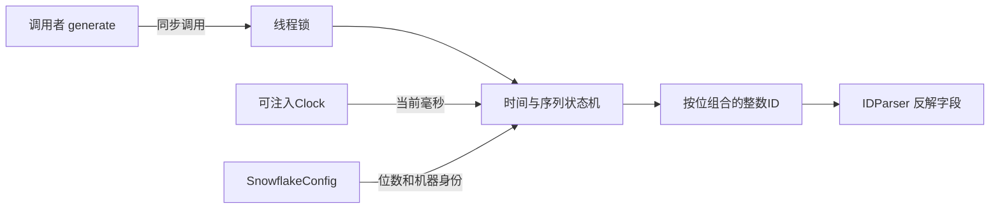
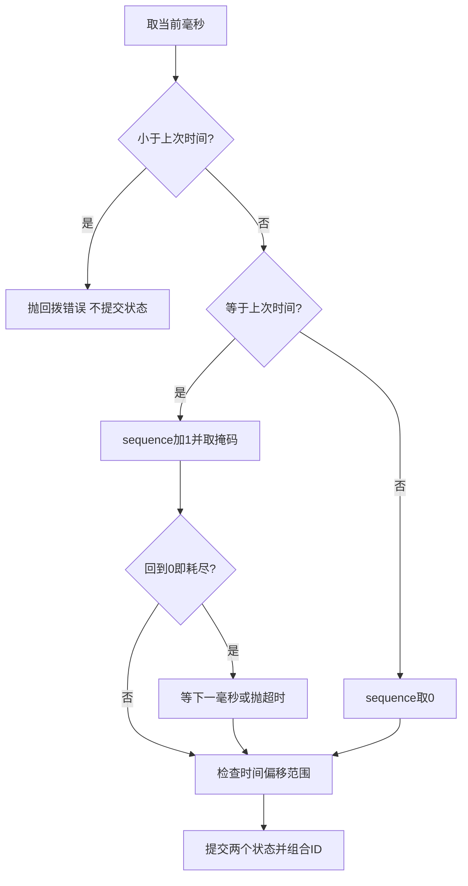

# 第8章：沿一个毫秒里的四个ID读懂Snowflake

把生成器看成一个小型状态机：它记住**上一次毫秒和该毫秒已用的序列号**，再把时间、机房、机器和序列拼成整数。单个实例用锁保护这两个状态；多个实例还需要由部署方分配不同机器身份。

## 先预测一个最小案例

使用可控时钟，固定为 `epoch_ms + 100`；把序列位数设置为2，所以可用序列为0、1、2、3。同一实例连续生成四次，解析后应得到相同时间和机器字段，序列分别为0、1、2、3。第五次不能再使用0：它必须等待下一毫秒，或者因等待超时报错。

这比先记住默认41/5/5/12位更重要：**唯一性来自时间、节点身份、序列三者组合不重复**，而不是来自整数足够大。

所有节点均在本进程；图中没有中心发号服务。实例锁不替代跨进程机器身份分配，重启后也不能自动证明不会使用旧的时间／序列组合。

## 哪些数据必须记住

| 状态或配置 | 案例值／意义 | 所有者 |
|---|---|---|
| `_last_timestamp` | 首次生成前为-1，随后为 `epoch+100` | 生成器实例，锁内修改 |
| `_sequence` | 在固定毫秒依次为0、1、2、3 | 同一把实例锁保护 |
| `epoch_ms` | 时间字段的起点 | 不可变配置 |
| `machine_id/datacenter_id` | 区分不同发号身份 | 配置；由部署方保证分配 |
| `max_sequence` | 2位对应3，是位掩码 | 根据配置推导 |
| 返回ID | 时间偏移、节点和序列的组合 | 输出结果，可由解析器还原 |

## 六站源码阅读路线

1. {{symbol:src/unique_id/config.py:SnowflakeConfig.__post_init__}}：检查位布局和节点编号范围。先确认案例的2位序列配置合法。
2. {{symbol:src/unique_id/snowflake.py:SnowflakeGenerator.__init__}}：定位初始状态与锁。输入配置和Clock，输出一个带独立状态的实例。
3. {{symbol:src/unique_id/snowflake.py:SnowflakeGenerator.generate}}：看锁覆盖的范围；入口本身不负责算法，下一站才是状态机。
4. {{symbol:src/unique_id/snowflake.py:SnowflakeGenerator._generate_locked}}：输入当前毫秒和旧状态，决定新序列并生成ID。重点找“状态何时正式写回”。
5. {{symbol:src/unique_id/snowflake.py:SnowflakeGenerator._wait_next_millis}}：只在序列耗尽时进入；等待的是业务时钟推进，截止时间使用单调时钟。
6. {{symbol:src/unique_id/parser.py:IDParser.parse}}：拿到ID后用相同布局反解。把输出字段对回案例，证明理解了按位组合。

## 微观一：异常之前不提交状态

{{excerpt:src/unique_id/snowflake.py:SnowflakeGenerator._generate_locked:2:14}}

第一段拒绝比 `_last_timestamp` 更小的时间。局部变量 `sequence` 先从0开始；相同毫秒时加1并用位掩码限制范围。加到4后 `4 & 3 == 0`，表示耗尽，而非允许重用0，所以调用等待函数。

范围校验通过后，最后一行才一起更新 `_last_timestamp` 和 `_sequence`。如果等待超时、时钟回拨或时间偏移超出布局，在这行之前就会抛异常，不能偷偷消耗或重置序列状态。

## 微观二：等待不会占满CPU，但仍持有生成器锁

{{excerpt:src/unique_id/snowflake.py:SnowflakeGenerator._wait_next_millis:11:15}}

循环每次重新读业务时钟，发现推进便返回；回拨立即报错，截止则抛 `SequenceOverflowError`。`sleep` 让出CPU，但外层 `generate` 的实例锁仍被持有，其他线程不能同时修改序列。等待上限限制了这段串行等待的时间，不能把它描述成无等待的无限吞吐。

{{symbol:src/unique_id/snowflake.py:SnowflakeGenerator.generate_batch}} 一次持锁生成多个ID。如果中途失败，之前已经生成的内部状态不会回滚；调用者不能把批量方法当成事务。

## 失败案例与两项测试

在案例的第五次生成时保持Clock不动，并设置短等待期限。预期是超时，随后把Clock推进1毫秒，再生成应成功，序列从0开始，而前四个ID没有重复。

- {{symbol:tests/test_review.py:test_overflow_timeout_does_not_reuse_ids}}：观察超时前后生成的ID和时钟推进；断言重点是恢复后没有复用旧ID。
- {{symbol:tests/test_review.py:test_threads_share_sequence_without_duplicates}}：多个线程共享一个实例，输出应无重复；它证明的是共享实例的并发序列保护。
- {{symbol:tests/test_snowflake.py:TestSnowflakeGenerate.test_sequence_increments_same_millisecond}}：从解析出的序列字段理解正常路径。

## 三个自查问题

- **相同机器配置的两个实例能靠各自的锁避免重复吗？** 不能。锁只在实例内生效；它们可能在相同毫秒使用相同序列。
- **为什么等待超时使用单调时钟？** 业务时钟可能停住或回拨，等待期限不能跟着回退。
- **ID较大是否表示真实创建时间一定更晚？** 同一生成器在契约内可排序；跨机器有时钟差，不能推导全局严格时间顺序。

## 动手练习

把2位序列改成3位，保持同一个固定毫秒。预期可连续生成8个ID，第9个才等待；把时钟推进1毫秒后解析新ID，时间偏移增加1且序列为0。运行方式见 {{file:README_CN.md}}，可复用测试中的可控时钟。
