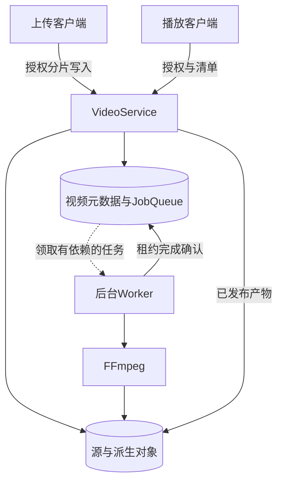
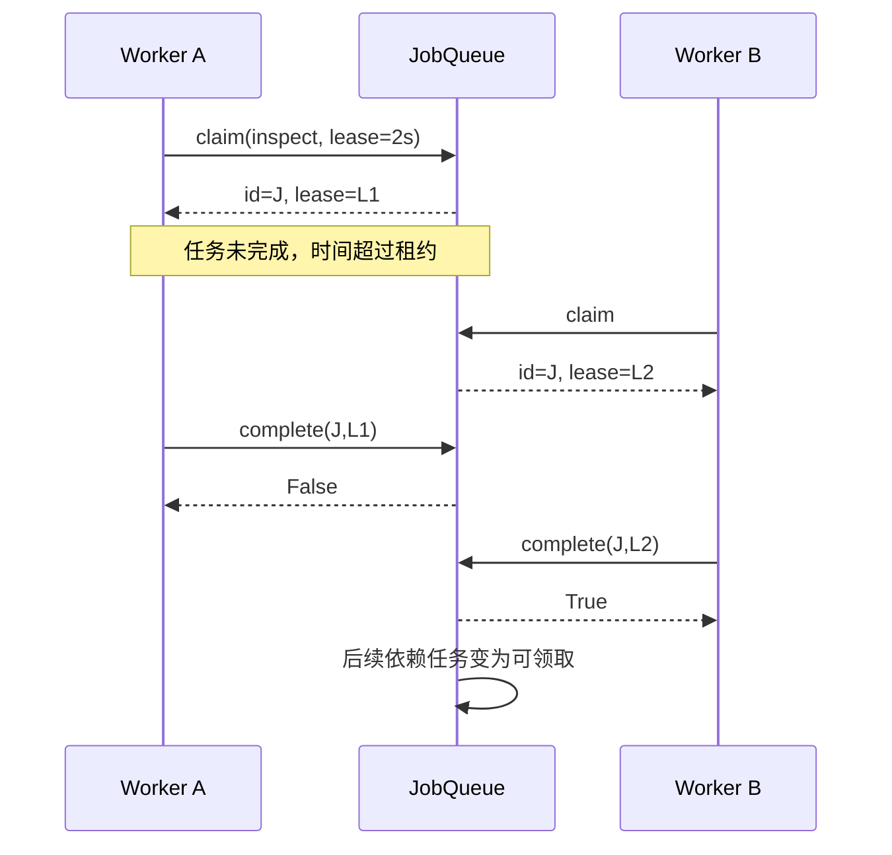

# 第15章：从7字节上传看懂视频处理流水线

视频系统最容易混淆的是三种“完成”：**分片传完、源视频确认、处理产物可以播放**。本项目把它们放进不同状态，并用带依赖关系和租约的后台任务推进。

先选VideoService＋本地对象存储＋SQLite元数据的方案学习。PostgreSQL和S3适配是另一组部署配置，见 {{file:README_CN.md}}；FFmpeg负责真实媒体处理，存储和调度单元测试中的小字节串不是合法视频。

## 用一个上传案例串起状态

创建大小为7、分片大小为4的上传。数据是abcd和efg，分片编号0、1。

1. 先上传分片1，uploaded_parts只有1；此时finish应失败，因为分片0缺失。
2. 上传分片0，再次上传相同abcd是幂等的；把同一分片改为xxxx应拒绝。
3. finish接收完整源，重复finish仍返回同一video_id，不重复创建流水线。
4. 任务先运行inspect；依赖满足后thumbnail和encode等任务才可领取。
5. 最终发布完成后状态才能成为READY。此时播放授权才有对应的已发布媒体可用。

前四步可用测试中的7字节对象学习存储和调度；真实转码必须改用有效媒体样本。

## 宏观：大对象与小状态分离

| 状态／数据 | 关键字段 | 意义 |
|---|---|---|
| 视频上传 | video_id、分片编号、size、checksum | 源对象的完整性和幂等身份 |
| 流水线任务 | id、name、kind及依赖 | 描述先做什么、后做什么 |
| 执行中任务 | state=RUNNING、lease、expires、attempts | 一个有限期的执行资格 |
| 完成产物 | output中的对象键 | 指向已验证的对象，不是随意本地路径 |
| 可播放视频 | READY与发布产物 | 源上传完成后还需等待处理 |
| 签名授权 | 类型、归属、期限等声明 | 分片上传与播放不能互相替用 |

## 七站阅读路线

1. {{symbol:src/video_streaming/service.py:VideoService.create}}：输入总大小和part_size，输出video_id与分片授权；核对7字节为何分成4＋3。
2. {{symbol:src/video_streaming/service.py:VideoService.put_part}}：看编号、大小和校验和怎样绑定；数据写入失败不能标记上传成功。
3. {{symbol:src/video_streaming/service.py:VideoService.finish}}：检查分片齐全、源对象组装及DAG冻结，输出仍是原video_id。
4. {{symbol:src/video_streaming/pipeline.py:Pipeline.tasks}}：把流水线配置变成依赖任务；先画出inspect之后哪些节点可并行。
5. {{symbol:src/video_streaming/scheduling.py:JobQueue.claim}}：只领取依赖满足的任务，分配新的lease并增加attempts。
6. {{symbol:src/video_streaming/worker.py:Worker.run_once}}：从领取进入处理与完成推进；再看 {{symbol:src/video_streaming/media.py:FFmpegMedia.run}} 管理子进程。
7. {{symbol:src/video_streaming/scheduling.py:JobQueue.complete}}：确认当前租约和产物，之后回到服务的发布完成路径。

## 微观一：任务ID不是执行资格

{{excerpt:src/video_streaming/scheduling.py:JobQueue.claim:13:17}}

重点读三个动作：事务内恢复过期任务、从ready任务中选择、生成新lease。任务id可以保持不变，而lease在被重新领取时改变。

用例中worker A领取inspect，租约2秒；时钟推进3秒后worker B再领取同一id。B的lease必须不同。A后来完成时，已经失去提交资格。

## 微观二：慢对象I/O之后还要复核

{{excerpt:src/video_streaming/scheduling.py:JobQueue.complete:22:12}}

检查output对象可能耗时，期间租约会过期。所以complete在慢校验之后再次读取_current；“函数开头有效”不能替代“提交时仍有效”。

一旦_current返回None，旧worker不能把新worker的任务标记DONE，也不能用迟到的fatal failure把新尝试终止。处理产物可能需要后续回收，但它不能冒充已发布的有效结果。

## 失败时从哪层恢复

源分片响应丢失：使用同一授权与相同内容重试，避免创建另一个上传。

处理进程异常：交给任务失败／租约恢复路径，按attempts限制重试。Worker还要清理自己创建的临时目录。

数据库成功受理但HTTP客户端断开：不能因此删除已持久化视频。客户端查询status或重试同一完成操作，恢复当前状态。

## 两组测试足够建立主线

- {{symbol:tests/test_video.py:test_resumable_idempotent_parts_and_finalization}}：按1→0上传，分别观察缺失分片拒绝、相同内容幂等、不同内容冲突，以及重复finish只生成一套任务。
- {{symbol:tests/test_video.py:test_dependencies_concurrent_claims_and_lease_fencing}}：八个领取者最初只有一个能拿到inspect；旧租约完成和失败均被拒绝，新租约完成后才释放下游。
- {{symbol:tests/test_pipeline_reliability.py:test_long_running_task_renews_before_competing_worker_reclaims}}：再阅读持续处理时续租如何维持资格。

## 自查与练习

**上传接口返回video_id就能播放吗？** 不能。video_id标识受理对象，播放需要处理及发布阶段完成。

**同一个任务id能出现两次执行吗？** 能。重试会重新执行，但有效提交由lease隔离。

**把FFmpeg命令放在元数据锁内更安全吗？** 不会自动更安全；它会让慢媒体工作占住状态访问。正确边界是任务资格、输出校验和短提交。

练习：沿租约测试把A的完成调用挪到B完成之后。预期A仍返回False，视频任务只有一次有效完成；观察DONE不会被旧失败覆盖。
