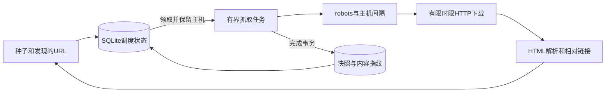
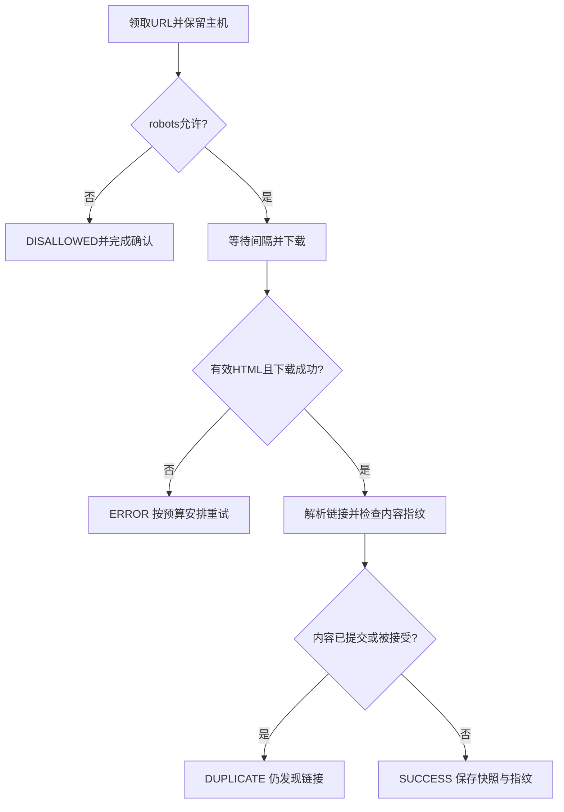

# 第10章：沿两张网页理解调度、去重和恢复

把爬虫看成一个循环：**调度一个URL，下载并发现新URL，再把新URL交回调度器**。真正难的是限制并发、遵守主机间隔、正确确认已完成工作，以及崩溃后能接着做。本页选择设置 `state_path` 的持久模式；未设置时使用内存frontier，恢复能力不同。

## 案例：主页发现一个相对链接

种子为 `https://a.test/index`，返回HTML含 `<a href="child">`；child返回与主页完全相同的HTML字节。设置本批 `max_pages=2`。预期两个URL都被尝试，主页为SUCCESS，child可因内容重复标为DUPLICATE；只需保存一份成功内容快照，但不能因为字节重复而停止基于child自身URL的链接解析。

URL去重解决“同一地址是否重复入队”；内容去重解决“相同字节是否重复保存”。两者不能共用一个“见过了就全部跳过”的判断。

这些组件主要在一个进程中通过异步任务协作；`SQLiteCrawlState` 的阻塞数据库操作经线程执行，仍由该次crawl拥有并排空。

## 调度和内容的状态表

| 数据 | 真实字段／对象 | 理解重点 |
|---|---|---|
| `FrontierEntry` | url、priority、depth、host | 一次待处理地址，不是网页内容 |
| SQLite `jobs` | state、due、attempts、fingerprint、unchanged | pending/inflight/done与下次执行时间 |
| `hosts` | host、next_ready | 该主机何时能开始后续请求 |
| `fingerprints` | hash | 已成功接受的内容身份 |
| `snapshots` | url、fetched_at、status、html | 持久网页内容 |
| `_content_pending/_claims` | 指纹的在途拥有者 | 避免并发重复接受，失败时要释放 |
| `CrawlResult.status` | SUCCESS/ERROR/DUPLICATE等 | 业务结果，不直接等同jobs状态 |

## 六站源码阅读路线

1. {{symbol:src/web_crawler/crawler.py:Crawler.crawl}}：批次入口，先看并发任务集合和max_pages的检查，知道一个批次何时结束。
2. {{symbol:src/web_crawler/crawler.py:Crawler._enqueue_url}}：发现URL如何经过深度与过滤限制；持久模式先保存远端发现，再做后续路由移交。
3. {{symbol:src/web_crawler/state.py:SQLiteCrawlState.get}}：从持久队列领取到期任务并保留主机；输出FrontierEntry给处理任务。
4. {{symbol:src/web_crawler/crawler.py:Crawler._process_entry}}：robots、下载、重定向、HTML检查和发现链接集中在这里；先跟主页正常路径。
5. {{symbol:src/web_crawler/crawler.py:Crawler._claim_content}}：跟child的重复内容分支，理解临时指纹拥有者与已提交指纹的区别。
6. {{symbol:src/web_crawler/state.py:SQLiteCrawlState.finish}}：提交状态、内容和主机可用时间，最后回到 {{symbol:src/web_crawler/crawler.py:Crawler._process_url}} 的异常与取消补偿。

## 微观一：并发容量在创建任务前就受限制

{{excerpt:src/web_crawler/crawler.py:Crawler.crawl:21:11}}

这段while同时限制 `len(tasks)` 和“已尝试加在途”总量。先领取一个任务，才创建对应协程；不会先为所有URL创建任务再在内部等待信号量。`max_pages` 统计尝试，包括ERROR和DUPLICATE，不只是成功网页数。

没有任务但仍有未来重试时，循环暂时等待；未来的周期重爬则留到下一批次。理解这一点后，才不会把 `is_empty` 当作数据库里完全没有任何记录。

## 微观二：内容重复，发现过程仍要继续

{{excerpt:src/web_crawler/crawler.py:Crawler._process_entry:66:17}}

先得到内容指纹并申领，再用 `response.url` 作为相对链接基准提取链接。重复分支仍把链接入队，只是不再把相同HTML作为新的成功快照保存。否则相同HTML放在 `/a/` 和 `/b/` 下时，两个不同的 `child` 地址会漏掉一组。

## 失败与取消：还没确认的URL要能重新领取

`_process_url` 的finally处理“尚未完成确认”情形。持久模式把领取的任务归还；`crawl` 取消并等待自己创建的任务，再关闭持久状态。{{symbol:src/web_crawler/crawler.py:Crawler._io}} 使用shield并等待已经开始的同步数据库操作结束，避免外层取消后锁和连接先被释放。

`finish` 对ERROR且预算允许的任务安排指数延迟；成功或重复内容可按unchanged次数扩大重爬间隔。这里“本批结束”与“以后不再抓”是两个判断。

- {{symbol:tests/test_durable_crawl.py:test_new_instance_resumes_pending_children_and_deduplicates_disk_content}}：本次只抓主页，重建实例后继续child，重复内容只留下一个快照。
- {{symbol:tests/test_durable_crawl.py:test_duplicate_html_still_discovers_relative_links_for_each_base}}：检查两个基准URL下的相对链接都被发现。
- {{symbol:tests/test_durable_crawl.py:test_cancelled_fetch_is_available_after_restart}}：取消后重建实例，未完成URL仍可再次抓取。

## 三个自查问题

- **max_concurrent=4能让同一主机同时抓4个URL吗？** 还受主机保留与礼貌间隔约束，不能只看全局并发上限。
- **Hook异常是否代表网页没下载成功？** Hook按实现隔离错误；不能把业务内容处理Hook当成调度事务的一部分。
- **只给URLSeen加锁能解决内容重复吗？** 不能，两个不同URL可能返回相同字节。

## 动手练习

把max_pages改成1，预期第一批只尝试主页，child仍在持久队列；新建Crawler并用空种子继续，预期child仍可被处理。再将child内容改为不同字节，预期其结果变为SUCCESS且快照数增加。配置和运行方式见 {{file:README_CN.md}}。
