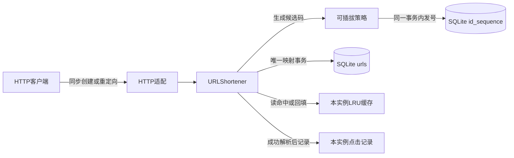
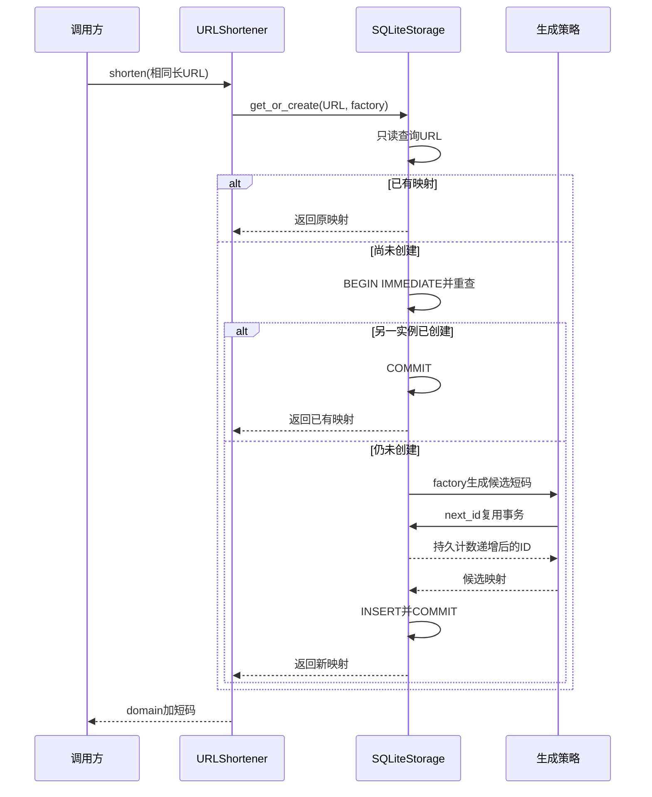

# 第9章：跟着同一个URL走完创建、重定向与缓存

短链接服务的核心是一张**不可变双向唯一映射**：长URL对应短码，短码再找回长URL。生成策略决定“候选短码是什么”，存储决定“并发请求最终保存哪条映射”；HTTP层只是把这两个操作暴露成创建和重定向。

## 一个贯穿全篇的请求

采用 `SQLiteStorage` 保存映射，并将同一个对象注入 `Base62Strategy(id_generator=storage)`；连续两次缩短 `https://example.com/guide`。把首次得到的短码记为 `c`，不预先猜数据库当前发到哪个ID。两次返回应相同，数据库只保留一条该URL的映射，也只消耗一个ID。随后调用 `resolve(c)` 两次：两次返回原URL和重定向类型，首次回源，后续可以命中本实例缓存；本实例点击数应增加2。



本页选择持久映射方案，默认不传存储时则使用内存实现。点击记录与LRU仍在进程内；重启后映射能恢复，并不表示点击记录也持久化了。

## 先分清三种状态

| 数据 | 关键字段 | 事实还是派生 |
|---|---|---|
| SQLite `urls` | `code/url/redirect/created`；code与url分别唯一 | 链接映射事实，重启后保留 |
| SQLite `id_sequence` | 单行 `value` | 协调发号事实，与映射创建共用事务 |
| `URLMapping` | `short_code/long_url/redirect_type/created_at` | 不可变业务对象 |
| `_cache` | short_code → mapping，维护最近使用顺序 | 可丢弃的读取加速 |
| `_clicks` | short_code → ClickRecord列表 | 进程内观测，和映射事务不同 |
| 候选短码 | 策略函数的计算结果 | 未保存前不等于已接受链接 |

## 六站阅读路线

1. [URLShortener.shorten](../src/url_shortener/shortener.py#L57)：输入长URL，输出完整短URL。先看最终的 `get_or_create`，理解原子性不在HTTP Handler里。
2. [redirect_uri](../src/url_shortener/urls.py#L9)：由 `_validate_url` 调用；拒绝无效主机、端口、空白等，确认中文网址可编码。保存仍保留原串；HTTP层才使用转换后的URI。
3. [Base62Strategy.generate](../src/url_shortener/strategies.py#L178)：理解策略只负责码的构造；切回服务代码看它如何被factory调用。
4. [SQLiteStorage.get_or_create](../src/url_shortener/sqlite_storage.py#L60)：已存在先只读返回；未命中才在事务中重查、生成和保存。factory经 [SQLiteStorage.next_id](../src/url_shortener/sqlite_storage.py#L73) 发号；同一个存储对象会复用事务。
5. [URLShortener.resolve](../src/url_shortener/shortener.py#L90)：输入短码，先查LRU，再查SQLite；成功后记录点击，输出 `(long_url, redirect_type)`。
6. [create_app](../src/url_shortener/http.py#L8)：最后再看如何把业务结果转换成HTTP状态和Location，避免把业务方法返回值误认为已经发出了重定向响应。

## 微观一：为什么不是先查再单独保存

[sqlite_storage.py:60](../src/url_shortener/sqlite_storage.py#L60)

```python
def get_or_create(self, long_url, factory):
    # Mappings are immutable: an existing row needs no writer reservation.
    mapping = self.get_by_long_url(long_url)
    if mapping is not None:
        return mapping
    with self._transaction():
        # Another process may have created it before BEGIN IMMEDIATE.
        mapping = self.get_by_long_url(long_url)
        if mapping is None:
            mapping = factory()
            self.save(mapping)
        return mapping
```

第一次只读查询命中即可返回；映射不可变，不需要写锁。未命中时才由 `_transaction` 执行 `BEGIN IMMEDIATE`，随后重查。factory、ID分配和 `save` 复用线程局部连接，第二个实例进入事务后会看到前一个实例已保存的URL。成功提交，异常回滚；事务内重查不能删除。

这段代码保证本地共享SQLite文件的接受语义。默认进程内ID计数器仍不适合跨实例发号；持久场景应按上面的方式注入SQLite分配器。不能据此推导跨数据库集群全局唯一性。Base62超过七位时保留全部编码，绝不截断。



## 微观二：锁只保护缓存结构，回源在锁外

[shortener.py:107](../src/url_shortener/shortener.py#L107)

```python
with self._cache_lock:
    mapping = self._cache.get(short_code)
    if mapping is not None:
        self._cache.move_to_end(short_code)
if mapping is None:
    mapping = self._storage.get_by_short_code(short_code)
    if mapping is not None and self._cache_capacity:
        with self._cache_lock:
            self._cache[short_code] = mapping
            self._cache.move_to_end(short_code)
            while len(self._cache) > self._cache_capacity:
                self._cache.popitem(last=False)
```

首先在 `_cache_lock` 内取值并更新LRU顺序；未命中后，数据库读取发生在锁外。这样一个慢回源不会堵住另一个已经命中的键。拿到映射后再短暂持锁回填、淘汰，缓存容量为0时不回填。

失败短码在点击记录之前抛 `ShortCodeNotFoundError`；缓存命中也仍会走后面的点击记录，因此不能把缓存命中等同于“无需记录解析”。

## 失败路径：冲突不能覆盖旧链接

[SQLiteStorage.save](../src/url_shortener/sqlite_storage.py#L88) 使用INSERT与唯一约束；若同一个code已经属于另一条映射，不会执行覆盖。候选策略可在自身契约内尝试新码，最终仍不能悄悄改写旧链接的目标。

- [test_shared_database_atomic_creation_and_restart](../tests/test_chapter_review.py#L12)：并发共享数据库创建相同URL，检查相同返回以及重启后仍能读取。
- [test_collision_never_overwrites_old_link](../tests/test_chapter_review.py#L27)：强制短码冲突，观察旧映射保持不变。
- [test_existing_url_does_not_wait_for_sqlite_writer](../tests/test_open_source_review.py#L110)：另一条连接持有写事务时，重复创建已有URL仍能只读完成。
- [test_id_allocation_rolls_back_with_failed_mapping](../tests/test_open_source_review.py#L65)：factory分配ID后失败，观察计数和映射一起回滚。
- [TestResolve.test_resolve_records_click_analytics](../tests/test_shortener.py#L90)：成功解析后才增加点击记录。

## 读完应能解释

- **重复缩短相同URL会改成新的302或301吗？** `get_or_create` 返回已有不可变映射，不把新参数覆盖到旧记录。
- **SQLite重启恢复能保证点击数恢复吗？** 不能，点击保存在实例内存中。
- **中文网址为什么库能返回原文、HTTP却不能直接发送原文？** `Location` 必须适合传输；HTTP层调用同一个 `redirect_uri` 做IDNA与百分号编码，存储身份保持原输入。
- **为什么Base62接SQLite时要传同一个对象两次？** 发号器才能复用映射写事务；不要用另一个对象的连接等待当前对象自己持有的写锁。
- **为什么保存接口还要唯一约束，策略已经检查过存在性？** 检查和保存之间可能有并发，最终冲突必须由接受数据的一层守住。

## 动手练习

把缓存容量设为1，依次解析 `c1`、`c2`、`c1`。预期最后一次 `c1` 再次回源，两个URL映射从未消失；本实例点击计数分别为2和1。然后用同一SQLite文件重建实例，预期映射仍在、点击计数重新从0开始。运行方式见 [README_CN.md](../README_CN.md)。

再运行 [verify_concurrency.py](../tools/verify_concurrency.py)，观察4个独立进程如何对同一个URL去重、为不同URL发不同ID，并在重开数据库后继续创建。原书与GitHub代码的取舍见 [open-source-review_cn.md](../docs/open-source-review_cn.md)。


---

[返回全仓库学习导航](../../docs/learning-guide_cn.md) · [项目运行说明](../README.md)

[导读原稿](../../tools/learning_guides/url-shortener.md)。正文与图按当前实现编写；源码链接和摘录由生成器绑定到当前定义。修改行为后应同时复核案例、时序和解释，再重新生成；定义与链接校验不等同于业务回归测试。
