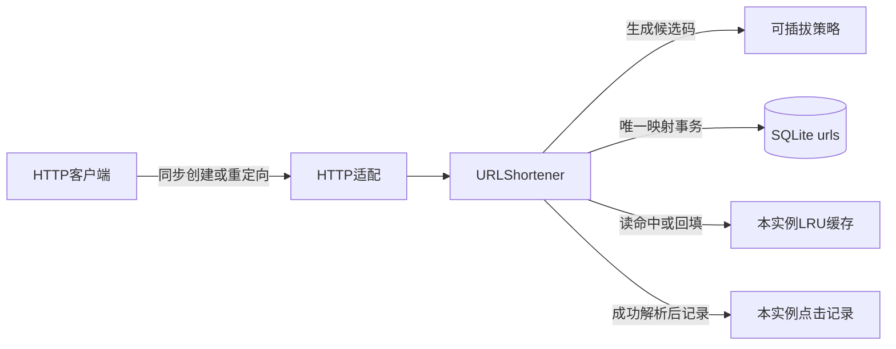
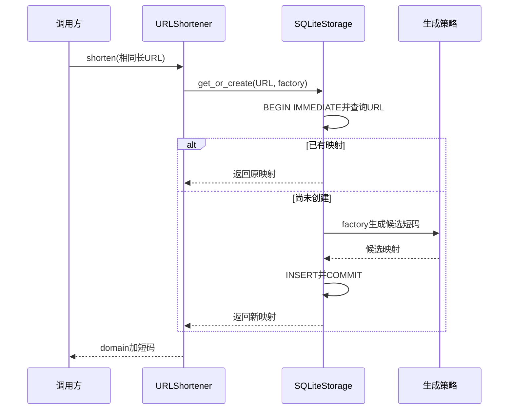

# 第9章：跟着同一个URL走完创建、重定向与缓存

短链接服务的核心是一张**不可变双向唯一映射**：长URL对应短码，短码再找回长URL。生成策略决定“候选短码是什么”，存储决定“并发请求最终保存哪条映射”；HTTP层只是把这两个操作暴露成创建和重定向。

## 一个贯穿全篇的请求

采用 `SQLiteStorage` 保存映射；连续两次缩短 `https://example.com/guide`。把首次得到的短码记为 `c`，不预先猜随机／哈希策略产生的具体字符。两次返回应相同，数据库只保留一条该URL的映射。随后调用 `resolve(c)` 两次：两次返回原URL和重定向类型，首次回源，后续可以命中本实例缓存；本实例点击数应增加2。



本页选择持久映射方案，默认不传存储时则使用内存实现。点击记录与LRU仍在进程内；重启后映射能恢复，并不表示点击记录也持久化了。

## 先分清三种状态

| 数据 | 关键字段 | 事实还是派生 |
|---|---|---|
| SQLite `urls` | `code/url/redirect/created`；code与url分别唯一 | 链接映射事实，重启后保留 |
| `URLMapping` | `short_code/long_url/redirect_type/created_at` | 不可变业务对象 |
| `_cache` | short_code → mapping，维护最近使用顺序 | 可丢弃的读取加速 |
| `_clicks` | short_code → ClickRecord列表 | 进程内观测，和映射事务不同 |
| 候选短码 | 策略函数的计算结果 | 未保存前不等于已接受链接 |

## 六站阅读路线

1. [URLShortener.shorten](../src/url_shortener/shortener.py#L57)：输入长URL，输出完整短URL。先看最终的 `get_or_create`，理解原子性不在HTTP Handler里。
2. [URLShortener._validate_url](../src/url_shortener/shortener.py#L156)：阻止空值、控制字符和非HTTP(S)地址进入策略层；下一站才开始创建候选码。
3. [Base62Strategy.generate](../src/url_shortener/strategies.py#L179)：理解策略只负责码的构造；切回服务代码看它如何被factory调用。
4. [SQLiteStorage.get_or_create](../src/url_shortener/sqlite_storage.py#L34)：把查询、factory和保存放在一次事务中；这是案例两次创建得到同一映射的关键。
5. [URLShortener.resolve](../src/url_shortener/shortener.py#L87)：输入短码，先查LRU，再查SQLite；成功后记录点击，输出 `(long_url, redirect_type)`。
6. [create_app](../src/url_shortener/http.py#L7)：最后再看如何把业务结果转换成HTTP状态和Location，避免把业务方法返回值误认为已经发出了重定向响应。

## 微观一：为什么不是先查再单独保存

[sqlite_storage.py:34](../src/url_shortener/sqlite_storage.py#L34)

```python
def get_or_create(self, long_url, factory):
    with self._connection() as db:
        db.execute("BEGIN IMMEDIATE")
        self._local.connection = db
        try:
            mapping = self.get_by_long_url(long_url)
            if mapping is None:
                mapping = factory()
                self.save(mapping)
            db.execute("COMMIT")
            return mapping
        except BaseException:
            db.execute("ROLLBACK")
            raise
        finally:
            del self._local.connection
```

`BEGIN IMMEDIATE` 在读取前取得写事务。查询、factory内的策略操作和 `save` 复用线程局部连接，因此第二个共享同一文件的实例会在前一个事务结束后重新看到已有URL。成功后提交，任意异常则回滚。

这段代码保证的是本地SQLite的映射接受语义。不能据此推导跨数据库集群的全局唯一性，也不能假设默认进程内ID生成器适合多实例统一发号。



## 微观二：锁只保护缓存结构，回源在锁外

[shortener.py:104](../src/url_shortener/shortener.py#L104)

```python
with self._cache_lock:
    mapping = self._cache.get(short_code)
    if mapping is not None:
        self._cache.move_to_end(short_code)
if mapping is None:
    mapping = self._storage.get_by_short_code(short_code)
    if mapping is not None and self._cache_capacity:
        with self._cache_lock:
            self._cache[short_code] = mapping
            self._cache.move_to_end(short_code)
            while len(self._cache) > self._cache_capacity:
                self._cache.popitem(last=False)
```

首先在 `_cache_lock` 内取值并更新LRU顺序；未命中后，数据库读取发生在锁外。这样一个慢回源不会堵住另一个已经命中的键。拿到映射后再短暂持锁回填、淘汰，缓存容量为0时不回填。

失败短码在点击记录之前抛 `ShortCodeNotFoundError`；缓存命中也仍会走后面的点击记录，因此不能把缓存命中等同于“无需记录解析”。

## 失败路径：冲突不能覆盖旧链接

[SQLiteStorage.save](../src/url_shortener/sqlite_storage.py#L51) 使用INSERT与唯一约束；若同一个code已经属于另一条映射，不会执行覆盖。候选策略可在自身契约内尝试新码，最终仍不能悄悄改写旧链接的目标。

- [test_shared_database_atomic_creation_and_restart](../tests/test_chapter_review.py#L12)：并发共享数据库创建相同URL，检查相同返回以及重启后仍能读取。
- [test_collision_never_overwrites_old_link](../tests/test_chapter_review.py#L27)：强制短码冲突，观察旧映射保持不变。
- [TestResolve.test_resolve_records_click_analytics](../tests/test_shortener.py#L90)：成功解析后才增加点击记录。

## 读完应能解释

- **重复缩短相同URL会改成新的302或301吗？** `get_or_create` 返回已有不可变映射，不把新参数覆盖到旧记录。
- **SQLite重启恢复能保证点击数恢复吗？** 不能，点击保存在实例内存中。
- **为什么保存接口还要唯一约束，策略已经检查过存在性？** 检查和保存之间可能有并发，最终冲突必须由接受数据的一层守住。

## 动手练习

把缓存容量设为1，依次解析 `c1`、`c2`、`c1`。预期最后一次 `c1` 再次回源，两个URL映射从未消失；本实例点击计数分别为2和1。然后用同一SQLite文件重建实例，预期映射仍在、点击计数重新从0开始。运行方式见 [README_CN.md](../README_CN.md)。


---

[返回全仓库学习导航](../../docs/learning-guide_cn.md) · [项目运行说明](../README.md)

[导读原稿](../../tools/learning_guides/url-shortener.md)。正文与图按当前实现编写；源码链接和摘录由生成器绑定到当前定义。修改行为后应同时复核案例、时序和解释，再重新生成；定义与链接校验不等同于业务回归测试。
