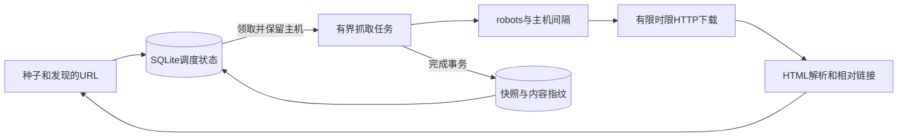
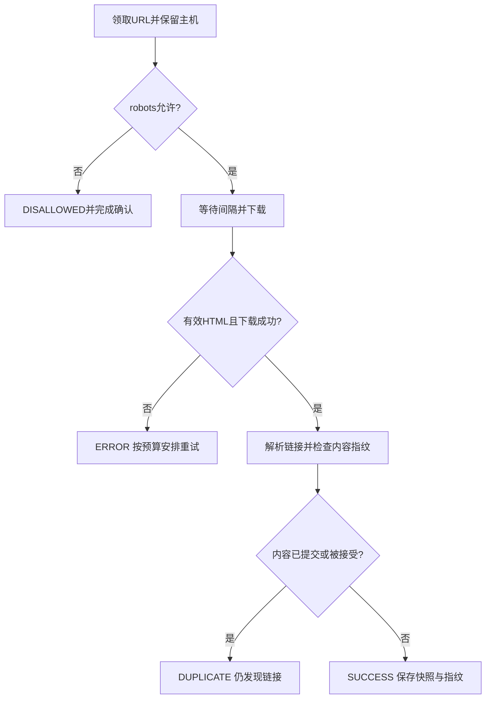
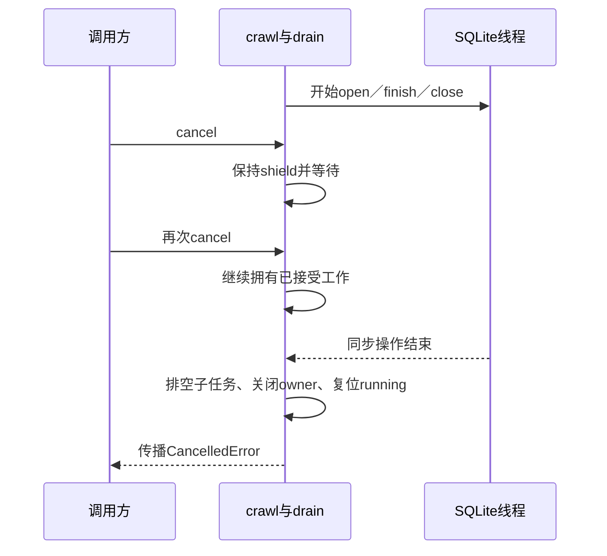

# 第10章：沿两张网页理解调度、去重和恢复

把爬虫看成一个循环：**调度一个URL，下载并发现新URL，再把新URL交回调度器**。真正难的是限制并发、遵守主机间隔、正确确认已完成工作，以及崩溃后能接着做。本页选择设置 `state_path` 的持久模式；未设置时使用内存frontier，恢复能力不同。

## 案例：主页发现一个相对链接

种子为 `https://a.test/index`，返回HTML含 `<a href="child">`；child返回与主页完全相同的HTML字节。设置本批 `max_pages=2`。预期两个URL都被尝试，主页为SUCCESS，child可因内容重复标为DUPLICATE；只需保存一份成功内容快照，但不能因为字节重复而停止基于child自身URL的链接解析。

URL去重解决“同一地址是否重复入队”；内容去重解决“相同字节是否重复保存”。两者不能共用一个“见过了就全部跳过”的判断。



这些组件主要在一个进程中通过异步任务协作；`SQLiteCrawlState` 的阻塞数据库操作经线程执行，仍由该次crawl拥有并排空。

## 调度和内容的状态表

| 数据 | 真实字段／对象 | 理解重点 |
|---|---|---|
| `FrontierEntry` | url、priority、depth、host | 一次待处理地址，不是网页内容 |
| SQLite `jobs` | state、due、attempts、fingerprint、unchanged | pending/inflight/done与下次执行时间 |
| `hosts` | host、next_ready | 该主机何时能开始后续请求 |
| `fingerprints` | hash | 已成功接受的内容身份 |
| `snapshots` | url、fetched_at、status、html | 持久网页内容 |
| `_content_pending/_claims` | 指纹的在途拥有者 | 避免并发重复接受，失败时要释放 |
| `CrawlResult.status` | SUCCESS/ERROR/DUPLICATE等 | 业务结果，不直接等同jobs状态 |

## 六站源码阅读路线

1. [Crawler.crawl](../src/web_crawler/crawler.py#L120)：批次入口，先看并发任务集合和max_pages的检查，知道一个批次何时结束。
2. [Crawler._enqueue_url](../src/web_crawler/crawler.py#L351)：发现URL如何经过深度与过滤限制；持久模式先保存远端发现，再做后续路由移交。
3. [SQLiteCrawlState.get](../src/web_crawler/state.py#L145)：从持久队列领取到期任务并保留主机；输出FrontierEntry给处理任务。
4. [Crawler._process_entry](../src/web_crawler/crawler.py#L217)：robots、下载、重定向、HTML检查和发现链接集中在这里；先跟主页正常路径。
5. [Crawler._claim_content](../src/web_crawler/crawler.py#L319)：跟child的重复内容分支，理解临时指纹拥有者与已提交指纹的区别。
6. [SQLiteCrawlState.finish](../src/web_crawler/state.py#L229)：提交状态、内容和主机可用时间，最后回到 [Crawler._process_url](../src/web_crawler/crawler.py#L181) 的异常与取消补偿。

未设置state_path时，第三站改读 [URLFrontier.get](../src/web_crawler/frontier.py#L57)。其他业务管线相同，但恢复能力和队列数据位置不同。

## 微观一：并发容量在创建任务前就受限制

[crawler.py:141](../src/web_crawler/crawler.py#L141)

```python
while not await self._queue_call("is_empty") or tasks:
    if self._attempted >= self._config.max_pages:
        break
    while (
        len(tasks) < self._config.max_concurrent
        and self._attempted + len(tasks) < self._config.max_pages
    ):
        entry = await self._queue_call("get", reserve=True)
        if entry is None:
            break
        tasks.add(asyncio.create_task(self._process_url(entry)))
```

这段while同时限制 `len(tasks)` 和“已尝试加在途”总量。先领取一个任务，才创建对应协程；不会先为所有URL创建任务再在内部等待信号量。`max_pages` 统计尝试，包括ERROR和DUPLICATE，不只是成功网页数。

没有任务但仍有未来重试时，循环暂时等待；未来的周期重爬则留到下一批次。理解这一点后，才不会把 `is_empty` 当作数据库里完全没有任何记录。

当一个慢下载尚未结束，另一个主机的礼貌间隔可能已经到期。因此只在有空闲槽和剩余预算时，`asyncio.wait`最多等待50毫秒就返回调度循环重查；满载时等待任务完成。对应 [test_idle_slot_rechecks_host_deadline_while_other_download_is_slow](../tests/test_open_source_review.py#L272) 同时覆盖内存与持久模式。

### 内存分支：队首可用才参与选择

[frontier.py:43](../src/web_crawler/frontier.py#L43)

```python
def _schedule(self, host: str, now: float) -> None:
    if host in self._active_hosts or host in self._waiting:
        return
    queue = self._back_queues.get(host)
    if not queue:
        return
    last_access = self._host_last_access.get(host)
    due = now if last_access is None else last_access + self._per_host_delay
    if due > now:
        self._waiting[host] = due
        heapq.heappush(self._delayed, (due, host))
    else:
        heapq.heappush(self._front_queue, queue[0])
```

先看active/waiting两个集合：主机在途或已有唤醒时间，就不向就绪堆重复发布。到期时只发布该主机优先堆的队首，`get`再从所有可用队首中选最高优先级；更高优先级新任务可能使旧队首项失效，因此出队时还核对序号。完成后再开始该主机的下一次间隔。

这使一个活跃主机积压10000条URL时，也不会每次为另一个主机取任务而重扫这10000条。[test_frontier_matches_simple_scheduling_oracle](../tests/test_open_source_review.py#L82) 用全扫描oracle核对随机操作序列，[test_busy_host_backlog_is_not_scanned_per_poll](../tests/test_open_source_review.py#L15) 保护这一复杂度约束。

## 微观二：内容重复，发现过程仍要继续

[crawler.py:283](../src/web_crawler/crawler.py#L283)

```python
fingerprint = self._content_seen.compute_fingerprint(response.body)
duplicate = await self._claim_content(fingerprint, url)
html = response.body.decode("utf-8", errors="replace")
links = self._link_extractor.extract(html, response.url)
if duplicate:
    # Identical bytes at different base URLs can have distinct
    # relative link targets. Deduplicate storage, not discovery.
    for link in links:
        await self._enqueue_url(
            link, web_crawler.models.Priority.MEDIUM, depth + 1
        )
    return web_crawler.models.CrawlResult(
        url,
        status.DUPLICATE,
        http_status=response.status_code,
        content_fingerprint=fingerprint,
        depth=depth,
```

先得到内容指纹并申领，再用 `response.url` 作为相对链接基准提取链接。重复分支仍把链接入队，只是不再把相同HTML作为新的成功快照保存。否则相同HTML放在 `/a/` 和 `/b/` 下时，两个不同的 `child` 地址会漏掉一组。

[LinkExtractor.extract](../src/web_crawler/parser.py#L87) 还会应用文档中第一个base href；例如文档位于`/index`、base为`/assets/`，则child是`/assets/child`。一个坏href只跳过自己，不能使好链接一起丢失。[test_pipeline_keeps_valid_links_and_document_base](../tests/test_open_source_review.py#L233) 将这些情况串进两种调度管线。



## 失败与取消：还没确认的URL要能重新领取

`_process_url` 的finally处理“尚未完成确认”情形。持久模式把领取的任务归还；`crawl` 取消并等待自己创建的任务，再关闭持久状态。[Crawler._io](../src/web_crawler/crawler.py#L109) 经[Crawler._drain](../src/web_crawler/crawler.py#L96)等待已经接受的同步数据库操作。每次取消都继续shield，直到工作完成再传播取消；子任务清理也使用同一规则。只在第一次取消时shield、随后直接await任务，第二次取消仍可能让数据库线程被遗弃。



为什么必须等慢open结束？线程不能随async任务被强杀；如果crawl先返回，线程稍后可能取得文件锁，留下“实例显示不忙、数据库却被占用”的状态。[test_repeated_cancellation_drains_database_and_releases_owner](../tests/test_cancellation_review.py#L25)用事件控制open/finish/close，连续取消两次，检查排空前不能返回，清理后旧实例和新owner都可使用。它验证的是生命周期所有权，不是强制中断SQL或DNS。

`finish` 对ERROR且预算允许的任务安排指数延迟；成功或重复内容可按unchanged次数扩大重爬间隔。这里“本批结束”与“以后不再抓”是两个判断。

- [test_new_instance_resumes_pending_children_and_deduplicates_disk_content](../tests/test_durable_crawl.py#L107)：本次只抓主页，重建实例后继续child，重复内容只留下一个快照。
- [test_duplicate_html_still_discovers_relative_links_for_each_base](../tests/test_durable_crawl.py#L196)：检查两个基准URL下的相对链接都被发现。
- [test_cancelled_fetch_is_available_after_restart](../tests/test_durable_crawl.py#L123)：取消后重建实例，未完成URL仍可再次抓取。

## 三个自查问题

- **max_concurrent=4能让同一主机同时抓4个URL吗？** 还受主机保留与礼貌间隔约束，不能只看全局并发上限。
- **Hook异常是否代表网页没下载成功？** Hook按实现隔离错误；不能把业务内容处理Hook当成调度事务的一部分。
- **只给URLSeen加锁能解决内容重复吗？** 不能，两个不同URL可能返回相同字节。
- **robots中的`%2A`和`*`一样吗？** 前者是字面字符，后者是通配符。[RobotsChecker._allows](../src/web_crawler/robots.py#L78) 先解析URL再规范化路径，保留转义分隔符；空路径带查询也从`/`开始。回归入口是 [test_robots_preserves_encoded_delimiters_and_literal_metacharacters](../tests/test_open_source_review.py#L214)。

## 动手练习

把max_pages改成1，预期第一批只尝试主页，child仍在持久队列；新建Crawler并用空种子继续，预期child仍可被处理。再将child内容改为不同字节，预期其结果变为SUCCESS且快照数增加。配置和运行方式见 [README_CN.md](../README_CN.md)。

然后运行 [verify_http.py](../tools/verify_http.py) 的自有回环HTTP案例，观察base href、坏链接隔离、robots禁止与重启恢复；测量范围见 [REPORT.md](../benchmarks/REPORT.md)。原书和Scrapy的取舍记录在 [open-source-review_cn.md](../docs/open-source-review_cn.md)。


---

[返回全仓库学习导航](../../docs/learning-guide_cn.md) · [项目运行说明](../README.md)

[导读原稿](../../tools/learning_guides/web-crawler.md)。正文与图按当前实现编写；源码链接和摘录由生成器绑定到当前定义。修改行为后应同时复核案例、时序和解释，再重新生成；定义与链接校验不等同于业务回归测试。
